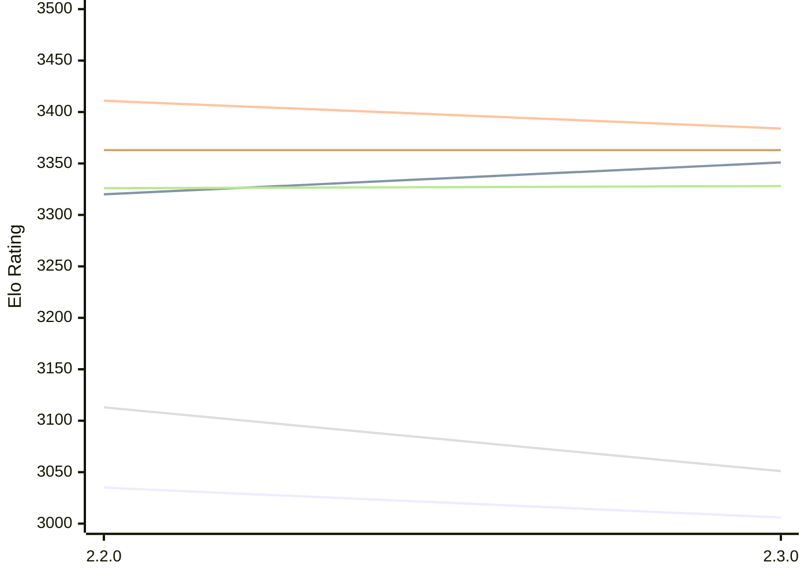

# Engine: Endspiel

Author: Thilo Horstmann

Home: https://github.com/thilo11/endspiel

## Elo Ratings E1 (Ultra 7 265T (1.50 GHz) - E-Core)

| Version | Published | STC 8.0+0.08s  | LTC 60.0+0.60s | VLTC 2m24s+1.12s | Comment |
| --- | --- | --- | --- | --- | --- |
| 2.3.0 | 2026-11-12 | 3006(-29) | 3351(+31) | 3384(-27) |  |
| 2.2.0 | 2026-10-30 | 3035 | 3320 | 3411 |  |
 | | | cElo (∆ prev) | cElo (∆ prev) | cElo (∆ prev) | 

## Elo Ratings P1 (Ultra 7 265T (1.50 GHz) - P-Core)

| Version | Published | STC 8.0+0.08s  | LTC 60.0+0.60s | VLTC 2m24s+1.12s | Comment |
| --- | --- | --- | --- | --- | --- |
| 2.3.0 | 2026-11-12 | 3051(-62) | 3328(+2) | 3363(0) |  |
| 2.2.0 | 2026-10-30 | 3113 | 3326 | 3363 |  |
 | | | cElo (∆ prev) | cElo (∆ prev) | cElo (∆ prev) | 

## Elo Ratings T1 (i5-7500T 2.70GHz)

| Version | Published | STC 8.0+0.08s  | LTC 60.0+0.60s | VLTC 2m24s+1.12s | Comment |
| --- | --- | --- | --- | --- | --- |
| 2.2.0 | 2026-10-30 | 3113 | 3326 | 3363 |  |
 | | | cElo (∆ prev) | cElo (∆ prev) | cElo (∆ prev) | 

<a href="https://github.com/computer-chess-index/cci/issues/new?template=submit-version.yml&title=[VERSION]+Endspiel+<version>&body=###%20Engine%20name%0AEndspiel%0A%0A###%20Version%0A2.3.0" target="_blank">Submit new version</a>

 Test Conditions:

GUI/CLI: <a href=https://github.com/cutechess/cutechess target="_blank">Cute-Chess</a> 
Elo Calculation: <a href=https://www.remi-coulom.fr/Bayesian-Elo/ target="_blank">Bayesian-Elo</a> 
CPU for P1: Intel(R) Core(TM) Ultra 7 265T (1.50 GHz) - P-Core 
CPU for E1: Intel(R) Core(TM) Ultra 7 265T (1.50 GHz) - E-Core 
CPU for T1: Intel(R) Core(TM) i5-7500T 2.70GHz 
Opening book: 8_moves_v3 
\* STC: 8.0+0.08s, LTC: 60.0+0.60s, VLTC: 2m24s+1.12s

 Lists:
Ratings: <a href=https://github.com/computer-chess-index/cci/blob/main/lists/CCIRatings.csv target="_blank">Complete list</a>

Generated: 2026-11-23 05:38:12

## Ratings Verlauf E1 / P1

## Detailed Evaluation Results

| Version | Time Control | Variant | Elo  | Range +/- | Matches | Score | Average Opponent Elo | Draws |
| --- | --- |--- | --- | --- | --- | --- | --- | --- |
| 2.3.0 | VLTC (2m24s+1.12s) | P1 | 3363 | 46 | 136 | 58% | 3175 | 61% |
|  |  | E1 | 3384 | 39 | 184 | 55% | 3302 | 64% |
|  | LTC (60.0+0.60s) | P1 | 3328 | 52 | 104 | 58% | 3152 | 59% |
|  |  | E1 | 3351 | 36 | 208 | 55% | 3289 | 64% |
|  | STC (8.0+0.08s) | P1 | 3051 | 39 | 202 | 57% | 2974 | 47% |
|  |  | E1 | 3006 | 38 | 212 | 50% | 3000 | 43% |
| --- | --- |--- | --- | --- | --- | --- | --- | --- |
| 2.2.0 | VLTC (2m24s+1.12s) | P1 | 3363 | 155 | 8 | 50% | 3363 | 100% |
|  |  | E1 | 3411 | 42 | 140 | 50% | 3410 | 71% |
|  | LTC (60.0+0.60s) | P1 | 3326 | 208 | 4 | 50% | 3326 | 100% |
|  |  | E1 | 3320 | 41 | 156 | 49% | 3324 | 65% |
|  | STC (8.0+0.08s) | P1 | 3113 | 87 | 36 | 58% | 3046 | 50% |
|  |  | E1 | 3035 | 39 | 184 | 49% | 3043 | 53% |