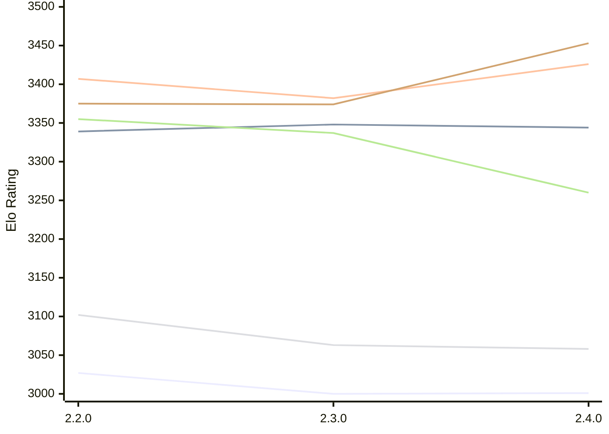

# Engine: Endspiel

Author: Thilo Horstmann

Home: https://github.com/thilo11/endspiel

## Elo Ratings E1 (Ultra 7 265T (1.50 GHz) - E-Core)

| Version | Published | STC 8.0+0.08s  | LTC 60.0+0.60s | VLTC 2m24s+1.12s | Comment |
| --- | --- | --- | --- | --- | --- |
| 2.4.0 | 2026-11-24 | 3001(+1) | 3344(-4) | 3426(+44) |  |
| 2.3.0 | 2026-11-12 | 3000(-27) | 3348(+9) | 3382(-25) |  |
| 2.2.0 | 2026-10-30 | 3027 | 3339 | 3407 |  |
 | | | cElo (∆ prev) | cElo (∆ prev) | cElo (∆ prev) | 

## Elo Ratings P1 (Ultra 7 265T (1.50 GHz) - P-Core)

| Version | Published | STC 8.0+0.08s  | LTC 60.0+0.60s | VLTC 2m24s+1.12s | Comment |
| --- | --- | --- | --- | --- | --- |
| 2.4.0 | 2026-11-24 | 3058(-5) | 3260(-77) | 3453(+79) |  |
| 2.3.0 | 2026-11-12 | 3063(-39) | 3337(-18) | 3374(-1) |  |
| 2.2.0 | 2026-10-30 | 3102 | 3355 | 3375 |  |
 | | | cElo (∆ prev) | cElo (∆ prev) | cElo (∆ prev) | 

## Elo Ratings T1 (i5-7500T 2.70GHz)

| Version | Published | STC 8.0+0.08s  | LTC 60.0+0.60s | VLTC 2m24s+1.12s | Comment |
| --- | --- | --- | --- | --- | --- |
| 2.2.0 | 2026-10-30 | 3102 | 3355 | 3375 |  |
 | | | cElo (∆ prev) | cElo (∆ prev) | cElo (∆ prev) | 

<a href="https://github.com/computer-chess-index/cci/issues/new?template=submit-version.yml&title=[VERSION]+Endspiel+<version>&body=###%20Engine%20name%0AEndspiel%0A%0A###%20Version%0A2.4.0" target="_blank">Submit new version</a>

 Test Conditions:

GUI/CLI: <a href=https://github.com/cutechess/cutechess target="_blank">Cute-Chess</a> 
Elo Calculation: <a href=https://www.remi-coulom.fr/Bayesian-Elo/ target="_blank">Bayesian-Elo</a> 
CPU for P1: Intel(R) Core(TM) Ultra 7 265T (1.50 GHz) - P-Core 
CPU for E1: Intel(R) Core(TM) Ultra 7 265T (1.50 GHz) - E-Core 
CPU for T1: Intel(R) Core(TM) i5-7500T 2.70GHz 
Opening book: 8_moves_v3 
\* STC: 8.0+0.08s, LTC: 60.0+0.60s, VLTC: 2m24s+1.12s

 Lists:
Ratings: <a href=https://github.com/computer-chess-index/cci/blob/main/lists/CCIRatings.csv target="_blank">Complete list</a>

Generated: 2026-11-27 05:38:17

## Ratings Verlauf E1 / P1

## Detailed Evaluation Results

| Version | Time Control | Variant | Elo  | Range +/- | Matches | Score | Average Opponent Elo | Draws |
| --- | --- |--- | --- | --- | --- | --- | --- | --- |
| 2.4.0 | VLTC (2m24s+1.12s) | P1 | 3453 | 81 | 36 | 56% | 3416 | 78% |
|  |  | E1 | 3426 | 40 | 148 | 51% | 3421 | 76% |
|  | LTC (60.0+0.60s) | E1 | 3344 | 44 | 132 | 48% | 3359 | 64% |
|  |  | P1 | 3260 | 75 | 44 | 52% | 3243 | 68% |
|  | STC (8.0+0.08s) | E1 | 3001 | 44 | 144 | 49% | 3009 | 53% |
|  |  | P1 | 3058 | 71 | 48 | 51% | 3048 | 73% |
| --- | --- |--- | --- | --- | --- | --- | --- | --- |
| 2.3.0 | VLTC (2m24s+1.12s) | P1 | 3374 | 46 | 136 | 58% | 3186 | 61% |
|  |  | E1 | 3382 | 38 | 188 | 55% | 3303 | 63% |
|  | LTC (60.0+0.60s) | P1 | 3337 | 53 | 104 | 58% | 3162 | 59% |
|  |  | E1 | 3348 | 35 | 217 | 55% | 3287 | 66% |
|  | STC (8.0+0.08s) | P1 | 3063 | 39 | 206 | 57% | 2990 | 46% |
|  |  | E1 | 3000 | 37 | 228 | 50% | 2998 | 45% |
| --- | --- |--- | --- | --- | --- | --- | --- | --- |
| 2.2.0 | VLTC (2m24s+1.12s) | E1 | 3407 | 41 | 148 | 50% | 3406 | 70% |
|  |  | P1 | 3375 | 116 | 16 | 50% | 3374 | 88% |
|  | LTC (60.0+0.60s) | E1 | 3339 | 34 | 224 | 52% | 3325 | 64% |
|  |  | P1 | 3355 | 75 | 44 | 52% | 3340 | 68% |
|  | STC (8.0+0.08s) | P1 | 3102 | 49 | 108 | 50% | 3098 | 61% |
|  |  | E1 | 3027 | 36 | 208 | 48% | 3040 | 54% |