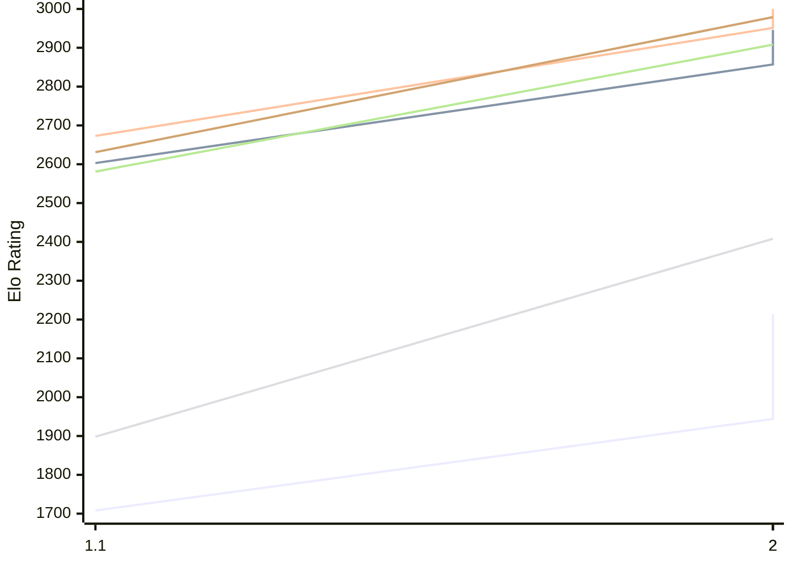
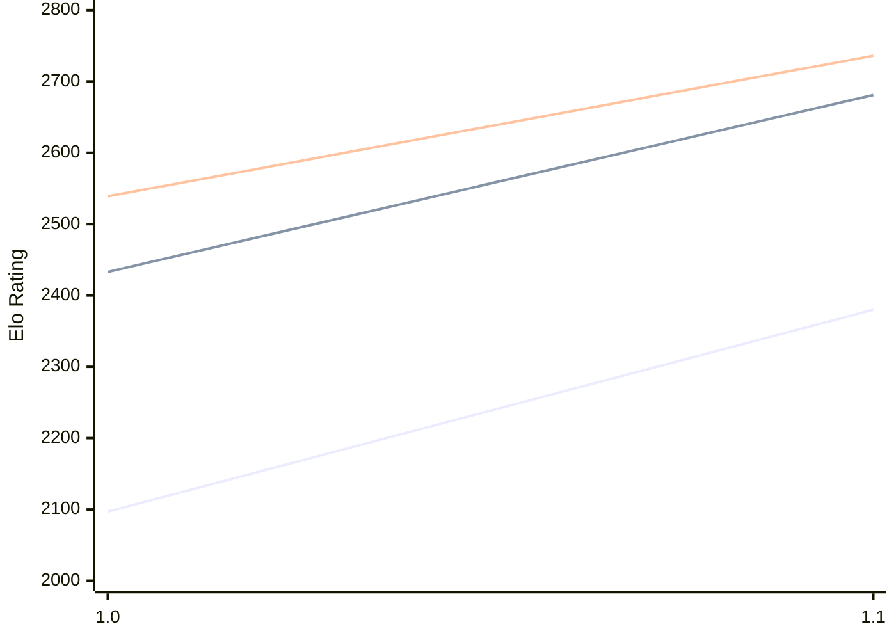

# Engine: Erinn

Author: Elias Niemann

Home: https://github.com/NichtElias/Erinn

## Elo Ratings E1 (Ultra 7 265T (1.50 GHz) - E-Core)

| Version | Published | STC 8.0+0.08s  | LTC 60.0+0.60s | VLTC 2m24s+1.12s | Comment |
| --- | --- | --- | --- | --- | --- |
| 2 | 2026-10-01 | 2214(+270) | 2946(+89) | 3000(+49) |  |
| 2 | 2026-10-01 | 1944(+236) | 2857(+254) | 2951(+278) |  |
| 1.1 | 2026-07-11 | 1708 | 2603 | 2673 |  |
 | | | cElo (∆ prev) | cElo (∆ prev) | cElo (∆ prev) | 

## Elo Ratings P1 (Ultra 7 265T (1.50 GHz) - P-Core)

| Version | Published | STC 8.0+0.08s  | LTC 60.0+0.60s | VLTC 2m24s+1.12s | Comment |
| --- | --- | --- | --- | --- | --- |
| 2 | 2026-10-01 | 2408(+510) | 2908(+327) | 2979(+348) |  |
| 1.1 | 2026-07-11 | 1898 | 2581 | 2631 |  |
 | | | cElo (∆ prev) | cElo (∆ prev) | cElo (∆ prev) | 

## Elo Ratings T1 (i5-7500T 2.70GHz)

| Version | Published | STC 8.0+0.08s  | LTC 60.0+0.60s | VLTC 2m24s+1.12s | Comment |
| --- | --- | --- | --- | --- | --- |
| 1.1 | 2026-07-11 | 2380(+283) | 2681(+248) | 2736(+197) |  |
| 1.0 | 2026-06-10 | 2097 | 2433 | 2539 |  |
 | | | cElo (∆ prev) | cElo (∆ prev) | cElo (∆ prev) | 

<a href="https://github.com/computer-chess-index/cci/issues/new?template=submit-version.yml&title=[VERSION]+Erinn+<version>&body=###%20Engine%20name%0AErinn%0A%0A###%20Version%0A1.1" target="_blank">Submit new version</a>

 Test Conditions:

GUI/CLI: <a href=https://github.com/cutechess/cutechess target="_blank">Cute-Chess</a> 
Elo Calculation: <a href=https://www.remi-coulom.fr/Bayesian-Elo/ target="_blank">Bayesian-Elo</a> 
CPU for P1: Intel(R) Core(TM) Ultra 7 265T (1.50 GHz) - P-Core 
CPU for E1: Intel(R) Core(TM) Ultra 7 265T (1.50 GHz) - E-Core 
CPU for T1: Intel(R) Core(TM) i5-7500T 2.70GHz 
Opening book: 8_moves_v3 
\* STC: 8.0+0.08s, LTC: 60.0+0.60s, VLTC: 2m24s+1.12s

 Lists:
Ratings: <a href=https://github.com/computer-chess-index/cci/blob/main/lists/CCIRatings.csv target="_blank">Complete list</a>

Generated: 2026-11-23 05:38:15

## Ratings Verlauf E1 / P1

## Ratings Verlauf T1

## Detailed Evaluation Results

| Version | Time Control | Variant | Elo  | Range +/- | Matches | Score | Average Opponent Elo | Draws |
| --- | --- |--- | --- | --- | --- | --- | --- | --- |
| 2 | VLTC (2m24s+1.12s) | E1 | 3000 | 30 | 320 | 50% | 3001 | 44% |
|  |  | E1 | 2951 | 89 | 44 | 59% | 2865 | 23% |
|  |  | P1 | 2979 | 33 | 268 | 47% | 3004 | 47% |
|  | LTC (60.0+0.60s) | E1 | 2946 | 29 | 354 | 52% | 2928 | 43% |
|  |  | E1 | 2857 | 88 | 40 | 60% | 2768 | 40% |
|  |  | P1 | 2908 | 32 | 290 | 52% | 2893 | 44% |
|  | STC (8.0+0.08s) | E1 | 1944 | 109 | 32 | 64% | 1805 | 16% |
|  |  | P1 | 2408 | 40 | 240 | 51% | 2392 | 15% |
|  |  | E1 | 2214 | 29 | 472 | 58% | 2120 | 15% |
| --- | --- |--- | --- | --- | --- | --- | --- | --- |
| 1.1 | VLTC (2m24s+1.12s) | T1 | 2736 | 31 | 302 | 50% | 2736 | 52% |
|  |  | P1 | 2631 | 39 | 192 | 49% | 2635 | 46% |
|  |  | E1 | 2673 | 41 | 184 | 53% | 2620 | 42% |
|  | LTC (60.0+0.60s) | T1 | 2681 | 27 | 404 | 50% | 2688 | 45% |
|  |  | P1 | 2581 | 43 | 176 | 50% | 2585 | 38% |
|  |  | E1 | 2603 | 41 | 186 | 50% | 2610 | 38% |
|  | STC (8.0+0.08s) | T1 | 2380 | 26 | 448 | 47% | 2404 | 40% |
|  |  | P1 | 1898 | 38 | 250 | 53% | 1870 | 20% |
|  |  | E1 | 1708 | 43 | 206 | 49% | 1720 | 18% |
| --- | --- |--- | --- | --- | --- | --- | --- | --- |
| 1.0 | VLTC (2m24s+1.12s) | T1 | 2539 | 32 | 316 | 50% | 2533 | 35% |
|  | LTC (60.0+0.60s) | T1 | 2433 | 30 | 368 | 56% | 2368 | 37% |
|  | STC (8.0+0.08s) | T1 | 2097 | 36 | 276 | 52% | 2066 | 25% |