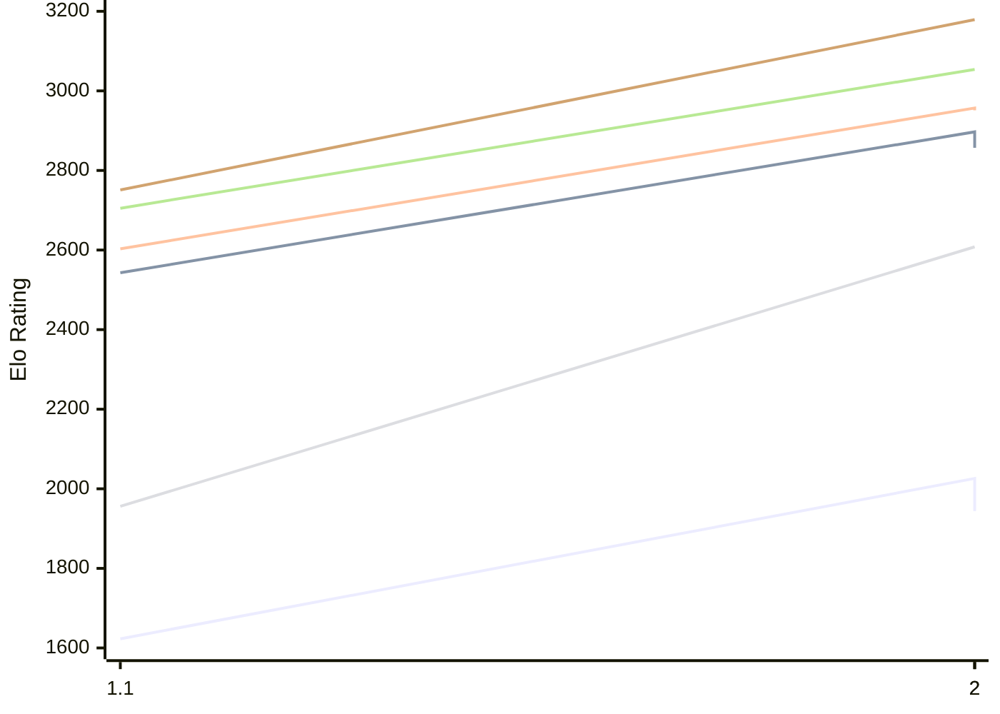
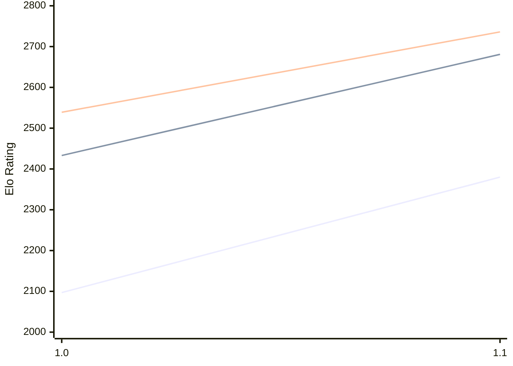

# Engine: Erinn

Author: Elias Niemann

Home: https://github.com/NichtElias/Erinn

## Elo Ratings E1

| Version | Published | STC 8.0+0.08s  | LTC 60.0+0.60s | VLTC 2m24s+1.12s | Comment |
| --- | --- | --- | --- | --- | --- |
| 2 | 2026-10-01 | 1944(-82) | 2857(-40) | 2951(-6) |  |
| 2 | 2026-10-01 | 2026(+403) | 2897(+354) | 2957(+354) |  |
| 1.1 | 2026-07-11 | 1623 | 2543 | 2603 |  |
 | | | cElo (∆ prev) | cElo (∆ prev) | cElo (∆ prev) | 

## Elo Ratings P1

| Version | Published | STC 8.0+0.08s  | LTC 60.0+0.60s | VLTC 2m24s+1.12s | Comment |
| --- | --- | --- | --- | --- | --- |
| 2 | 2026-10-01 | 2608(+652) | 3054(+349) | 3179(+428) |  |
| 1.1 | 2026-07-11 | 1956 | 2705 | 2751 |  |
 | | | cElo (∆ prev) | cElo (∆ prev) | cElo (∆ prev) | 

## Elo Ratings T1

| Version | Published | STC 8.0+0.08s  | LTC 60.0+0.60s | VLTC 2m24s+1.12s | Comment |
| --- | --- | --- | --- | --- | --- |
| 1.1 | 2026-07-11 | 2380(+283) | 2681(+248) | 2736(+197) |  |
| 1.0 | 2026-06-10 | 2097 | 2433 | 2539 |  |
 | | | cElo (∆ prev) | cElo (∆ prev) | cElo (∆ prev) | 

<a href="https://github.com/computer-chess-index/cci/issues/new?template=submit-version.yml&title=[VERSION]+Erinn+<version>&body=###%20Engine%20name%0AErinn%0A%0A###%20Version%0A1.1" target="_blank">Submit new version</a>

 Test Conditions:

GUI/CLI: <a href=https://github.com/cutechess/cutechess target="_blank">Cute-Chess</a> 
Elo Calculation: <a href=https://www.remi-coulom.fr/Bayesian-Elo/ target="_blank">Bayesian-Elo</a> 
CPU for P1: Intel(R) Core(TM) Ultra 7 265T (1.50 GHz) - P-Core 
CPU for E1: Intel(R) Core(TM) Ultra 7 265T (1.50 GHz) - E-Core 
CPU for T1: Intel(R) Core(TM) i5-7500T 2.70GHz 
Opening book: 8_moves_v3 
\* STC: 8.0+0.08s, LTC: 60.0+0.60s, VLTC: 2m24s+1.12s

 Lists:
Ratings: <a href=https://github.com/computer-chess-index/cci/blob/main/lists/CCIRatings.csv target="_blank">Complete list</a>

Generated: 2026-10-12 04:38:16

## Ratings Verlauf E1 / P1

## Ratings Verlauf T1

## Detailed Evaluation Results

| Version | Time Control | Elo  | Range +/- | Matches | Score | Average Opponent Elo | Draws |
| --- | --- | --- | --- | --- | --- | --- | --- |
| 2 | VLTC (2m24s+1.12s) | 2951 | 89 | 44 | 59% | 2865 | 23% |
| 2 | VLTC (2m24s+1.12s) | 3179 | 79 | 48 | 54% | 3121 | 46% |
| 2 | VLTC (2m24s+1.12s) | 2957 | 66 | 74 | 57% | 2888 | 34% |
| 2 | LTC (60.0+0.60s) | 2857 | 88 | 40 | 60% | 2768 | 40% |
| 2 | LTC (60.0+0.60s) | 3054 | 83 | 46 | 70% | 2892 | 43% |
| 2 | LTC (60.0+0.60s) | 2897 | 67 | 72 | 59% | 2815 | 35% |
| 2 | STC (8.0+0.08s) | 1944 | 109 | 32 | 64% | 1805 | 16% |
| --- | --- | --- | --- | --- | --- | --- | --- |
| 2 | STC (8.0+0.08s) | 2608 | 99 | 52 | 70% | 2344 | 2% |
| --- | --- | --- | --- | --- | --- | --- | --- |
| 2 | STC (8.0+0.08s) | 2026 | 64 | 94 | 61% | 1918 | 17% |
| --- | --- | --- | --- | --- | --- | --- | --- |
| 1.1 | VLTC (2m24s+1.12s) | 2751 | 45 | 140 | 51% | 2743 | 47% |
| 1.1 | VLTC (2m24s+1.12s) | 2603 | 47 | 136 | 53% | 2577 | 44% |
| 1.1 | VLTC (2m24s+1.12s) | 2736 | 31 | 302 | 50% | 2736 | 52% |
| 1.1 | LTC (60.0+0.60s) | 2543 | 45 | 156 | 50% | 2541 | 37% |
| 1.1 | LTC (60.0+0.60s) | 2681 | 27 | 404 | 50% | 2688 | 45% |
| 1.1 | LTC (60.0+0.60s) | 2705 | 50 | 126 | 54% | 2666 | 40% |
| 1.1 | STC (8.0+0.08s) | 1623 | 48 | 162 | 46% | 1673 | 17% |
| --- | --- | --- | --- | --- | --- | --- | --- |
| 1.1 | STC (8.0+0.08s) | 2380 | 26 | 448 | 47% | 2404 | 40% |
| --- | --- | --- | --- | --- | --- | --- | --- |
| 1.1 | STC (8.0+0.08s) | 1956 | 42 | 200 | 49% | 1982 | 21% |
| --- | --- | --- | --- | --- | --- | --- | --- |
| 1.0 | VLTC (2m24s+1.12s) | 2539 | 32 | 316 | 50% | 2533 | 35% |
| 1.0 | LTC (60.0+0.60s) | 2433 | 30 | 368 | 56% | 2368 | 37% |
| 1.0 | STC (8.0+0.08s) | 2097 | 36 | 276 | 52% | 2066 | 25% |
| --- | --- | --- | --- | --- | --- | --- | --- |