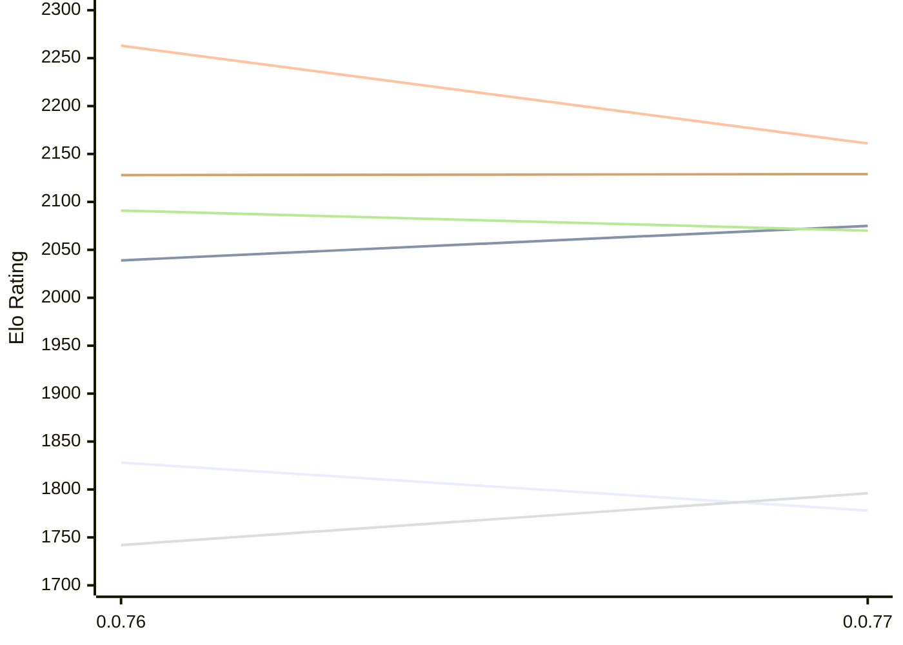
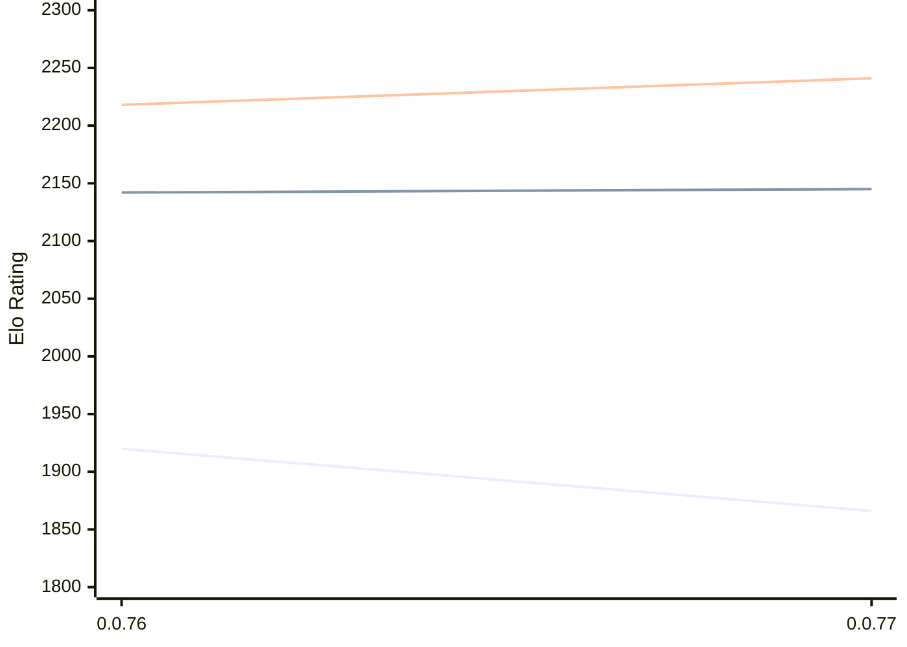

# Engine: Fktb

Author: Landon Peng

Home: https://github.com/lunbun/fktb

## Elo Ratings E1 (Ultra 7 265T (1.50 GHz) - E-Core)

| Version | Published | STC 8.0+0.08s  | LTC 60.0+0.60s | VLTC 2m24s+1.12s | Comment |
| --- | --- | --- | --- | --- | --- |
| 0.0.77 | 2026-01-18 | 1778(-50) | 2075(+36) | 2161(-102) |  |
| 0.0.76 | 2026-01-05 | 1828 | 2039 | 2263 |  |
 | | | cElo (∆ prev) | cElo (∆ prev) | cElo (∆ prev) | 

## Elo Ratings P1 (Ultra 7 265T (1.50 GHz) - P-Core)

| Version | Published | STC 8.0+0.08s  | LTC 60.0+0.60s | VLTC 2m24s+1.12s | Comment |
| --- | --- | --- | --- | --- | --- |
| 0.0.77 | 2026-01-18 | 1796(+54) | 2070(-21) | 2129(+1) |  |
| 0.0.76 | 2026-01-05 | 1742 | 2091 | 2128 |  |
 | | | cElo (∆ prev) | cElo (∆ prev) | cElo (∆ prev) | 

## Elo Ratings T1 (i5-7500T 2.70GHz)

| Version | Published | STC 8.0+0.08s  | LTC 60.0+0.60s | VLTC 2m24s+1.12s | Comment |
| --- | --- | --- | --- | --- | --- |
| 0.0.77 | 2026-01-18 | 1866(-54) | 2145(+3) | 2241(+23) |  |
| 0.0.76 | 2026-01-05 | 1920 | 2142 | 2218 |  |
 | | | cElo (∆ prev) | cElo (∆ prev) | cElo (∆ prev) | 

<a href="https://github.com/computer-chess-index/cci/issues/new?template=submit-version.yml&title=[VERSION]+Fktb+<version>&body=###%20Engine%20name%0AFktb%0A%0A###%20Version%0A0.0.77" target="_blank">Submit new version</a>

 Test Conditions:

GUI/CLI: <a href=https://github.com/cutechess/cutechess target="_blank">Cute-Chess</a> 
Elo Calculation: <a href=https://www.remi-coulom.fr/Bayesian-Elo/ target="_blank">Bayesian-Elo</a> 
CPU for P1: Intel(R) Core(TM) Ultra 7 265T (1.50 GHz) - P-Core 
CPU for E1: Intel(R) Core(TM) Ultra 7 265T (1.50 GHz) - E-Core 
CPU for T1: Intel(R) Core(TM) i5-7500T 2.70GHz 
Opening book: 8_moves_v3 
\* STC: 8.0+0.08s, LTC: 60.0+0.60s, VLTC: 2m24s+1.12s

 Lists:
Ratings: <a href=https://github.com/computer-chess-index/cci/blob/main/lists/CCIRatings.csv target="_blank">Complete list</a>

Generated: 2026-11-13 05:38:29

## Ratings Verlauf E1 / P1

## Ratings Verlauf T1

## Detailed Evaluation Results

| Version | Time Control | Variant | Elo  | Range +/- | Matches | Score | Average Opponent Elo | Draws |
| --- | --- |--- | --- | --- | --- | --- | --- | --- |
| 0.0.77 | VLTC (2m24s+1.12s) | T1 | 2241 | 24 | 580 | 52% | 2221 | 31% |
|  |  | P1 | 2129 | 42 | 190 | 47% | 2168 | 31% |
|  |  | E1 | 2161 | 31 | 362 | 52% | 2157 | 26% |
|  | LTC (60.0+0.60s) | T1 | 2145 | 25 | 536 | 49% | 2153 | 29% |
|  |  | P1 | 2070 | 43 | 200 | 42% | 2190 | 26% |
|  |  | E1 | 2075 | 29 | 414 | 52% | 2068 | 28% |
|  | STC (8.0+0.08s) | T1 | 1866 | 22 | 740 | 50% | 1856 | 27% |
|  |  | P1 | 1796 | 42 | 196 | 49% | 1810 | 26% |
|  |  | E1 | 1778 | 30 | 368 | 46% | 1814 | 28% |
| --- | --- |--- | --- | --- | --- | --- | --- | --- |
| 0.0.76 | VLTC (2m24s+1.12s) | P1 | 2128 | 134 | 20 | 38% | 2296 | 25% |
|  |  | E1 | 2263 | 134 | 28 | 25% | 2624 | 7% |
|  |  | T1 | 2218 | 52 | 132 | 48% | 2245 | 22% |
|  | LTC (60.0+0.60s) | E1 | 2039 | 93 | 52 | 47% | 2118 | 17% |
|  |  | T1 | 2142 | 45 | 172 | 49% | 2152 | 23% |
|  |  | P1 | 2091 | 170 | 16 | 31% | 2298 | 13% |
|  | STC (8.0+0.08s) | E1 | 1828 | 75 | 64 | 40% | 1931 | 23% |
|  |  | T1 | 1920 | 49 | 140 | 48% | 1939 | 27% |
|  |  | P1 | 1742 | 122 | 32 | 19% | 2157 | 19% |