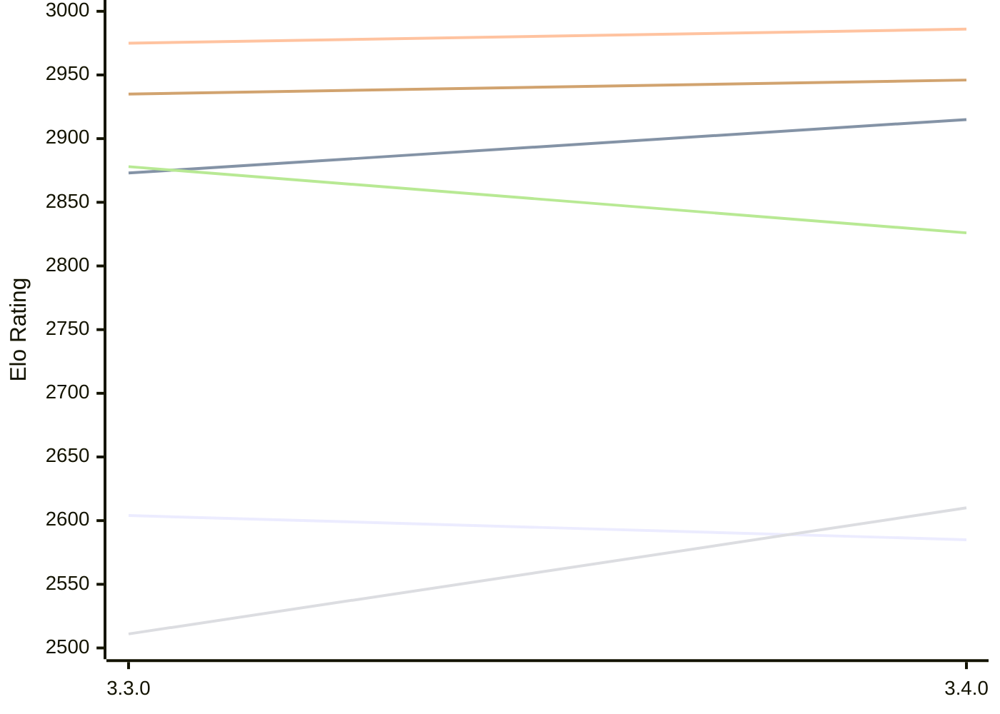

# Engine: Fructosita

Author: Antonio Espinosa

Home: https://github.com/josantesbo/Fructosita-Chess-Engine

## Elo Ratings E1 (Ultra 7 265T (1.50 GHz) - E-Core)

| Version | Published | STC 8.0+0.08s  | LTC 60.0+0.60s | VLTC 2m24s+1.12s | Comment |
| --- | --- | --- | --- | --- | --- |
| 3.4.0 | 2026-11-25 | 2585(-19) | 2915(+42) | 2986(+11) |  |
| 3.3.0 | 2026-11-03 | 2604 | 2873 | 2975 |  |
 | | | cElo (∆ prev) | cElo (∆ prev) | cElo (∆ prev) | 

## Elo Ratings P1 (Ultra 7 265T (1.50 GHz) - P-Core)

| Version | Published | STC 8.0+0.08s  | LTC 60.0+0.60s | VLTC 2m24s+1.12s | Comment |
| --- | --- | --- | --- | --- | --- |
| 3.4.0 | 2026-11-25 | 2610(+99) | 2826(-52) | 2946(+11) |  |
| 3.3.0 | 2026-11-03 | 2511 | 2878 | 2935 |  |
 | | | cElo (∆ prev) | cElo (∆ prev) | cElo (∆ prev) | 

## Elo Ratings T1 (i5-7500T 2.70GHz)

| Version | Published | STC 8.0+0.08s  | LTC 60.0+0.60s | VLTC 2m24s+1.12s | Comment |
| --- | --- | --- | --- | --- | --- |
| 3.3.0 | 2026-11-03 | 2511 | 2878 | 2935 |  |
 | | | cElo (∆ prev) | cElo (∆ prev) | cElo (∆ prev) | 

<a href="https://github.com/computer-chess-index/cci/issues/new?template=submit-version.yml&title=[VERSION]+Fructosita+<version>&body=###%20Engine%20name%0AFructosita%0A%0A###%20Version%0A3.4.0" target="_blank">Submit new version</a>

 Test Conditions:

GUI/CLI: <a href=https://github.com/cutechess/cutechess target="_blank">Cute-Chess</a> 
Elo Calculation: <a href=https://www.remi-coulom.fr/Bayesian-Elo/ target="_blank">Bayesian-Elo</a> 
CPU for P1: Intel(R) Core(TM) Ultra 7 265T (1.50 GHz) - P-Core 
CPU for E1: Intel(R) Core(TM) Ultra 7 265T (1.50 GHz) - E-Core 
CPU for T1: Intel(R) Core(TM) i5-7500T 2.70GHz 
Opening book: 8_moves_v3 
\* STC: 8.0+0.08s, LTC: 60.0+0.60s, VLTC: 2m24s+1.12s

 Lists:
Ratings: <a href=https://github.com/computer-chess-index/cci/blob/main/lists/CCIRatings.csv target="_blank">Complete list</a>

Generated: 2026-11-28 05:38:43

## Ratings Verlauf E1 / P1

## Detailed Evaluation Results

| Version | Time Control | Variant | Elo  | Range +/- | Matches | Score | Average Opponent Elo | Draws |
| --- | --- |--- | --- | --- | --- | --- | --- | --- |
| 3.4.0 | VLTC (2m24s+1.12s) | P1 | 2946 | 42 | 172 | 51% | 2939 | 42% |
|  |  | E1 | 2986 | 36 | 232 | 47% | 3008 | 42% |
|  | LTC (60.0+0.60s) | P1 | 2826 | 96 | 36 | 46% | 2869 | 25% |
|  |  | E1 | 2915 | 40 | 192 | 53% | 2890 | 38% |
|  | STC (8.0+0.08s) | P1 | 2610 | 43 | 182 | 57% | 2549 | 30% |
|  |  | E1 | 2585 | 47 | 144 | 49% | 2592 | 33% |
| --- | --- |--- | --- | --- | --- | --- | --- | --- |
| 3.3.0 | VLTC (2m24s+1.12s) | P1 | 2935 | 40 | 202 | 50% | 2938 | 35% |
|  |  | E1 | 2975 | 30 | 368 | 51% | 2967 | 34% |
|  | LTC (60.0+0.60s) | P1 | 2878 | 38 | 222 | 55% | 2778 | 42% |
|  |  | E1 | 2873 | 29 | 414 | 55% | 2765 | 34% |
|  | STC (8.0+0.08s) | P1 | 2511 | 37 | 272 | 59% | 2304 | 30% |
|  |  | E1 | 2604 | 32 | 392 | 61% | 2304 | 26% |