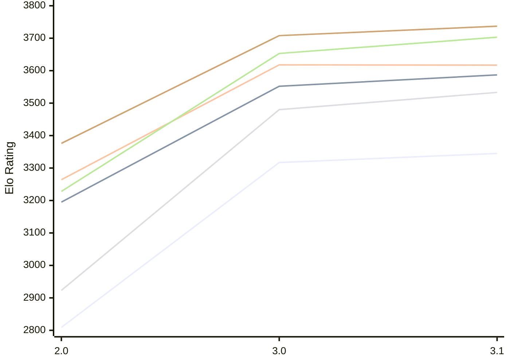

# Engine: Funcomp

Author: James Coit

Home: https://github.com/Moxnar/FunComp

## Elo Ratings E1 (Ultra 7 265T (1.50 GHz) - E-Core)

| Version | Published | STC 8.0+0.08s  | LTC 60.0+0.60s | VLTC 2m24s+1.12s | Comment |
| --- | --- | --- | --- | --- | --- |
| 3.1 | 2026-10-30 | 3345(+28) | 3587(+35) | 3617(-1) |  |
| 3.0 | 2026-10-20 | 3317(+508) | 3552(+357) | 3618(+354) |  |
| 2.0 | 2026-10-03 | 2809 | 3195 | 3264 |  |
 | | | cElo (∆ prev) | cElo (∆ prev) | cElo (∆ prev) | 

## Elo Ratings P1 (Ultra 7 265T (1.50 GHz) - P-Core)

| Version | Published | STC 8.0+0.08s  | LTC 60.0+0.60s | VLTC 2m24s+1.12s | Comment |
| --- | --- | --- | --- | --- | --- |
| 3.1 | 2026-10-30 | 3533(+53) | 3703(+50) | 3737(+29) |  |
| 3.0 | 2026-10-20 | 3480(+557) | 3653(+425) | 3708(+332) |  |
| 2.0 | 2026-10-03 | 2923 | 3228 | 3376 |  |
 | | | cElo (∆ prev) | cElo (∆ prev) | cElo (∆ prev) | 

## Elo Ratings T1 (i5-7500T 2.70GHz)

| Version | Published | STC 8.0+0.08s  | LTC 60.0+0.60s | VLTC 2m24s+1.12s | Comment |
| --- | --- | --- | --- | --- | --- |
| 1.0 | 2026-09-28 | 2576 | 2809 | 2966 |  |
 | | | cElo (∆ prev) | cElo (∆ prev) | cElo (∆ prev) | 

<a href="https://github.com/computer-chess-index/cci/issues/new?template=submit-version.yml&title=[VERSION]+Funcomp+<version>&body=###%20Engine%20name%0AFuncomp%0A%0A###%20Version%0A1.0" target="_blank">Submit new version</a>

 Test Conditions:

GUI/CLI: <a href=https://github.com/cutechess/cutechess target="_blank">Cute-Chess</a> 
Elo Calculation: <a href=https://www.remi-coulom.fr/Bayesian-Elo/ target="_blank">Bayesian-Elo</a> 
CPU for P1: Intel(R) Core(TM) Ultra 7 265T (1.50 GHz) - P-Core 
CPU for E1: Intel(R) Core(TM) Ultra 7 265T (1.50 GHz) - E-Core 
CPU for T1: Intel(R) Core(TM) i5-7500T 2.70GHz 
Opening book: 8_moves_v3 
\* STC: 8.0+0.08s, LTC: 60.0+0.60s, VLTC: 2m24s+1.12s

 Lists:
Ratings: <a href=https://github.com/computer-chess-index/cci/blob/main/lists/CCIRatings.csv target="_blank">Complete list</a>

Generated: 2026-11-06 05:38:19

## Ratings Verlauf E1 / P1

## Detailed Evaluation Results

| Version | Time Control | Variant | Elo  | Range +/- | Matches | Score | Average Opponent Elo | Draws |
| --- | --- |--- | --- | --- | --- | --- | --- | --- |
| 3.1 | VLTC (2m24s+1.12s) | P1 | 3737 | 47 | 102 | 50% | 3734 | 85% |
|  |  | E1 | 3617 | 36 | 178 | 49% | 3619 | 84% |
|  | LTC (60.0+0.60s) | P1 | 3703 | 39 | 168 | 52% | 3688 | 69% |
|  |  | E1 | 3587 | 33 | 228 | 52% | 3578 | 76% |
|  | STC (8.0+0.08s) | P1 | 3533 | 43 | 136 | 50% | 3532 | 67% |
|  |  | E1 | 3345 | 37 | 188 | 51% | 3340 | 63% |
| --- | --- |--- | --- | --- | --- | --- | --- | --- |
| 3.0 | VLTC (2m24s+1.12s) | P1 | 3708 | 40 | 154 | 57% | 3650 | 75% |
|  |  | E1 | 3618 | 36 | 192 | 53% | 3590 | 71% |
|  | LTC (60.0+0.60s) | P1 | 3653 | 45 | 128 | 57% | 3587 | 69% |
|  |  | E1 | 3552 | 36 | 196 | 55% | 3513 | 69% |
|  | STC (8.0+0.08s) | P1 | 3480 | 54 | 96 | 57% | 3391 | 61% |
|  |  | E1 | 3317 | 33 | 260 | 54% | 3275 | 55% |
| --- | --- |--- | --- | --- | --- | --- | --- | --- |
| 2.0 | VLTC (2m24s+1.12s) | P1 | 3376 | 40 | 192 | 57% | 3281 | 46% |
|  |  | E1 | 3264 | 34 | 272 | 54% | 3195 | 42% |
|  | LTC (60.0+0.60s) | E1 | 3195 | 35 | 262 | 53% | 3113 | 39% |
|  |  | P1 | 3228 | 40 | 212 | 61% | 3009 | 43% |
|  | STC (8.0+0.08s) | E1 | 2809 | 34 | 302 | 57% | 2687 | 30% |
|  |  | P1 | 2923 | 45 | 168 | 51% | 2896 | 28% |
| --- | --- |--- | --- | --- | --- | --- | --- | --- |
| 1.0 | VLTC (2m24s+1.12s) | T1 | 2966 | 38 | 230 | 54% | 2924 | 36% |
|  | LTC (60.0+0.60s) | T1 | 2809 | 41 | 204 | 57% | 2719 | 34% |
|  | STC (8.0+0.08s) | T1 | 2576 | 43 | 196 | 56% | 2510 | 25% |