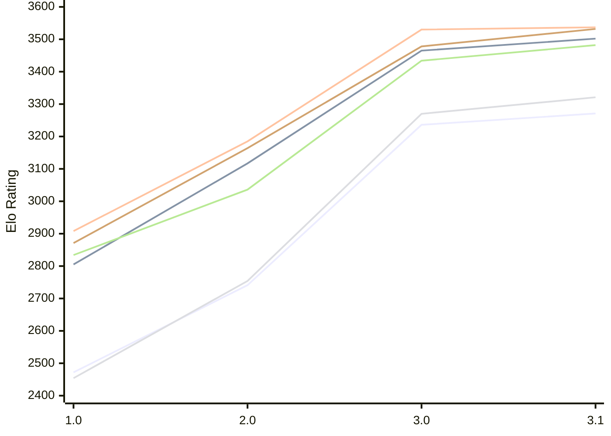

# Engine: Funcomp

Author: James Coit

Home: https://github.com/Moxnar/FunComp

## Elo Ratings E1 (Ultra 7 265T (1.50 GHz) - E-Core)

| Version | Published | STC 8.0+0.08s  | LTC 60.0+0.60s | VLTC 2m24s+1.12s | Comment |
| --- | --- | --- | --- | --- | --- |
| 3.1 | 2026-10-30 | 3271(+35) | 3502(+37) | 3537(+7) |  |
| 3.0 | 2026-10-20 | 3236(+495) | 3465(+348) | 3530(+345) |  |
| 2.0 | 2026-10-03 | 2741(+269) | 3117(+312) | 3185(+277) |  |
| 1.0 | 2026-09-28 | 2472 | 2805 | 2908 |  |
 | | | cElo (∆ prev) | cElo (∆ prev) | cElo (∆ prev) | 

## Elo Ratings P1 (Ultra 7 265T (1.50 GHz) - P-Core)

| Version | Published | STC 8.0+0.08s  | LTC 60.0+0.60s | VLTC 2m24s+1.12s | Comment |
| --- | --- | --- | --- | --- | --- |
| 3.1 | 2026-10-30 | 3321(+51) | 3482(+48) | 3532(+54) |  |
| 3.0 | 2026-10-20 | 3270(+516) | 3434(+398) | 3478(+314) |  |
| 2.0 | 2026-10-03 | 2754(+300) | 3036(+202) | 3164(+293) |  |
| 1.0 | 2026-09-28 | 2454 | 2834 | 2871 |  |
 | | | cElo (∆ prev) | cElo (∆ prev) | cElo (∆ prev) | 

## Elo Ratings T1 (i5-7500T 2.70GHz)

| Version | Published | STC 8.0+0.08s  | LTC 60.0+0.60s | VLTC 2m24s+1.12s | Comment |
| --- | --- | --- | --- | --- | --- |
| 1.0 | 2026-09-28 | 2576 | 2809 | 2966 |  |
 | | | cElo (∆ prev) | cElo (∆ prev) | cElo (∆ prev) | 

<a href="https://github.com/computer-chess-index/cci/issues/new?template=submit-version.yml&title=[VERSION]+Funcomp+<version>&body=###%20Engine%20name%0AFuncomp%0A%0A###%20Version%0A1.0" target="_blank">Submit new version</a>

 Test Conditions:

GUI/CLI: <a href=https://github.com/cutechess/cutechess target="_blank">Cute-Chess</a> 
Elo Calculation: <a href=https://www.remi-coulom.fr/Bayesian-Elo/ target="_blank">Bayesian-Elo</a> 
CPU for P1: Intel(R) Core(TM) Ultra 7 265T (1.50 GHz) - P-Core 
CPU for E1: Intel(R) Core(TM) Ultra 7 265T (1.50 GHz) - E-Core 
CPU for T1: Intel(R) Core(TM) i5-7500T 2.70GHz 
Opening book: 8_moves_v3 
\* STC: 8.0+0.08s, LTC: 60.0+0.60s, VLTC: 2m24s+1.12s

 Lists:
Ratings: <a href=https://github.com/computer-chess-index/cci/blob/main/lists/CCIRatings.csv target="_blank">Complete list</a>

Generated: 2026-11-28 05:38:45

## Ratings Verlauf E1 / P1

## Detailed Evaluation Results

| Version | Time Control | Variant | Elo  | Range +/- | Matches | Score | Average Opponent Elo | Draws |
| --- | --- |--- | --- | --- | --- | --- | --- | --- |
| 3.1 | VLTC (2m24s+1.12s) | E1 | 3537 | 31 | 246 | 50% | 3536 | 83% |
|  |  | P1 | 3532 | 36 | 182 | 52% | 3518 | 84% |
|  | LTC (60.0+0.60s) | E1 | 3502 | 29 | 287 | 51% | 3494 | 77% |
|  |  | P1 | 3482 | 37 | 184 | 53% | 3461 | 68% |
|  | STC (8.0+0.08s) | E1 | 3271 | 30 | 300 | 51% | 3262 | 59% |
|  |  | P1 | 3321 | 36 | 204 | 51% | 3314 | 65% |
| --- | --- |--- | --- | --- | --- | --- | --- | --- |
| 3.0 | VLTC (2m24s+1.12s) | P1 | 3478 | 40 | 158 | 57% | 3425 | 75% |
|  |  | E1 | 3530 | 34 | 220 | 52% | 3510 | 70% |
|  | LTC (60.0+0.60s) | P1 | 3434 | 43 | 140 | 57% | 3374 | 71% |
|  |  | E1 | 3465 | 34 | 224 | 54% | 3434 | 70% |
|  | STC (8.0+0.08s) | P1 | 3270 | 49 | 114 | 56% | 3197 | 64% |
|  |  | E1 | 3236 | 31 | 292 | 53% | 3201 | 57% |
| --- | --- |--- | --- | --- | --- | --- | --- | --- |
| 2.0 | VLTC (2m24s+1.12s) | E1 | 3185 | 34 | 272 | 54% | 3117 | 42% |
|  |  | P1 | 3164 | 40 | 192 | 57% | 3075 | 46% |
|  | LTC (60.0+0.60s) | P1 | 3036 | 40 | 212 | 61% | 2831 | 43% |
|  |  | E1 | 3117 | 35 | 262 | 53% | 3038 | 39% |
|  | STC (8.0+0.08s) | P1 | 2754 | 45 | 168 | 51% | 2727 | 28% |
|  |  | E1 | 2741 | 34 | 302 | 57% | 2620 | 30% |
| --- | --- |--- | --- | --- | --- | --- | --- | --- |
| 1.0 | VLTC (2m24s+1.12s) | T1 | 2966 | 38 | 230 | 54% | 2924 | 36% |
|  |  | P1 | 2871 | 55 | 108 | 45% | 2936 | 33% |
|  |  | E1 | 2908 | 37 | 238 | 45% | 2966 | 34% |
|  | LTC (60.0+0.60s) | T1 | 2809 | 41 | 204 | 57% | 2719 | 34% |
|  |  | P1 | 2834 | 35 | 274 | 39% | 2952 | 36% |
|  |  | E1 | 2805 | 33 | 314 | 49% | 2822 | 29% |
|  | STC (8.0+0.08s) | T1 | 2576 | 43 | 196 | 56% | 2510 | 25% |
|  |  | P1 | 2454 | 41 | 216 | 46% | 2520 | 25% |
|  |  | E1 | 2472 | 46 | 172 | 46% | 2523 | 20% |