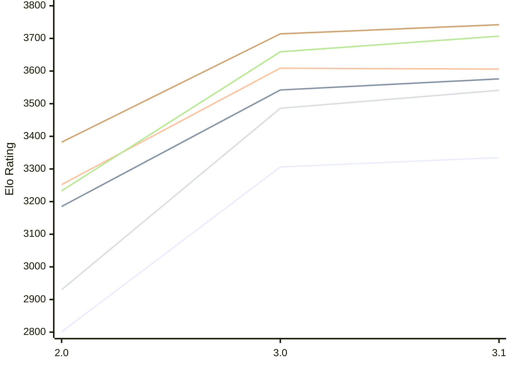

# Engine: Funcomp

Author: James Coit

Home: https://github.com/Moxnar/FunComp

## Elo Ratings E1 (Ultra 7 265T (1.50 GHz) - E-Core)

| Version | Published | STC 8.0+0.08s  | LTC 60.0+0.60s | VLTC 2m24s+1.12s | Comment |
| --- | --- | --- | --- | --- | --- |
| 3.1 | 2026-10-30 | 3335(+29) | 3576(+34) | 3606(-3) |  |
| 3.0 | 2026-10-20 | 3306(+505) | 3542(+357) | 3609(+357) |  |
| 2.0 | 2026-10-03 | 2801 | 3185 | 3252 |  |
 | | | cElo (∆ prev) | cElo (∆ prev) | cElo (∆ prev) | 

## Elo Ratings P1 (Ultra 7 265T (1.50 GHz) - P-Core)

| Version | Published | STC 8.0+0.08s  | LTC 60.0+0.60s | VLTC 2m24s+1.12s | Comment |
| --- | --- | --- | --- | --- | --- |
| 3.1 | 2026-10-30 | 3541(+55) | 3707(+48) | 3742(+28) |  |
| 3.0 | 2026-10-20 | 3486(+556) | 3659(+426) | 3714(+332) |  |
| 2.0 | 2026-10-03 | 2930 | 3233 | 3382 |  |
 | | | cElo (∆ prev) | cElo (∆ prev) | cElo (∆ prev) | 

## Elo Ratings T1 (i5-7500T 2.70GHz)

| Version | Published | STC 8.0+0.08s  | LTC 60.0+0.60s | VLTC 2m24s+1.12s | Comment |
| --- | --- | --- | --- | --- | --- |
| 1.0 | 2026-09-28 | 2576 | 2809 | 2966 |  |
 | | | cElo (∆ prev) | cElo (∆ prev) | cElo (∆ prev) | 

<a href="https://github.com/computer-chess-index/cci/issues/new?template=submit-version.yml&title=[VERSION]+Funcomp+<version>&body=###%20Engine%20name%0AFuncomp%0A%0A###%20Version%0A1.0" target="_blank">Submit new version</a>

 Test Conditions:

GUI/CLI: <a href=https://github.com/cutechess/cutechess target="_blank">Cute-Chess</a> 
Elo Calculation: <a href=https://www.remi-coulom.fr/Bayesian-Elo/ target="_blank">Bayesian-Elo</a> 
CPU for P1: Intel(R) Core(TM) Ultra 7 265T (1.50 GHz) - P-Core 
CPU for E1: Intel(R) Core(TM) Ultra 7 265T (1.50 GHz) - E-Core 
CPU for T1: Intel(R) Core(TM) i5-7500T 2.70GHz 
Opening book: 8_moves_v3 
\* STC: 8.0+0.08s, LTC: 60.0+0.60s, VLTC: 2m24s+1.12s

 Lists:
Ratings: <a href=https://github.com/computer-chess-index/cci/blob/main/lists/CCIRatings.csv target="_blank">Complete list</a>

Generated: 2026-11-05 05:38:24

## Ratings Verlauf E1 / P1

## Detailed Evaluation Results

| Version | Time Control | Variant | Elo  | Range +/- | Matches | Score | Average Opponent Elo | Draws |
| --- | --- |--- | --- | --- | --- | --- | --- | --- |
| 3.1 | VLTC (2m24s+1.12s) | E1 | 3606 | 37 | 174 | 49% | 3610 | 84% |
|  |  | P1 | 3742 | 47 | 102 | 50% | 3740 | 85% |
|  | LTC (60.0+0.60s) | E1 | 3576 | 33 | 224 | 52% | 3567 | 75% |
|  |  | P1 | 3707 | 41 | 148 | 52% | 3694 | 71% |
|  | STC (8.0+0.08s) | E1 | 3335 | 37 | 188 | 51% | 3330 | 63% |
|  |  | P1 | 3541 | 44 | 132 | 51% | 3537 | 67% |
| --- | --- |--- | --- | --- | --- | --- | --- | --- |
| 3.0 | VLTC (2m24s+1.12s) | P1 | 3714 | 40 | 154 | 57% | 3656 | 75% |
|  |  | E1 | 3609 | 36 | 192 | 53% | 3579 | 71% |
|  | LTC (60.0+0.60s) | P1 | 3659 | 45 | 128 | 57% | 3592 | 69% |
|  |  | E1 | 3542 | 36 | 196 | 55% | 3503 | 69% |
|  | STC (8.0+0.08s) | P1 | 3486 | 54 | 96 | 57% | 3397 | 61% |
|  |  | E1 | 3306 | 33 | 260 | 54% | 3266 | 55% |
| --- | --- |--- | --- | --- | --- | --- | --- | --- |
| 2.0 | VLTC (2m24s+1.12s) | E1 | 3252 | 34 | 272 | 54% | 3185 | 42% |
|  |  | P1 | 3382 | 40 | 192 | 57% | 3286 | 46% |
|  | LTC (60.0+0.60s) | P1 | 3233 | 40 | 212 | 61% | 3016 | 43% |
|  |  | E1 | 3185 | 35 | 262 | 53% | 3102 | 39% |
|  | STC (8.0+0.08s) | P1 | 2930 | 45 | 168 | 51% | 2903 | 28% |
|  |  | E1 | 2801 | 34 | 302 | 57% | 2678 | 30% |
| --- | --- |--- | --- | --- | --- | --- | --- | --- |
| 1.0 | VLTC (2m24s+1.12s) | T1 | 2966 | 38 | 230 | 54% | 2924 | 36% |
|  | LTC (60.0+0.60s) | T1 | 2809 | 41 | 204 | 57% | 2719 | 34% |
|  | STC (8.0+0.08s) | T1 | 2576 | 43 | 196 | 56% | 2510 | 25% |