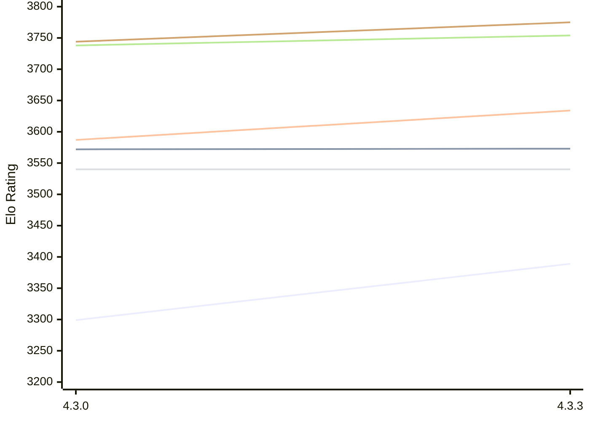
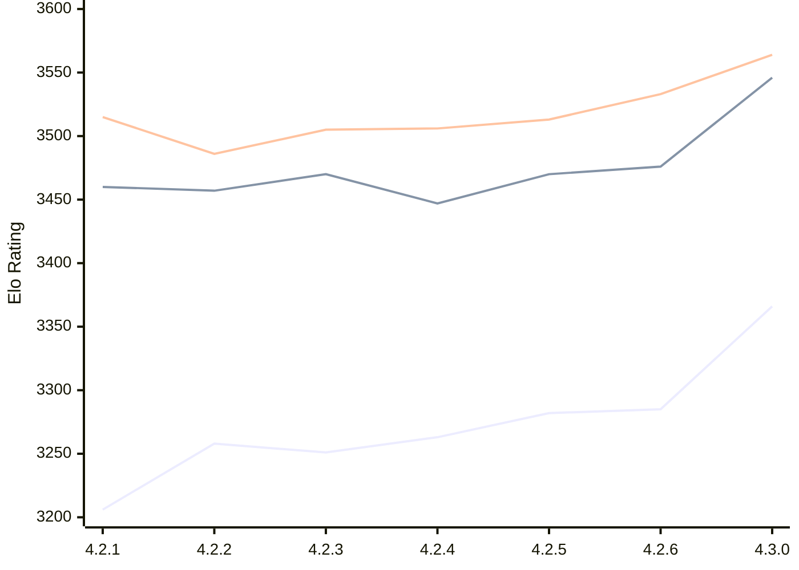

# Engine: Gaia

Author: Jean-Francois Romang, David Rabel

Home: https://github.com/jromang/gaiachess

## Elo Ratings E1

| Version | Published | STC 8.0+0.08s  | LTC 60.0+0.60s | VLTC 2m24s+1.12s | Comment |
| --- | --- | --- | --- | --- | --- |
| 4.3.3 | 2026-10-08 | 3389(+90) | 3573(+1) | 3634(+47) |  |
| 4.3.0 | 2026-09-05 | 3299 | 3572 | 3587 |  |
 | | | cElo (∆ prev) | cElo (∆ prev) | cElo (∆ prev) | 

## Elo Ratings P1

| Version | Published | STC 8.0+0.08s  | LTC 60.0+0.60s | VLTC 2m24s+1.12s | Comment |
| --- | --- | --- | --- | --- | --- |
| 4.3.3 | 2026-10-08 | 3540(0) | 3754(+16) | 3775(+31) |  |
| 4.3.0 | 2026-09-05 | 3540 | 3738 | 3744 |  |
 | | | cElo (∆ prev) | cElo (∆ prev) | cElo (∆ prev) | 

## Elo Ratings T1

| Version | Published | STC 8.0+0.08s  | LTC 60.0+0.60s | VLTC 2m24s+1.12s | Comment |
| --- | --- | --- | --- | --- | --- |
| 4.3.0 | 2026-09-05 | 3366(+81) | 3546(+70) | 3564(+31) |  |
| 4.2.6 | 2026-08-29 | 3285(+3) | 3476(+6) | 3533(+20) |  |
| 4.2.5 | 2026-08-24 | 3282(+19) | 3470(+23) | 3513(+7) |  |
| 4.2.4 | 2026-08-23 | 3263(+12) | 3447(-23) | 3506(+1) |  |
| 4.2.3 | 2026-08-21 | 3251(-7) | 3470(+13) | 3505(+19) |  |
| 4.2.2 | 2026-08-13 | 3258(+52) | 3457(-3) | 3486(-29) |  |
| 4.2.1 | 2026-08-09 | 3206 | 3460 | 3515 |  |
 | | | cElo (∆ prev) | cElo (∆ prev) | cElo (∆ prev) | 

<a href="https://github.com/computer-chess-index/cci/issues/new?template=submit-version.yml&title=[VERSION]+Gaia+<version>&body=###%20Engine%20name%0AGaia%0A%0A###%20Version%0A4.3.0" target="_blank">Submit new version</a>

 Test Conditions:

GUI/CLI: <a href=https://github.com/cutechess/cutechess target="_blank">Cute-Chess</a> 
Elo Calculation: <a href=https://www.remi-coulom.fr/Bayesian-Elo/ target="_blank">Bayesian-Elo</a> 
CPU for P1: Intel(R) Core(TM) Ultra 7 265T (1.50 GHz) - P-Core 
CPU for E1: Intel(R) Core(TM) Ultra 7 265T (1.50 GHz) - E-Core 
CPU for T1: Intel(R) Core(TM) i5-7500T 2.70GHz 
Opening book: 8_moves_v3 
\* STC: 8.0+0.08s, LTC: 60.0+0.60s, VLTC: 2m24s+1.12s

 Lists:
Ratings: <a href=https://github.com/computer-chess-index/cci/blob/main/lists/CCIRatings.csv target="_blank">Complete list</a>

Generated: 2026-10-12 04:38:42

## Ratings Verlauf E1 / P1

## Ratings Verlauf T1

## Detailed Evaluation Results

| Version | Time Control | Elo  | Range +/- | Matches | Score | Average Opponent Elo | Draws |
| --- | --- | --- | --- | --- | --- | --- | --- |
| 4.3.3 | VLTC (2m24s+1.12s) | 3775 | 131 | 12 | 54% | 3752 | 92% |
| 4.3.3 | VLTC (2m24s+1.12s) | 3634 | 69 | 46 | 52% | 3621 | 91% |
| 4.3.3 | LTC (60.0+0.60s) | 3754 | 133 | 12 | 50% | 3754 | 83% |
| 4.3.3 | LTC (60.0+0.60s) | 3573 | 155 | 8 | 50% | 3573 | 100% |
| 4.3.3 | STC (8.0+0.08s) | 3540 | 155 | 8 | 50% | 3540 | 100% |
| --- | --- | --- | --- | --- | --- | --- | --- |
| 4.3.3 | STC (8.0+0.08s) | 3389 | 74 | 48 | 53% | 3367 | 60% |
| --- | --- | --- | --- | --- | --- | --- | --- |
| 4.3.0 | VLTC (2m24s+1.12s) | 3564 | 35 | 186 | 51% | 3561 | 91% |
| 4.3.0 | VLTC (2m24s+1.12s) | 3744 | 42 | 128 | 50% | 3746 | 90% |
| 4.3.0 | VLTC (2m24s+1.12s) | 3587 | 38 | 152 | 51% | 3582 | 91% |
| 4.3.0 | LTC (60.0+0.60s) | 3546 | 30 | 252 | 50% | 3548 | 86% |
| 4.3.0 | LTC (60.0+0.60s) | 3738 | 42 | 130 | 51% | 3733 | 88% |
| 4.3.0 | LTC (60.0+0.60s) | 3572 | 35 | 192 | 51% | 3563 | 83% |
| 4.3.0 | STC (8.0+0.08s) | 3366 | 31 | 266 | 49% | 3372 | 70% |
| --- | --- | --- | --- | --- | --- | --- | --- |
| 4.3.0 | STC (8.0+0.08s) | 3540 | 37 | 190 | 51% | 3532 | 66% |
| --- | --- | --- | --- | --- | --- | --- | --- |
| 4.3.0 | STC (8.0+0.08s) | 3299 | 29 | 296 | 48% | 3317 | 68% |
| --- | --- | --- | --- | --- | --- | --- | --- |
| 4.2.6 | VLTC (2m24s+1.12s) | 3533 | 33 | 208 | 50% | 3530 | 84% |
| 4.2.6 | LTC (60.0+0.60s) | 3476 | 31 | 250 | 51% | 3470 | 81% |
| 4.2.6 | STC (8.0+0.08s) | 3285 | 33 | 232 | 50% | 3282 | 66% |
| --- | --- | --- | --- | --- | --- | --- | --- |
| 4.2.5 | VLTC (2m24s+1.12s) | 3513 | 28 | 300 | 51% | 3507 | 79% |
| 4.2.5 | LTC (60.0+0.60s) | 3470 | 28 | 306 | 51% | 3461 | 76% |
| 4.2.5 | STC (8.0+0.08s) | 3282 | 33 | 236 | 52% | 3263 | 63% |
| --- | --- | --- | --- | --- | --- | --- | --- |
| 4.2.4 | VLTC (2m24s+1.12s) | 3506 | 31 | 248 | 49% | 3513 | 79% |
| 4.2.4 | LTC (60.0+0.60s) | 3447 | 33 | 226 | 51% | 3444 | 77% |
| 4.2.4 | STC (8.0+0.08s) | 3263 | 33 | 238 | 47% | 3281 | 66% |
| --- | --- | --- | --- | --- | --- | --- | --- |
| 4.2.3 | VLTC (2m24s+1.12s) | 3505 | 36 | 190 | 51% | 3499 | 77% |
| 4.2.3 | LTC (60.0+0.60s) | 3470 | 30 | 266 | 48% | 3483 | 80% |
| 4.2.3 | STC (8.0+0.08s) | 3251 | 35 | 212 | 49% | 3262 | 64% |
| --- | --- | --- | --- | --- | --- | --- | --- |
| 4.2.2 | VLTC (2m24s+1.12s) | 3486 | 32 | 240 | 50% | 3487 | 79% |
| 4.2.2 | LTC (60.0+0.60s) | 3457 | 32 | 236 | 50% | 3457 | 77% |
| 4.2.2 | STC (8.0+0.08s) | 3258 | 33 | 248 | 51% | 3255 | 60% |
| --- | --- | --- | --- | --- | --- | --- | --- |
| 4.2.1 | VLTC (2m24s+1.12s) | 3515 | 56 | 88 | 59% | 3356 | 69% |
| 4.2.1 | LTC (60.0+0.60s) | 3460 | 47 | 128 | 59% | 3287 | 63% |
| 4.2.1 | STC (8.0+0.08s) | 3206 | 45 | 152 | 56% | 3082 | 53% |
| --- | --- | --- | --- | --- | --- | --- | --- |