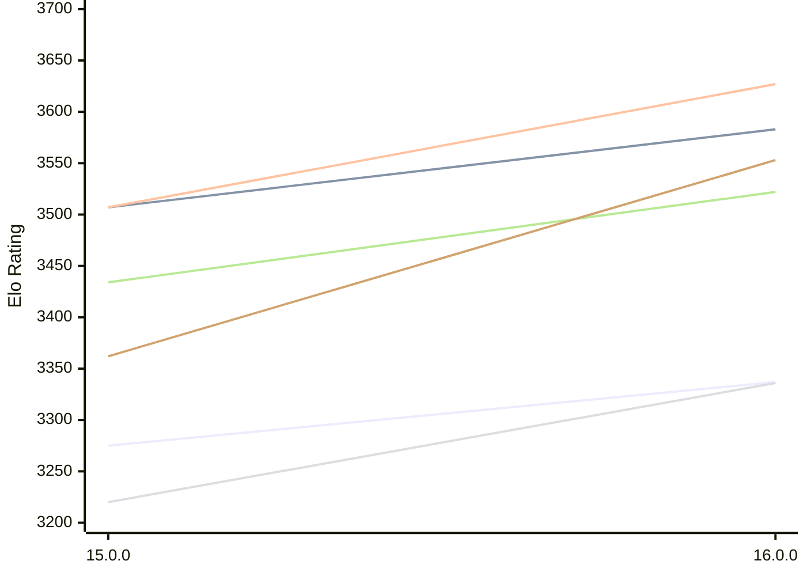
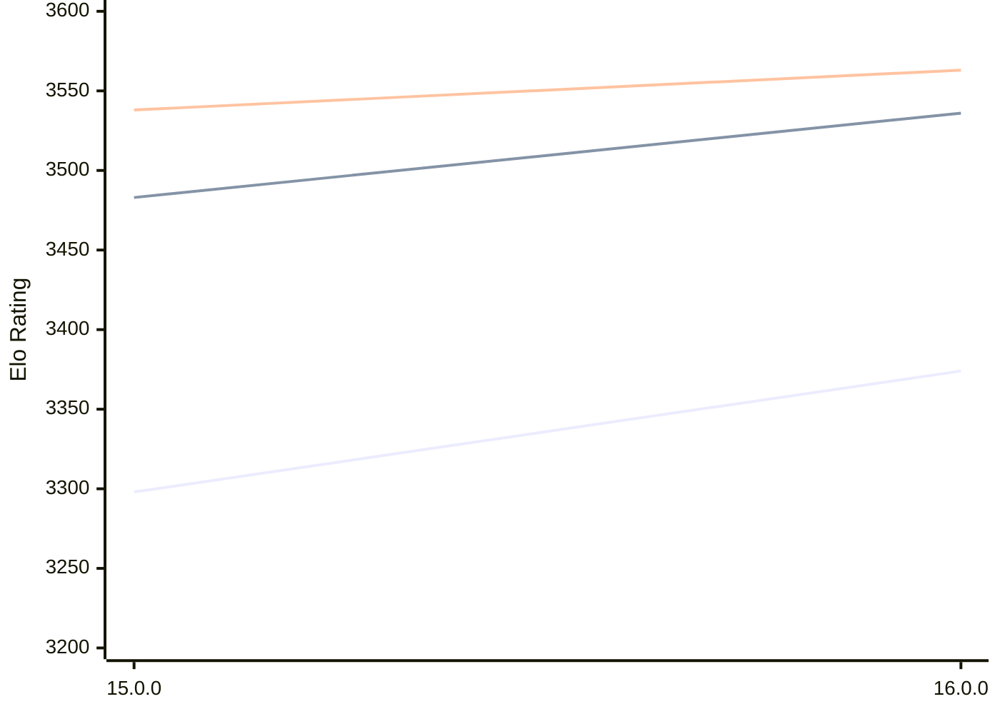

# Engine: Halogen

Author: Kieren Pearson

Home: https://github.com/KierenP/Halogen

## Elo Ratings E1 (Ultra 7 265T (1.50 GHz) - E-Core)

| Version | Published | STC 8.0+0.08s  | LTC 60.0+0.60s | VLTC 2m24s+1.12s | Comment |
| --- | --- | --- | --- | --- | --- |
| 16.0.0 | 2026-02-10 | 3337(+62) | 3583(+76) | 3627(+120) |  |
| 15.0.0 | 2025-09-01 | 3275 | 3507 | 3507 |  |
 | | | cElo (∆ prev) | cElo (∆ prev) | cElo (∆ prev) | 

## Elo Ratings P1 (Ultra 7 265T (1.50 GHz) - P-Core)

| Version | Published | STC 8.0+0.08s  | LTC 60.0+0.60s | VLTC 2m24s+1.12s | Comment |
| --- | --- | --- | --- | --- | --- |
| 16.0.0 | 2026-02-10 | 3336(+116) | 3522(+88) | 3553(+191) |  |
| 15.0.0 | 2025-09-01 | 3220 | 3434 | 3362 |  |
 | | | cElo (∆ prev) | cElo (∆ prev) | cElo (∆ prev) | 

## Elo Ratings T1 (i5-7500T 2.70GHz)

| Version | Published | STC 8.0+0.08s  | LTC 60.0+0.60s | VLTC 2m24s+1.12s | Comment |
| --- | --- | --- | --- | --- | --- |
| 16.0.0 | 2026-02-10 | 3374(+76) | 3536(+53) | 3563(+25) |  |
| 15.0.0 | 2025-09-01 | 3298 | 3483 | 3538 |  |
 | | | cElo (∆ prev) | cElo (∆ prev) | cElo (∆ prev) | 

<a href="https://github.com/computer-chess-index/cci/issues/new?template=submit-version.yml&title=[VERSION]+Halogen+<version>&body=###%20Engine%20name%0AHalogen%0A%0A###%20Version%0A16.0.0" target="_blank">Submit new version</a>

 Test Conditions:

GUI/CLI: <a href=https://github.com/cutechess/cutechess target="_blank">Cute-Chess</a> 
Elo Calculation: <a href=https://www.remi-coulom.fr/Bayesian-Elo/ target="_blank">Bayesian-Elo</a> 
CPU for P1: Intel(R) Core(TM) Ultra 7 265T (1.50 GHz) - P-Core 
CPU for E1: Intel(R) Core(TM) Ultra 7 265T (1.50 GHz) - E-Core 
CPU for T1: Intel(R) Core(TM) i5-7500T 2.70GHz 
Opening book: 8_moves_v3 
\* STC: 8.0+0.08s, LTC: 60.0+0.60s, VLTC: 2m24s+1.12s

 Lists:
Ratings: <a href=https://github.com/computer-chess-index/cci/blob/main/lists/CCIRatings.csv target="_blank">Complete list</a>

Generated: 2026-11-15 05:38:47

## Ratings Verlauf E1 / P1

## Ratings Verlauf T1

## Detailed Evaluation Results

| Version | Time Control | Variant | Elo  | Range +/- | Matches | Score | Average Opponent Elo | Draws |
| --- | --- |--- | --- | --- | --- | --- | --- | --- |
| 16.0.0 | VLTC (2m24s+1.12s) | P1 | 3553 | 33 | 252 | 61% | 3398 | 72% |
|  |  | E1 | 3627 | 28 | 336 | 60% | 3497 | 75% |
|  |  | T1 | 3563 | 21 | 538 | 50% | 3563 | 87% |
|  | LTC (60.0+0.60s) | P1 | 3522 | 39 | 164 | 57% | 3418 | 77% |
|  |  | E1 | 3583 | 32 | 270 | 57% | 3460 | 67% |
|  |  | T1 | 3536 | 20 | 556 | 50% | 3537 | 86% |
|  | STC (8.0+0.08s) | P1 | 3336 | 32 | 244 | 49% | 3340 | 75% |
|  |  | E1 | 3337 | 26 | 408 | 47% | 3363 | 60% |
|  |  | T1 | 3374 | 20 | 642 | 50% | 3376 | 75% |
| --- | --- |--- | --- | --- | --- | --- | --- | --- |
| 15.0.0 | VLTC (2m24s+1.12s) | E1 | 3507 | 92 | 33 | 64% | 3375 | 61% |
|  |  | T1 | 3538 | 27 | 324 | 52% | 3521 | 83% |
|  |  | P1 | 3362 | 106 | 26 | 67% | 3170 | 58% |
|  | LTC (60.0+0.60s) | T1 | 3483 | 30 | 276 | 52% | 3464 | 79% |
|  |  | P1 | 3434 | 125 | 28 | 86% | 2985 | 29% |
|  |  | E1 | 3507 | 75 | 56 | 69% | 3083 | 55% |
|  | STC (8.0+0.08s) | T1 | 3298 | 32 | 256 | 54% | 3259 | 64% |
|  |  | P1 | 3220 | 121 | 20 | 58% | 3104 | 45% |
|  |  | E1 | 3275 | 76 | 60 | 58% | 3043 | 40% |