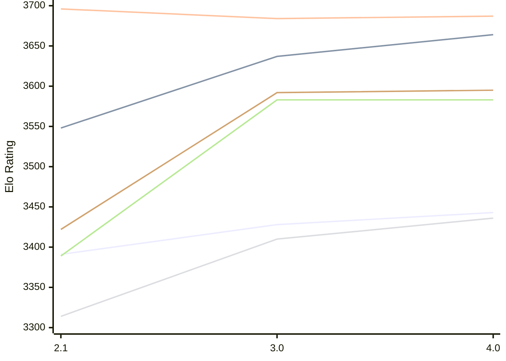
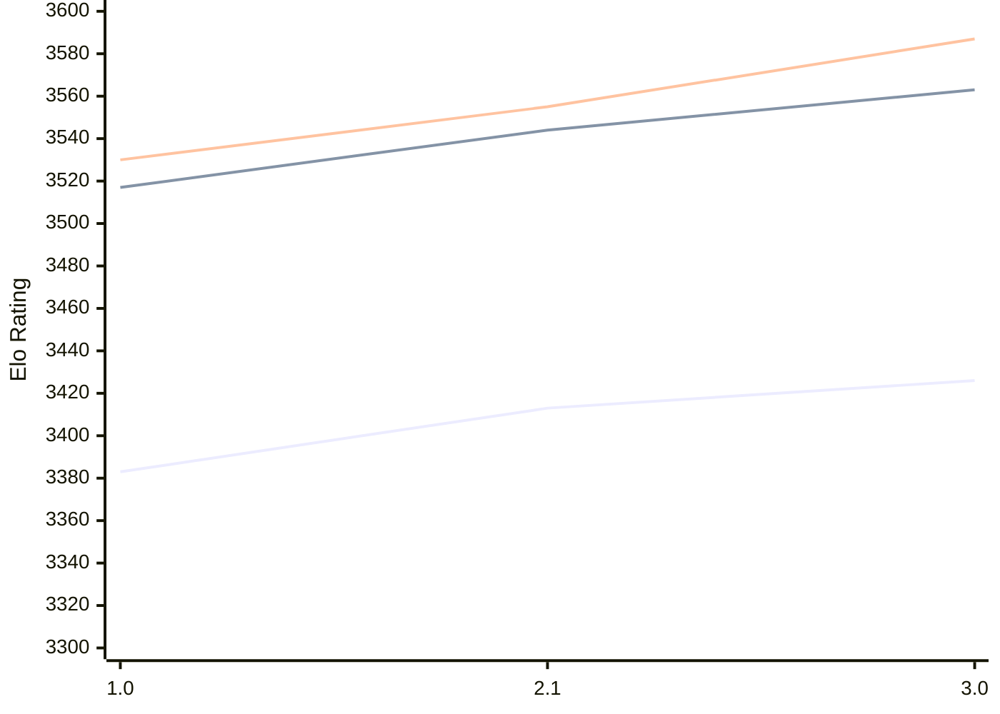

# Engine: Hobbes

Author: Dan Kelsey

Home: https://github.com/kelseyde/hobbes-chess-engine

## Elo Ratings E1 (Ultra 7 265T (1.50 GHz) - E-Core)

| Version | Published | STC 8.0+0.08s  | LTC 60.0+0.60s | VLTC 2m24s+1.12s | Comment |
| --- | --- | --- | --- | --- | --- |
| 4.0 | 2026-11-13 | 3443(+15) | 3664(+27) | 3687(+3) |  |
| 3.0 | 2026-07-22 | 3428(+37) | 3637(+89) | 3684(-12) |  |
| 2.1 | 2026-05-26 | 3391 | 3548 | 3696 |  |
 | | | cElo (∆ prev) | cElo (∆ prev) | cElo (∆ prev) | 

## Elo Ratings P1 (Ultra 7 265T (1.50 GHz) - P-Core)

| Version | Published | STC 8.0+0.08s  | LTC 60.0+0.60s | VLTC 2m24s+1.12s | Comment |
| --- | --- | --- | --- | --- | --- |
| 4.0 | 2026-11-13 | 3436(+26) | 3583(0) | 3595(+3) |  |
| 3.0 | 2026-07-22 | 3410(+96) | 3583(+194) | 3592(+170) |  |
| 2.1 | 2026-05-26 | 3314 | 3389 | 3422 |  |
 | | | cElo (∆ prev) | cElo (∆ prev) | cElo (∆ prev) | 

## Elo Ratings T1 (i5-7500T 2.70GHz)

| Version | Published | STC 8.0+0.08s  | LTC 60.0+0.60s | VLTC 2m24s+1.12s | Comment |
| --- | --- | --- | --- | --- | --- |
| 3.0 | 2026-07-22 | 3426(+13) | 3563(+19) | 3587(+32) |  |
| 2.1 | 2026-05-26 | 3413(+30) | 3544(+27) | 3555(+25) |  |
| 1.0 | 2026-03-05 | 3383 | 3517 | 3530 |  |
 | | | cElo (∆ prev) | cElo (∆ prev) | cElo (∆ prev) | 

<a href="https://github.com/computer-chess-index/cci/issues/new?template=submit-version.yml&title=[VERSION]+Hobbes+<version>&body=###%20Engine%20name%0AHobbes%0A%0A###%20Version%0A3.0" target="_blank">Submit new version</a>

 Test Conditions:

GUI/CLI: <a href=https://github.com/cutechess/cutechess target="_blank">Cute-Chess</a> 
Elo Calculation: <a href=https://www.remi-coulom.fr/Bayesian-Elo/ target="_blank">Bayesian-Elo</a> 
CPU for P1: Intel(R) Core(TM) Ultra 7 265T (1.50 GHz) - P-Core 
CPU for E1: Intel(R) Core(TM) Ultra 7 265T (1.50 GHz) - E-Core 
CPU for T1: Intel(R) Core(TM) i5-7500T 2.70GHz 
Opening book: 8_moves_v3 
\* STC: 8.0+0.08s, LTC: 60.0+0.60s, VLTC: 2m24s+1.12s

 Lists:
Ratings: <a href=https://github.com/computer-chess-index/cci/blob/main/lists/CCIRatings.csv target="_blank">Complete list</a>

Generated: 2026-11-23 05:38:58

## Ratings Verlauf E1 / P1

## Ratings Verlauf T1

## Detailed Evaluation Results

| Version | Time Control | Variant | Elo  | Range +/- | Matches | Score | Average Opponent Elo | Draws |
| --- | --- |--- | --- | --- | --- | --- | --- | --- |
| 4.0 | VLTC (2m24s+1.12s) | P1 | 3595 | 83 | 30 | 50% | 3595 | 100% |
|  |  | E1 | 3687 | 29 | 276 | 48% | 3700 | 88% |
|  | LTC (60.0+0.60s) | P1 | 3583 | 59 | 64 | 52% | 3572 | 88% |
|  |  | E1 | 3664 | 42 | 128 | 50% | 3660 | 85% |
|  | STC (8.0+0.08s) | E1 | 3443 | 38 | 172 | 48% | 3455 | 74% |
|  |  | P1 | 3436 | 46 | 116 | 53% | 3411 | 76% |
| --- | --- |--- | --- | --- | --- | --- | --- | --- |
| 3.0 | VLTC (2m24s+1.12s) | T1 | 3587 | 29 | 278 | 51% | 3576 | 88% |
|  |  | P1 | 3592 | 41 | 132 | 49% | 3599 | 96% |
|  |  | E1 | 3684 | 28 | 286 | 50% | 3681 | 96% |
|  | LTC (60.0+0.60s) | T1 | 3563 | 25 | 350 | 51% | 3557 | 90% |
|  |  | P1 | 3583 | 39 | 142 | 51% | 3578 | 96% |
|  |  | E1 | 3637 | 32 | 230 | 50% | 3640 | 87% |
|  | STC (8.0+0.08s) | T1 | 3426 | 26 | 350 | 49% | 3432 | 76% |
|  |  | P1 | 3410 | 35 | 196 | 50% | 3409 | 83% |
|  |  | E1 | 3428 | 29 | 294 | 48% | 3441 | 78% |
| --- | --- |--- | --- | --- | --- | --- | --- | --- |
| 2.1 | VLTC (2m24s+1.12s) | T1 | 3555 | 31 | 232 | 51% | 3549 | 90% |
|  |  | P1 | 3422 | 145 | 28 | 88% | 2712 | 25% |
|  |  | E1 | 3696 | 169 | 32 | 92% | 2700 | 9% |
|  | LTC (60.0+0.60s) | T1 | 3544 | 30 | 260 | 52% | 3530 | 88% |
|  |  | P1 | 3389 | 304 | 20 | 100% | 2473 | 0% |
|  |  | E1 | 3548 | 119 | 32 | 80% | 2935 | 34% |
|  | STC (8.0+0.08s) | T1 | 3413 | 28 | 296 | 52% | 3401 | 80% |
|  |  | P1 | 3314 | 327 | 10 | 100% | 2596 | 0% |
|  |  | E1 | 3391 | 96 | 36 | 63% | 3113 | 47% |
| --- | --- |--- | --- | --- | --- | --- | --- | --- |
| 1.0 | VLTC (2m24s+1.12s) | T1 | 3530 | 25 | 378 | 51% | 3521 | 90% |
|  | LTC (60.0+0.60s) | T1 | 3517 | 26 | 350 | 51% | 3506 | 87% |
|  | STC (8.0+0.08s) | T1 | 3383 | 23 | 484 | 53% | 3353 | 73% |