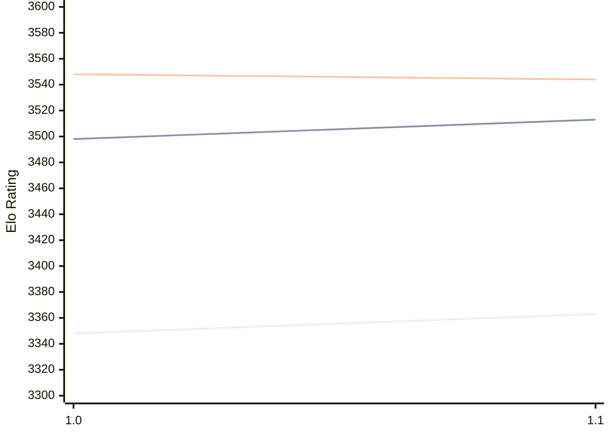

# Engine: Horsie

Author: Liam McGuire

Home: https://github.com/liamt19/Horsie

## Elo Ratings E1

| Version | Published | STC 8.0+0.08s  | LTC 60.0+0.60s | VLTC 2m24s+1.12s | Comment |
| --- | --- | --- | --- | --- | --- |
| 1.1 | 2025-05-13 | 3278 | 3522 | 3556 |  |
 | | | cElo (∆ prev) | cElo (∆ prev) | cElo (∆ prev) | 

## Elo Ratings P1

| Version | Published | STC 8.0+0.08s  | LTC 60.0+0.60s | VLTC 2m24s+1.12s | Comment |
| --- | --- | --- | --- | --- | --- |
| 1.1 | 2025-05-13 | 3510 | 3681 | 3735 |  |
 | | | cElo (∆ prev) | cElo (∆ prev) | cElo (∆ prev) | 

## Elo Ratings T1

| Version | Published | STC 8.0+0.08s  | LTC 60.0+0.60s | VLTC 2m24s+1.12s | Comment |
| --- | --- | --- | --- | --- | --- |
| 1.1 | 2025-05-13 | 3363(+15) | 3513(+15) | 3544(-4) |  |
| 1.0 | 2025-01-08 | 3348 | 3498 | 3548 |  |
 | | | cElo (∆ prev) | cElo (∆ prev) | cElo (∆ prev) | 

<a href="https://github.com/computer-chess-index/cci/issues/new?template=submit-version.yml&title=[VERSION]+Horsie+<version>&body=###%20Engine%20name%0AHorsie%0A%0A###%20Version%0A1.1" target="_blank">Submit new version</a>

 Test Conditions:

GUI/CLI: <a href=https://github.com/cutechess/cutechess target="_blank">Cute-Chess</a> 
Elo Calculation: <a href=https://www.remi-coulom.fr/Bayesian-Elo/ target="_blank">Bayesian-Elo</a> 
CPU for P1: Intel(R) Core(TM) Ultra 7 265T (1.50 GHz) - P-Core 
CPU for E1: Intel(R) Core(TM) Ultra 7 265T (1.50 GHz) - E-Core 
CPU for T1: Intel(R) Core(TM) i5-7500T 2.70GHz 
Opening book: 8_moves_v3 
\* STC: 8.0+0.08s, LTC: 60.0+0.60s, VLTC: 2m24s+1.12s

 Lists:
Ratings: <a href=https://github.com/computer-chess-index/cci/blob/main/lists/CCIRatings.csv target="_blank">Complete list</a>

Generated: 2026-10-13 04:39:25

## Ratings Verlauf T1

## Detailed Evaluation Results

| Version | Time Control | Elo  | Range +/- | Matches | Score | Average Opponent Elo | Draws |
| --- | --- | --- | --- | --- | --- | --- | --- |
| 1.1 | VLTC (2m24s+1.12s) | 3544 | 16 | 946 | 50% | 3541 | 87% |
| 1.1 | VLTC (2m24s+1.12s) | 3735 | 44 | 116 | 49% | 3744 | 87% |
| 1.1 | VLTC (2m24s+1.12s) | 3556 | 37 | 168 | 51% | 3545 | 85% |
| 1.1 | LTC (60.0+0.60s) | 3681 | 46 | 108 | 49% | 3690 | 82% |
| 1.1 | LTC (60.0+0.60s) | 3522 | 40 | 148 | 54% | 3495 | 82% |
| 1.1 | LTC (60.0+0.60s) | 3513 | 16 | 950 | 51% | 3509 | 83% |
| 1.1 | STC (8.0+0.08s) | 3510 | 38 | 172 | 50% | 3511 | 69% |
| --- | --- | --- | --- | --- | --- | --- | --- |
| 1.1 | STC (8.0+0.08s) | 3278 | 31 | 278 | 46% | 3302 | 65% |
| --- | --- | --- | --- | --- | --- | --- | --- |
| 1.1 | STC (8.0+0.08s) | 3363 | 15 | 1098 | 50% | 3364 | 69% |
| --- | --- | --- | --- | --- | --- | --- | --- |
| 1.0 | VLTC (2m24s+1.12s) | 3548 | 28 | 304 | 49% | 3553 | 86% |
| 1.0 | LTC (60.0+0.60s) | 3498 | 26 | 348 | 51% | 3490 | 85% |
| 1.0 | STC (8.0+0.08s) | 3348 | 29 | 292 | 49% | 3352 | 75% |
| --- | --- | --- | --- | --- | --- | --- | --- |