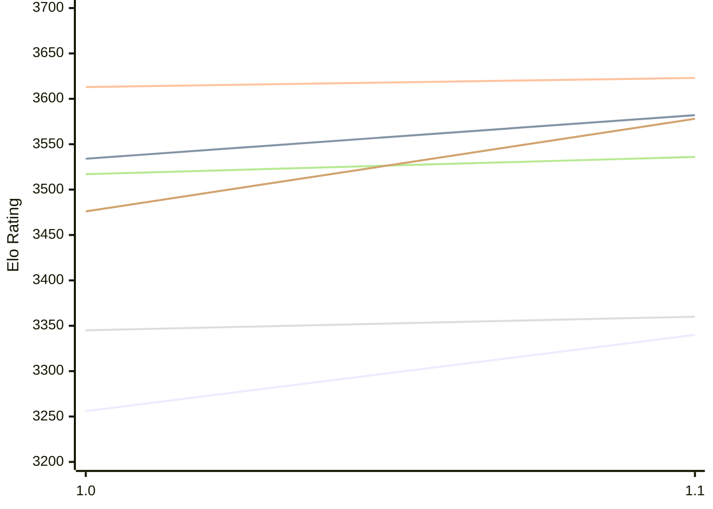
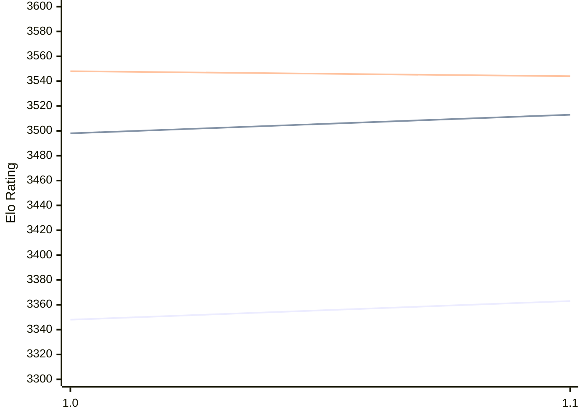

# Engine: Horsie

Author: Liam McGuire

Home: https://github.com/liamt19/Horsie

## Elo Ratings E1 (Ultra 7 265T (1.50 GHz) - E-Core)

| Version | Published | STC 8.0+0.08s  | LTC 60.0+0.60s | VLTC 2m24s+1.12s | Comment |
| --- | --- | --- | --- | --- | --- |
| 1.1 | 2025-05-13 | 3340(+84) | 3582(+48) | 3623(+10) |  |
| 1.0 | 2025-01-08 | 3256 | 3534 | 3613 |  |
 | | | cElo (∆ prev) | cElo (∆ prev) | cElo (∆ prev) | 

## Elo Ratings P1 (Ultra 7 265T (1.50 GHz) - P-Core)

| Version | Published | STC 8.0+0.08s  | LTC 60.0+0.60s | VLTC 2m24s+1.12s | Comment |
| --- | --- | --- | --- | --- | --- |
| 1.1 | 2025-05-13 | 3360(+15) | 3536(+19) | 3578(+102) |  |
| 1.0 | 2025-01-08 | 3345 | 3517 | 3476 |  |
 | | | cElo (∆ prev) | cElo (∆ prev) | cElo (∆ prev) | 

## Elo Ratings T1 (i5-7500T 2.70GHz)

| Version | Published | STC 8.0+0.08s  | LTC 60.0+0.60s | VLTC 2m24s+1.12s | Comment |
| --- | --- | --- | --- | --- | --- |
| 1.1 | 2025-05-13 | 3363(+15) | 3513(+15) | 3544(-4) |  |
| 1.0 | 2025-01-08 | 3348 | 3498 | 3548 |  |
 | | | cElo (∆ prev) | cElo (∆ prev) | cElo (∆ prev) | 

<a href="https://github.com/computer-chess-index/cci/issues/new?template=submit-version.yml&title=[VERSION]+Horsie+<version>&body=###%20Engine%20name%0AHorsie%0A%0A###%20Version%0A1.1" target="_blank">Submit new version</a>

 Test Conditions:

GUI/CLI: <a href=https://github.com/cutechess/cutechess target="_blank">Cute-Chess</a> 
Elo Calculation: <a href=https://www.remi-coulom.fr/Bayesian-Elo/ target="_blank">Bayesian-Elo</a> 
CPU for P1: Intel(R) Core(TM) Ultra 7 265T (1.50 GHz) - P-Core 
CPU for E1: Intel(R) Core(TM) Ultra 7 265T (1.50 GHz) - E-Core 
CPU for T1: Intel(R) Core(TM) i5-7500T 2.70GHz 
Opening book: 8_moves_v3 
\* STC: 8.0+0.08s, LTC: 60.0+0.60s, VLTC: 2m24s+1.12s

 Lists:
Ratings: <a href=https://github.com/computer-chess-index/cci/blob/main/lists/CCIRatings.csv target="_blank">Complete list</a>

Generated: 2026-11-25 05:39:06

## Ratings Verlauf E1 / P1

## Ratings Verlauf T1

## Detailed Evaluation Results

| Version | Time Control | Variant | Elo  | Range +/- | Matches | Score | Average Opponent Elo | Draws |
| --- | --- |--- | --- | --- | --- | --- | --- | --- |
| 1.1 | VLTC (2m24s+1.12s) | E1 | 3623 | 29 | 276 | 51% | 3618 | 84% |
|  |  | T1 | 3544 | 16 | 946 | 50% | 3541 | 87% |
|  |  | P1 | 3578 | 36 | 172 | 48% | 3591 | 88% |
|  | LTC (60.0+0.60s) | E1 | 3582 | 29 | 288 | 51% | 3575 | 79% |
|  |  | T1 | 3513 | 16 | 950 | 51% | 3509 | 83% |
|  |  | P1 | 3536 | 37 | 168 | 49% | 3542 | 82% |
|  | STC (8.0+0.08s) | T1 | 3363 | 15 | 1098 | 50% | 3364 | 69% |
|  |  | P1 | 3360 | 31 | 260 | 49% | 3367 | 68% |
|  |  | E1 | 3340 | 24 | 474 | 47% | 3360 | 65% |
| --- | --- |--- | --- | --- | --- | --- | --- | --- |
| 1.0 | VLTC (2m24s+1.12s) | E1 | 3613 | 64 | 64 | 57% | 3503 | 70% |
|  |  | T1 | 3548 | 28 | 304 | 49% | 3553 | 86% |
|  |  | P1 | 3476 | 102 | 28 | 66% | 3278 | 61% |
|  | LTC (60.0+0.60s) | E1 | 3534 | 64 | 70 | 63% | 3375 | 60% |
|  |  | T1 | 3498 | 26 | 348 | 51% | 3490 | 85% |
|  |  | P1 | 3517 | 80 | 40 | 56% | 3459 | 68% |
|  | STC (8.0+0.08s) | E1 | 3256 | 48 | 126 | 53% | 3182 | 56% |
|  |  | T1 | 3348 | 29 | 292 | 49% | 3352 | 75% |
|  |  | P1 | 3345 | 68 | 68 | 62% | 3127 | 53% |