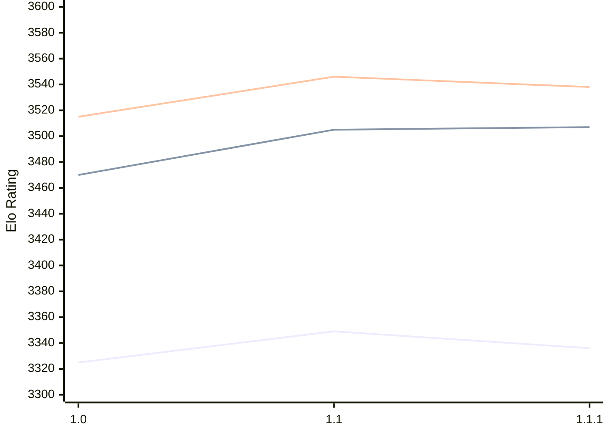

# Engine: Icarus

Author: 

Home: https://github.com/Sp00ph/icarus

## Elo Ratings E1 (Ultra 7 265T (1.50 GHz) - E-Core)

| Version | Published | STC 8.0+0.08s  | LTC 60.0+0.60s | VLTC 2m24s+1.12s | Comment |
| --- | --- | --- | --- | --- | --- |
| 1.1.1 | 2026-07-17 | 3281 | 3511 | 3546 |  |
 | | | cElo (∆ prev) | cElo (∆ prev) | cElo (∆ prev) | 

## Elo Ratings P1 (Ultra 7 265T (1.50 GHz) - P-Core)

| Version | Published | STC 8.0+0.08s  | LTC 60.0+0.60s | VLTC 2m24s+1.12s | Comment |
| --- | --- | --- | --- | --- | --- |
| 1.1.1 | 2026-07-17 | 3483 | 3652 | 3718 |  |
 | | | cElo (∆ prev) | cElo (∆ prev) | cElo (∆ prev) | 

## Elo Ratings T1 (i5-7500T 2.70GHz)

| Version | Published | STC 8.0+0.08s  | LTC 60.0+0.60s | VLTC 2m24s+1.12s | Comment |
| --- | --- | --- | --- | --- | --- |
| 1.1.1 | 2026-07-17 | 3336(-13) | 3507(+2) | 3538(-8) |  |
| 1.1 | 2026-06-05 | 3349(+24) | 3505(+35) | 3546(+31) |  |
| 1.0 | 2026-04-26 | 3325 | 3470 | 3515 |  |
 | | | cElo (∆ prev) | cElo (∆ prev) | cElo (∆ prev) | 

<a href="https://github.com/computer-chess-index/cci/issues/new?template=submit-version.yml&title=[VERSION]+Icarus+<version>&body=###%20Engine%20name%0AIcarus%0A%0A###%20Version%0A1.1.1" target="_blank">Submit new version</a>

 Test Conditions:

GUI/CLI: <a href=https://github.com/cutechess/cutechess target="_blank">Cute-Chess</a> 
Elo Calculation: <a href=https://www.remi-coulom.fr/Bayesian-Elo/ target="_blank">Bayesian-Elo</a> 
CPU for P1: Intel(R) Core(TM) Ultra 7 265T (1.50 GHz) - P-Core 
CPU for E1: Intel(R) Core(TM) Ultra 7 265T (1.50 GHz) - E-Core 
CPU for T1: Intel(R) Core(TM) i5-7500T 2.70GHz 
Opening book: 8_moves_v3 
\* STC: 8.0+0.08s, LTC: 60.0+0.60s, VLTC: 2m24s+1.12s

 Lists:
Ratings: <a href=https://github.com/computer-chess-index/cci/blob/main/lists/CCIRatings.csv target="_blank">Complete list</a>

Generated: 2026-10-17 04:39:22

## Ratings Verlauf T1

## Detailed Evaluation Results

| Version | Time Control | Variant | Elo  | Range +/- | Matches | Score | Average Opponent Elo | Draws |
| --- | --- |--- | --- | --- | --- | --- | --- | --- |
| 1.1.1 | VLTC (2m24s+1.12s) | P1 | 3718 | 41 | 140 | 51% | 3711 | 82% |
|  |  | E1 | 3546 | 31 | 240 | 49% | 3553 | 84% |
|  |  | T1 | 3538 | 24 | 404 | 50% | 3536 | 87% |
|  | LTC (60.0+0.60s) | P1 | 3652 | 37 | 172 | 49% | 3660 | 84% |
|  |  | E1 | 3511 | 31 | 242 | 49% | 3518 | 82% |
|  |  | T1 | 3507 | 27 | 326 | 50% | 3509 | 85% |
|  | STC (8.0+0.08s) | E1 | 3281 | 30 | 284 | 48% | 3294 | 63% |
|  |  | T1 | 3336 | 29 | 288 | 49% | 3341 | 74% |
|  |  | P1 | 3483 | 35 | 206 | 50% | 3483 | 71% |
| --- | --- |--- | --- | --- | --- | --- | --- | --- |
| 1.1 | VLTC (2m24s+1.12s) | T1 | 3546 | 28 | 300 | 50% | 3544 | 86% |
|  | LTC (60.0+0.60s) | T1 | 3505 | 24 | 404 | 52% | 3491 | 81% |
|  | STC (8.0+0.08s) | T1 | 3349 | 28 | 324 | 51% | 3345 | 75% |
| --- | --- |--- | --- | --- | --- | --- | --- | --- |
| 1.0 | VLTC (2m24s+1.12s) | T1 | 3515 | 27 | 334 | 50% | 3511 | 83% |
|  | LTC (60.0+0.60s) | T1 | 3470 | 26 | 338 | 51% | 3464 | 83% |
|  | STC (8.0+0.08s) | T1 | 3325 | 27 | 348 | 51% | 3318 | 71% |