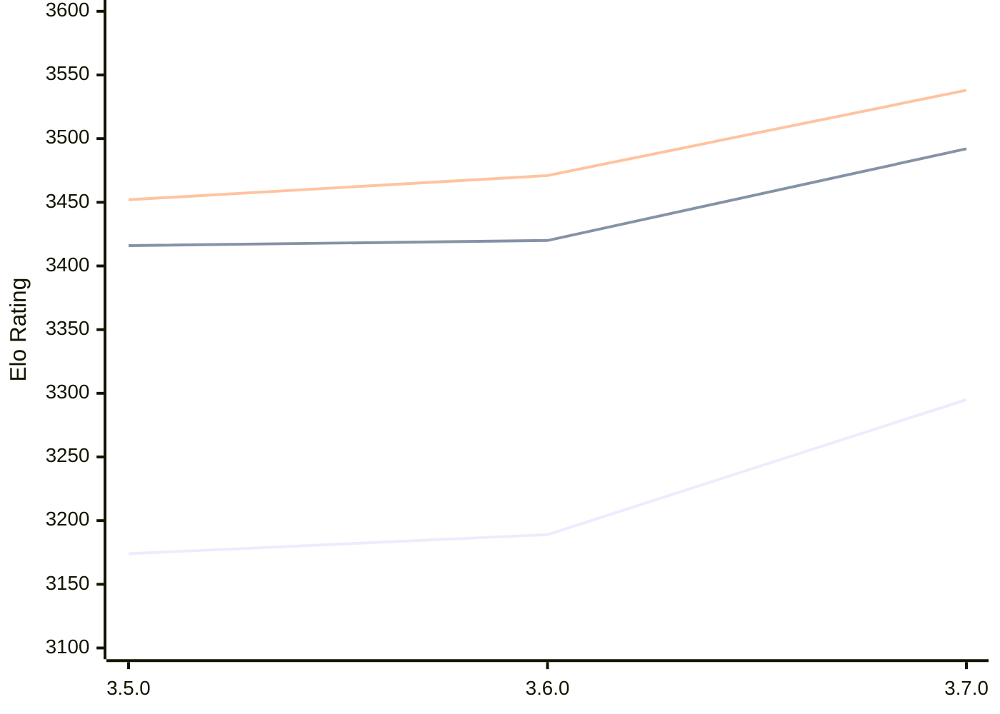

# Engine: Igel

Author: Volodymyr Shcherbyna

Home: https://github.com/vshcherbyna/igel

## Elo Ratings E1 (Ultra 7 265T (1.50 GHz) - E-Core)

| Version | Published | STC 8.0+0.08s  | LTC 60.0+0.60s | VLTC 2m24s+1.12s | Comment |
| --- | --- | --- | --- | --- | --- |
| 3.7.0 | 2026-08-27 | 3213 | 3495 | 3549 |  |
 | | | cElo (∆ prev) | cElo (∆ prev) | cElo (∆ prev) | 

## Elo Ratings P1 (Ultra 7 265T (1.50 GHz) - P-Core)

| Version | Published | STC 8.0+0.08s  | LTC 60.0+0.60s | VLTC 2m24s+1.12s | Comment |
| --- | --- | --- | --- | --- | --- |
| 3.7.0 | 2026-08-27 | 3438 | 3681 | 3718 |  |
 | | | cElo (∆ prev) | cElo (∆ prev) | cElo (∆ prev) | 

## Elo Ratings T1 (i5-7500T 2.70GHz)

| Version | Published | STC 8.0+0.08s  | LTC 60.0+0.60s | VLTC 2m24s+1.12s | Comment |
| --- | --- | --- | --- | --- | --- |
| 3.7.0 | 2026-08-27 | 3295(+106) | 3492(+72) | 3538(+67) |  |
| 3.6.0 | 2024-12-28 | 3189(+15) | 3420(+4) | 3471(+19) |  |
| 3.5.0 | 2023-06-22 | 3174 | 3416 | 3452 |  |
 | | | cElo (∆ prev) | cElo (∆ prev) | cElo (∆ prev) | 

<a href="https://github.com/computer-chess-index/cci/issues/new?template=submit-version.yml&title=[VERSION]+Igel+<version>&body=###%20Engine%20name%0AIgel%0A%0A###%20Version%0A3.7.0" target="_blank">Submit new version</a>

 Test Conditions:

GUI/CLI: <a href=https://github.com/cutechess/cutechess target="_blank">Cute-Chess</a> 
Elo Calculation: <a href=https://www.remi-coulom.fr/Bayesian-Elo/ target="_blank">Bayesian-Elo</a> 
CPU for P1: Intel(R) Core(TM) Ultra 7 265T (1.50 GHz) - P-Core 
CPU for E1: Intel(R) Core(TM) Ultra 7 265T (1.50 GHz) - E-Core 
CPU for T1: Intel(R) Core(TM) i5-7500T 2.70GHz 
Opening book: 8_moves_v3 
\* STC: 8.0+0.08s, LTC: 60.0+0.60s, VLTC: 2m24s+1.12s

 Lists:
Ratings: <a href=https://github.com/computer-chess-index/cci/blob/main/lists/CCIRatings.csv target="_blank">Complete list</a>

Generated: 2026-10-16 04:39:46

## Ratings Verlauf T1

## Detailed Evaluation Results

| Version | Time Control | Variant | Elo  | Range +/- | Matches | Score | Average Opponent Elo | Draws |
| --- | --- |--- | --- | --- | --- | --- | --- | --- |
| 3.7.0 | VLTC (2m24s+1.12s) | T1 | 3538 | 28 | 282 | 51% | 3529 | 87% |
|  |  | P1 | 3718 | 41 | 134 | 51% | 3713 | 87% |
|  |  | E1 | 3549 | 34 | 204 | 49% | 3559 | 86% |
|  | LTC (60.0+0.60s) | T1 | 3492 | 30 | 260 | 49% | 3497 | 80% |
|  |  | P1 | 3681 | 37 | 176 | 52% | 3669 | 76% |
|  |  | E1 | 3495 | 32 | 228 | 49% | 3499 | 78% |
|  | STC (8.0+0.08s) | T1 | 3295 | 32 | 248 | 50% | 3298 | 71% |
|  |  | P1 | 3438 | 36 | 198 | 49% | 3441 | 72% |
|  |  | E1 | 3213 | 30 | 288 | 46% | 3244 | 65% |
| --- | --- |--- | --- | --- | --- | --- | --- | --- |
| 3.6.0 | VLTC (2m24s+1.12s) | T1 | 3471 | 12 | 1674 | 50% | 3474 | 82% |
|  | LTC (60.0+0.60s) | T1 | 3420 | 12 | 1616 | 50% | 3417 | 76% |
|  | STC (8.0+0.08s) | T1 | 3189 | 12 | 1708 | 49% | 3198 | 63% |
| --- | --- |--- | --- | --- | --- | --- | --- | --- |
| 3.5.0 | VLTC (2m24s+1.12s) | T1 | 3452 | 17 | 800 | 50% | 3449 | 78% |
|  | LTC (60.0+0.60s) | T1 | 3416 | 17 | 828 | 49% | 3418 | 78% |
|  | STC (8.0+0.08s) | T1 | 3174 | 18 | 872 | 52% | 3133 | 58% |