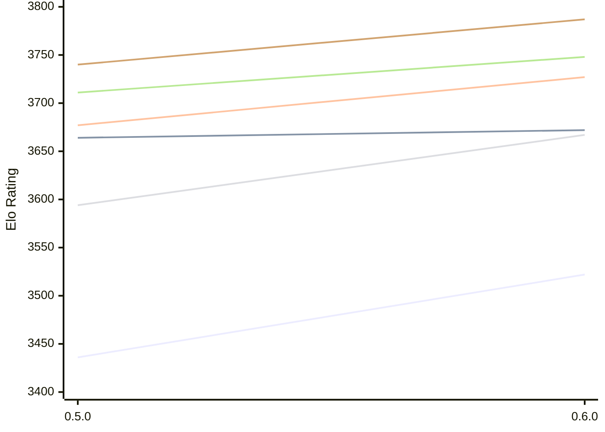

# Engine: Incipit

Author: Adam Twiss

Home: https://github.com/adamtwiss/incipit

## Elo Ratings E1 (Ultra 7 265T (1.50 GHz) - E-Core)

| Version | Published | STC 8.0+0.08s  | LTC 60.0+0.60s | VLTC 2m24s+1.12s | Comment |
| --- | --- | --- | --- | --- | --- |
| 0.6.0 | 2026-11-06 | 3522(+86) | 3672(+8) | 3727(+50) |  |
| 0.5.0 | 2026-10-17 | 3436 | 3664 | 3677 |  |
 | | | cElo (∆ prev) | cElo (∆ prev) | cElo (∆ prev) | 

## Elo Ratings P1 (Ultra 7 265T (1.50 GHz) - P-Core)

| Version | Published | STC 8.0+0.08s  | LTC 60.0+0.60s | VLTC 2m24s+1.12s | Comment |
| --- | --- | --- | --- | --- | --- |
| 0.6.0 | 2026-11-06 | 3667(+73) | 3748(+37) | 3787(+47) |  |
| 0.5.0 | 2026-10-17 | 3594 | 3711 | 3740 |  |
 | | | cElo (∆ prev) | cElo (∆ prev) | cElo (∆ prev) | 

## Elo Ratings T1 (i5-7500T 2.70GHz)

| Version | Published | STC 8.0+0.08s  | LTC 60.0+0.60s | VLTC 2m24s+1.12s | Comment |
| --- | --- | --- | --- | --- | --- |
| 0.5.0 | 2026-10-17 | 3594 | 3711 | 3740 |  |
 | | | cElo (∆ prev) | cElo (∆ prev) | cElo (∆ prev) | 

<a href="https://github.com/computer-chess-index/cci/issues/new?template=submit-version.yml&title=[VERSION]+Incipit+<version>&body=###%20Engine%20name%0AIncipit%0A%0A###%20Version%0A0.6.0" target="_blank">Submit new version</a>

 Test Conditions:

GUI/CLI: <a href=https://github.com/cutechess/cutechess target="_blank">Cute-Chess</a> 
Elo Calculation: <a href=https://www.remi-coulom.fr/Bayesian-Elo/ target="_blank">Bayesian-Elo</a> 
CPU for P1: Intel(R) Core(TM) Ultra 7 265T (1.50 GHz) - P-Core 
CPU for E1: Intel(R) Core(TM) Ultra 7 265T (1.50 GHz) - E-Core 
CPU for T1: Intel(R) Core(TM) i5-7500T 2.70GHz 
Opening book: 8_moves_v3 
\* STC: 8.0+0.08s, LTC: 60.0+0.60s, VLTC: 2m24s+1.12s

 Lists:
Ratings: <a href=https://github.com/computer-chess-index/cci/blob/main/lists/CCIRatings.csv target="_blank">Complete list</a>

Generated: 2026-11-09 05:39:01

## Ratings Verlauf E1 / P1

## Detailed Evaluation Results

| Version | Time Control | Variant | Elo  | Range +/- | Matches | Score | Average Opponent Elo | Draws |
| --- | --- |--- | --- | --- | --- | --- | --- | --- |
| 0.6.0 | VLTC (2m24s+1.12s) | E1 | 3727 | 37 | 166 | 51% | 3719 | 89% |
|  |  | P1 | 3787 | 58 | 68 | 51% | 3777 | 82% |
|  | LTC (60.0+0.60s) | P1 | 3748 | 45 | 116 | 52% | 3735 | 81% |
|  |  | E1 | 3672 | 40 | 146 | 51% | 3668 | 79% |
|  | STC (8.0+0.08s) | P1 | 3667 | 48 | 104 | 52% | 3654 | 81% |
|  |  | E1 | 3522 | 32 | 238 | 50% | 3522 | 73% |
| --- | --- |--- | --- | --- | --- | --- | --- | --- |
| 0.5.0 | VLTC (2m24s+1.12s) | P1 | 3740 | 36 | 212 | 62% | 3572 | 69% |
|  |  | E1 | 3677 | 34 | 234 | 59% | 3529 | 74% |
|  | LTC (60.0+0.60s) | P1 | 3711 | 42 | 160 | 64% | 3430 | 68% |
|  |  | E1 | 3664 | 34 | 240 | 58% | 3468 | 67% |
|  | STC (8.0+0.08s) | P1 | 3594 | 39 | 192 | 60% | 3347 | 64% |
|  |  | E1 | 3436 | 32 | 280 | 56% | 3274 | 62% |