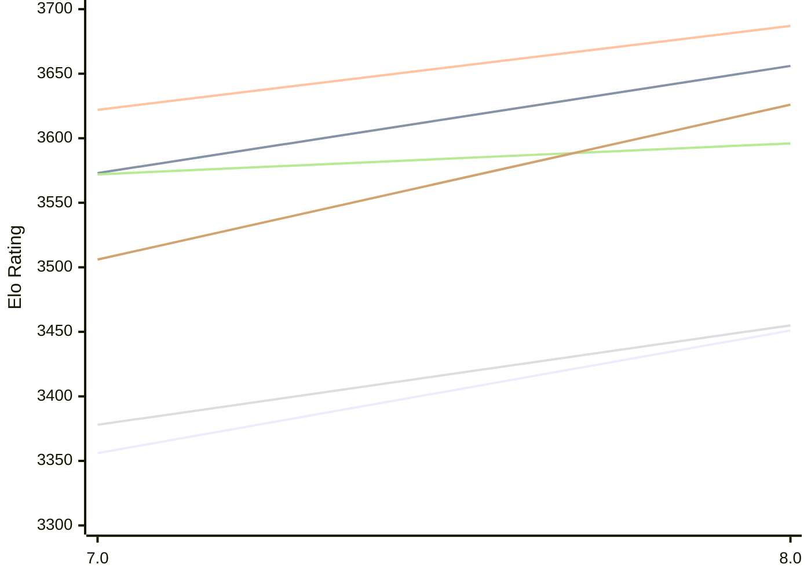
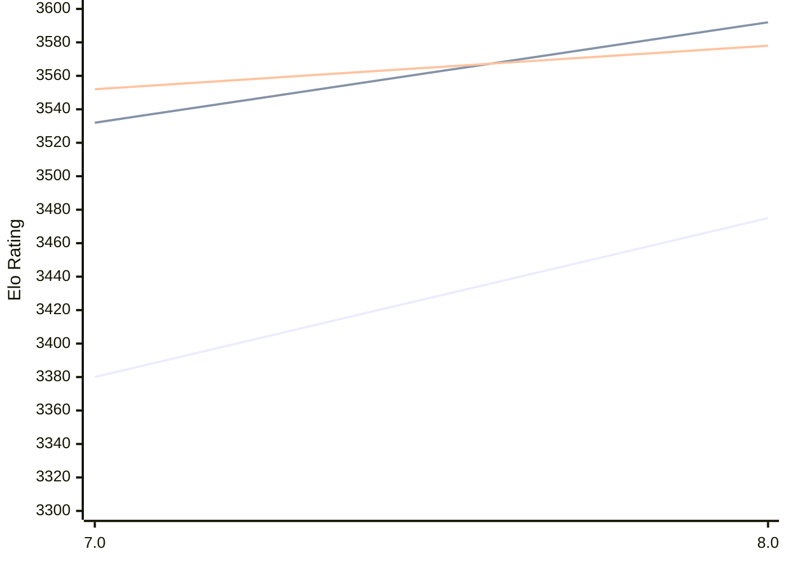

# Engine: Integral

Author: Aron Petkovski

Home: https://github.com/aronpetko/integral

## Elo Ratings E1 (Ultra 7 265T (1.50 GHz) - E-Core)

| Version | Published | STC 8.0+0.08s  | LTC 60.0+0.60s | VLTC 2m24s+1.12s | Comment |
| --- | --- | --- | --- | --- | --- |
| 8.0 | 2026-09-11 | 3451(+95) | 3656(+83) | 3687(+65) |  |
| 7.0 | 2025-02-14 | 3356 | 3573 | 3622 |  |
 | | | cElo (∆ prev) | cElo (∆ prev) | cElo (∆ prev) | 

## Elo Ratings P1 (Ultra 7 265T (1.50 GHz) - P-Core)

| Version | Published | STC 8.0+0.08s  | LTC 60.0+0.60s | VLTC 2m24s+1.12s | Comment |
| --- | --- | --- | --- | --- | --- |
| 8.0 | 2026-09-11 | 3455(+77) | 3596(+24) | 3626(+120) |  |
| 7.0 | 2025-02-14 | 3378 | 3572 | 3506 |  |
 | | | cElo (∆ prev) | cElo (∆ prev) | cElo (∆ prev) | 

## Elo Ratings T1 (i5-7500T 2.70GHz)

| Version | Published | STC 8.0+0.08s  | LTC 60.0+0.60s | VLTC 2m24s+1.12s | Comment |
| --- | --- | --- | --- | --- | --- |
| 8.0 | 2026-09-11 | 3475(+95) | 3592(+60) | 3578(+26) |  |
| 7.0 | 2025-02-14 | 3380 | 3532 | 3552 |  |
 | | | cElo (∆ prev) | cElo (∆ prev) | cElo (∆ prev) | 

<a href="https://github.com/computer-chess-index/cci/issues/new?template=submit-version.yml&title=[VERSION]+Integral+<version>&body=###%20Engine%20name%0AIntegral%0A%0A###%20Version%0A8.0" target="_blank">Submit new version</a>

 Test Conditions:

GUI/CLI: <a href=https://github.com/cutechess/cutechess target="_blank">Cute-Chess</a> 
Elo Calculation: <a href=https://www.remi-coulom.fr/Bayesian-Elo/ target="_blank">Bayesian-Elo</a> 
CPU for P1: Intel(R) Core(TM) Ultra 7 265T (1.50 GHz) - P-Core 
CPU for E1: Intel(R) Core(TM) Ultra 7 265T (1.50 GHz) - E-Core 
CPU for T1: Intel(R) Core(TM) i5-7500T 2.70GHz 
Opening book: 8_moves_v3 
\* STC: 8.0+0.08s, LTC: 60.0+0.60s, VLTC: 2m24s+1.12s

 Lists:
Ratings: <a href=https://github.com/computer-chess-index/cci/blob/main/lists/CCIRatings.csv target="_blank">Complete list</a>

Generated: 2026-11-26 05:39:25

## Ratings Verlauf E1 / P1

## Ratings Verlauf T1

## Detailed Evaluation Results

| Version | Time Control | Variant | Elo  | Range +/- | Matches | Score | Average Opponent Elo | Draws |
| --- | --- |--- | --- | --- | --- | --- | --- | --- |
| 8.0 | VLTC (2m24s+1.12s) | P1 | 3626 | 32 | 220 | 51% | 3621 | 86% |
|  |  | E1 | 3687 | 22 | 450 | 51% | 3681 | 91% |
|  |  | T1 | 3578 | 34 | 190 | 51% | 3573 | 95% |
|  | LTC (60.0+0.60s) | E1 | 3656 | 30 | 260 | 51% | 3649 | 86% |
|  |  | T1 | 3592 | 39 | 148 | 51% | 3583 | 91% |
|  |  | P1 | 3596 | 36 | 178 | 50% | 3599 | 86% |
|  | STC (8.0+0.08s) | E1 | 3451 | 25 | 414 | 46% | 3478 | 72% |
|  |  | T1 | 3475 | 27 | 316 | 52% | 3463 | 82% |
|  |  | P1 | 3455 | 30 | 274 | 47% | 3474 | 79% |
| --- | --- |--- | --- | --- | --- | --- | --- | --- |
| 7.0 | VLTC (2m24s+1.12s) | T1 | 3552 | 15 | 1010 | 50% | 3552 | 87% |
|  |  | P1 | 3506 | 77 | 44 | 64% | 3329 | 73% |
|  |  | E1 | 3622 | 58 | 88 | 64% | 3402 | 59% |
|  | LTC (60.0+0.60s) | P1 | 3572 | 117 | 24 | 63% | 3318 | 50% |
|  |  | E1 | 3573 | 53 | 84 | 54% | 3533 | 80% |
|  |  | T1 | 3532 | 15 | 1012 | 50% | 3530 | 85% |
|  | STC (8.0+0.08s) | P1 | 3378 | 76 | 50 | 62% | 3224 | 60% |
|  |  | E1 | 3356 | 44 | 134 | 52% | 3328 | 66% |
|  |  | T1 | 3380 | 15 | 1158 | 50% | 3378 | 70% |