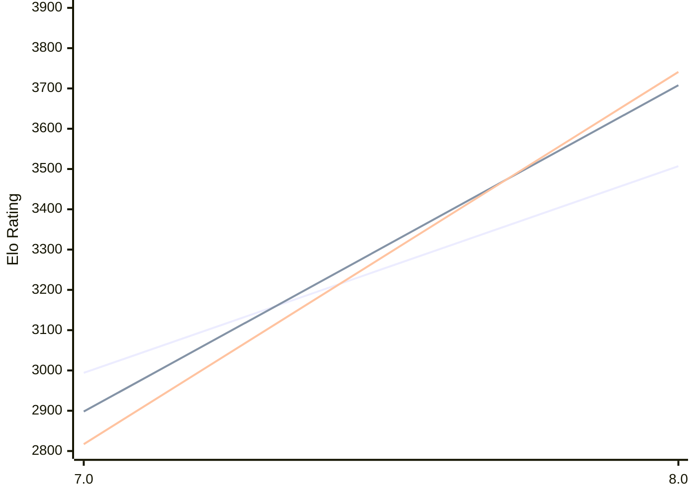
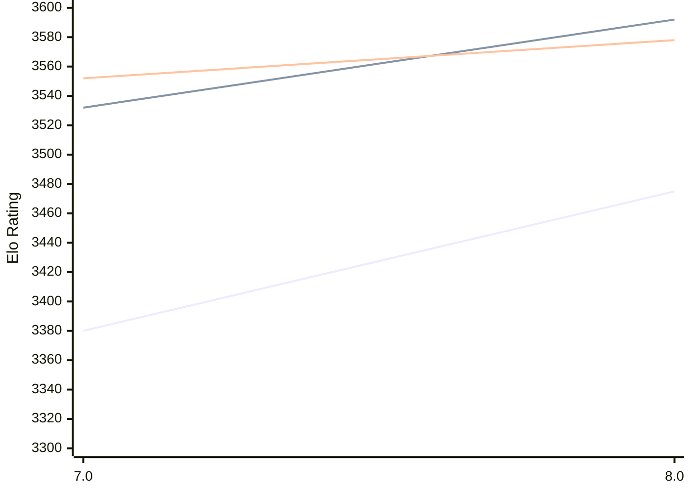

# Engine: Integral

Author: Aron Petkovski

Home: https://github.com/aronpetko/integral

## Elo Ratings E1 (Ultra 7 265T (1.50 GHz) - E-Core)

| Version | Published | STC 8.0+0.08s  | LTC 60.0+0.60s | VLTC 2m24s+1.12s | Comment |
| --- | --- | --- | --- | --- | --- |
| 8.0 | 2026-09-11 | 3507(+513) | 3708(+810) | 3741(+924) |  |
| 7.0 | 2025-02-14 | 2994 | 2898 | 2817 |  |
 | | | cElo (∆ prev) | cElo (∆ prev) | cElo (∆ prev) | 

## Elo Ratings P1 (Ultra 7 265T (1.50 GHz) - P-Core)

| Version | Published | STC 8.0+0.08s  | LTC 60.0+0.60s | VLTC 2m24s+1.12s | Comment |
| --- | --- | --- | --- | --- | --- |
| 8.0 | 2026-09-11 | 3645(+660) | 3787(+new) | 3812(+972) |  |
| 7.0 | 2025-02-14 | 2985 |  | 2840 |  |
 | | | cElo (∆ prev) | cElo (∆ prev) | cElo (∆ prev) | 

## Elo Ratings T1 (i5-7500T 2.70GHz)

| Version | Published | STC 8.0+0.08s  | LTC 60.0+0.60s | VLTC 2m24s+1.12s | Comment |
| --- | --- | --- | --- | --- | --- |
| 8.0 | 2026-09-11 | 3475(+95) | 3592(+60) | 3578(+26) |  |
| 7.0 | 2025-02-14 | 3380 | 3532 | 3552 |  |
 | | | cElo (∆ prev) | cElo (∆ prev) | cElo (∆ prev) | 

<a href="https://github.com/computer-chess-index/cci/issues/new?template=submit-version.yml&title=[VERSION]+Integral+<version>&body=###%20Engine%20name%0AIntegral%0A%0A###%20Version%0A8.0" target="_blank">Submit new version</a>

 Test Conditions:

GUI/CLI: <a href=https://github.com/cutechess/cutechess target="_blank">Cute-Chess</a> 
Elo Calculation: <a href=https://www.remi-coulom.fr/Bayesian-Elo/ target="_blank">Bayesian-Elo</a> 
CPU for P1: Intel(R) Core(TM) Ultra 7 265T (1.50 GHz) - P-Core 
CPU for E1: Intel(R) Core(TM) Ultra 7 265T (1.50 GHz) - E-Core 
CPU for T1: Intel(R) Core(TM) i5-7500T 2.70GHz 
Opening book: 8_moves_v3 
\* STC: 8.0+0.08s, LTC: 60.0+0.60s, VLTC: 2m24s+1.12s

 Lists:
Ratings: <a href=https://github.com/computer-chess-index/cci/blob/main/lists/CCIRatings.csv target="_blank">Complete list</a>

Generated: 2026-11-12 05:38:56

## Ratings Verlauf E1 / P1

## Ratings Verlauf T1

## Detailed Evaluation Results

| Version | Time Control | Variant | Elo  | Range +/- | Matches | Score | Average Opponent Elo | Draws |
| --- | --- |--- | --- | --- | --- | --- | --- | --- |
| 8.0 | VLTC (2m24s+1.12s) | E1 | 3741 | 26 | 336 | 51% | 3733 | 90% |
|  |  | T1 | 3578 | 34 | 190 | 51% | 3573 | 95% |
|  |  | P1 | 3812 | 36 | 178 | 51% | 3807 | 86% |
|  | LTC (60.0+0.60s) | E1 | 3708 | 32 | 224 | 50% | 3707 | 88% |
|  |  | T1 | 3592 | 39 | 148 | 51% | 3583 | 91% |
|  |  | P1 | 3787 | 37 | 164 | 50% | 3788 | 85% |
|  | STC (8.0+0.08s) | E1 | 3507 | 26 | 370 | 46% | 3536 | 72% |
|  |  | T1 | 3475 | 27 | 316 | 52% | 3463 | 82% |
|  |  | P1 | 3645 | 31 | 250 | 47% | 3664 | 79% |
| --- | --- |--- | --- | --- | --- | --- | --- | --- |
| 7.0 | VLTC (2m24s+1.12s) | P1 | 2840 | 190 | 4 | 50% | 2840 | 100% |
|  |  | T1 | 3552 | 15 | 1010 | 50% | 3552 | 87% |
|  |  | E1 | 2817 | 246 | 8 | 100% | 2373 | 0% |
|  | LTC (60.0+0.60s) | T1 | 3532 | 15 | 1012 | 50% | 3530 | 85% |
|  |  | E1 | 2898 | 147 | 8 | 50% | 2898 | 100% |
|  | STC (8.0+0.08s) | T1 | 3380 | 15 | 1158 | 50% | 3378 | 70% |
|  |  | E1 | 2994 | 222 | 4 | 25% | 3135 | 50% |
|  |  | P1 | 2985 | 262 | 4 | 100% | 2670 | 0% |