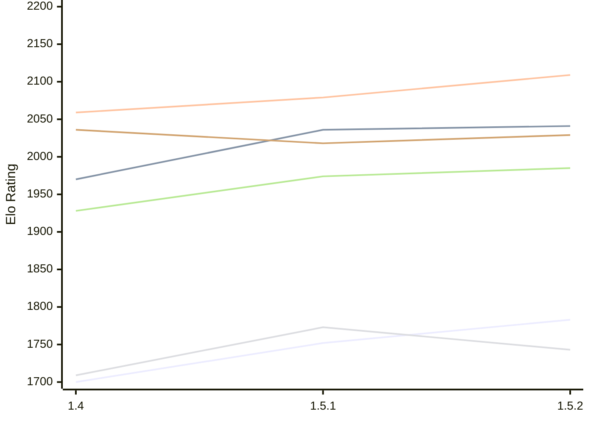

# Engine: Jace

Author: Glen Carbon

Home: https://github.com/jsgroby/jace

## Elo Ratings E1 (Ultra 7 265T (1.50 GHz) - E-Core)

| Version | Published | STC 8.0+0.08s  | LTC 60.0+0.60s | VLTC 2m24s+1.12s | Comment |
| --- | --- | --- | --- | --- | --- |
| 1.5.2 | 2026-11-16 | 1783(+31) | 2041(+5) | 2109(+30) |  |
| 1.5.1 | 2026-11-05 | 1752(+52) | 2036(+66) | 2079(+20) |  |
| 1.4 | 2026-10-15 | 1700 | 1970 | 2059 |  |
 | | | cElo (∆ prev) | cElo (∆ prev) | cElo (∆ prev) | 

## Elo Ratings P1 (Ultra 7 265T (1.50 GHz) - P-Core)

| Version | Published | STC 8.0+0.08s  | LTC 60.0+0.60s | VLTC 2m24s+1.12s | Comment |
| --- | --- | --- | --- | --- | --- |
| 1.5.2 | 2026-11-16 | 1743(-30) | 1985(+11) | 2029(+11) |  |
| 1.5.1 | 2026-11-05 | 1773(+64) | 1974(+46) | 2018(-18) |  |
| 1.4 | 2026-10-15 | 1709 | 1928 | 2036 |  |
 | | | cElo (∆ prev) | cElo (∆ prev) | cElo (∆ prev) | 

## Elo Ratings T1 (i5-7500T 2.70GHz)

| Version | Published | STC 8.0+0.08s  | LTC 60.0+0.60s | VLTC 2m24s+1.12s | Comment |
| --- | --- | --- | --- | --- | --- |
| 1.4 | 2026-10-15 | 1709 | 1928 | 2036 |  |
 | | | cElo (∆ prev) | cElo (∆ prev) | cElo (∆ prev) | 

<a href="https://github.com/computer-chess-index/cci/issues/new?template=submit-version.yml&title=[VERSION]+Jace+<version>&body=###%20Engine%20name%0AJace%0A%0A###%20Version%0A1.5.2" target="_blank">Submit new version</a>

 Test Conditions:

GUI/CLI: <a href=https://github.com/cutechess/cutechess target="_blank">Cute-Chess</a> 
Elo Calculation: <a href=https://www.remi-coulom.fr/Bayesian-Elo/ target="_blank">Bayesian-Elo</a> 
CPU for P1: Intel(R) Core(TM) Ultra 7 265T (1.50 GHz) - P-Core 
CPU for E1: Intel(R) Core(TM) Ultra 7 265T (1.50 GHz) - E-Core 
CPU for T1: Intel(R) Core(TM) i5-7500T 2.70GHz 
Opening book: 8_moves_v3 
\* STC: 8.0+0.08s, LTC: 60.0+0.60s, VLTC: 2m24s+1.12s

 Lists:
Ratings: <a href=https://github.com/computer-chess-index/cci/blob/main/lists/CCIRatings.csv target="_blank">Complete list</a>

Generated: 2026-11-24 05:39:18

## Ratings Verlauf E1 / P1

## Detailed Evaluation Results

| Version | Time Control | Variant | Elo  | Range +/- | Matches | Score | Average Opponent Elo | Draws |
| --- | --- |--- | --- | --- | --- | --- | --- | --- |
| 1.5.2 | VLTC (2m24s+1.12s) | E1 | 2109 | 43 | 192 | 45% | 2175 | 23% |
|  |  | P1 | 2029 | 45 | 176 | 51% | 2021 | 19% |
|  | LTC (60.0+0.60s) | P1 | 1985 | 58 | 96 | 50% | 1989 | 29% |
|  |  | E1 | 2041 | 36 | 286 | 44% | 2145 | 23% |
|  | STC (8.0+0.08s) | P1 | 1743 | 59 | 96 | 52% | 1720 | 25% |
|  |  | E1 | 1783 | 47 | 164 | 47% | 1810 | 20% |
| --- | --- |--- | --- | --- | --- | --- | --- | --- |
| 1.5.1 | VLTC (2m24s+1.12s) | P1 | 2018 | 40 | 244 | 44% | 2064 | 18% |
|  |  | E1 | 2079 | 33 | 344 | 46% | 2122 | 21% |
|  | LTC (60.0+0.60s) | P1 | 1974 | 44 | 178 | 48% | 1998 | 24% |
|  |  | E1 | 2036 | 38 | 256 | 51% | 2025 | 20% |
|  | STC (8.0+0.08s) | P1 | 1773 | 42 | 204 | 52% | 1755 | 20% |
|  |  | E1 | 1752 | 37 | 262 | 50% | 1752 | 18% |
| --- | --- |--- | --- | --- | --- | --- | --- | --- |
| 1.4 | VLTC (2m24s+1.12s) | P1 | 2036 | 60 | 100 | 52% | 2021 | 19% |
|  |  | E1 | 2059 | 44 | 186 | 53% | 2030 | 19% |
|  | LTC (60.0+0.60s) | P1 | 1928 | 66 | 76 | 47% | 1952 | 26% |
|  |  | E1 | 1970 | 36 | 274 | 53% | 1937 | 24% |
|  | STC (8.0+0.08s) | P1 | 1709 | 53 | 124 | 49% | 1721 | 20% |
|  |  | E1 | 1700 | 49 | 150 | 47% | 1724 | 17% |