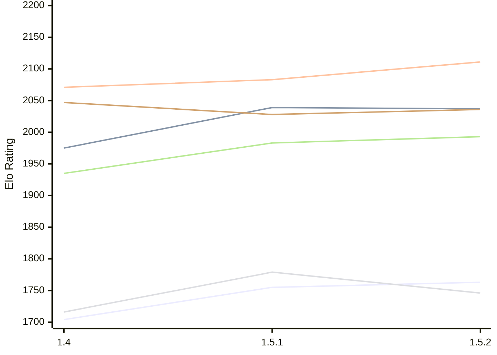

# Engine: Jace

Author: Glen Carbon

Home: https://github.com/jsgroby/jace

## Elo Ratings E1 (Ultra 7 265T (1.50 GHz) - E-Core)

| Version | Published | STC 8.0+0.08s  | LTC 60.0+0.60s | VLTC 2m24s+1.12s | Comment |
| --- | --- | --- | --- | --- | --- |
| 1.5.2 | 2026-11-16 | 1763(+8) | 2037(-2) | 2111(+28) |  |
| 1.5.1 | 2026-11-05 | 1755(+51) | 2039(+64) | 2083(+12) |  |
| 1.4 | 2026-10-15 | 1704 | 1975 | 2071 |  |
 | | | cElo (∆ prev) | cElo (∆ prev) | cElo (∆ prev) | 

## Elo Ratings P1 (Ultra 7 265T (1.50 GHz) - P-Core)

| Version | Published | STC 8.0+0.08s  | LTC 60.0+0.60s | VLTC 2m24s+1.12s | Comment |
| --- | --- | --- | --- | --- | --- |
| 1.5.2 | 2026-11-16 | 1746(-33) | 1993(+10) | 2036(+8) |  |
| 1.5.1 | 2026-11-05 | 1779(+63) | 1983(+48) | 2028(-19) |  |
| 1.4 | 2026-10-15 | 1716 | 1935 | 2047 |  |
 | | | cElo (∆ prev) | cElo (∆ prev) | cElo (∆ prev) | 

## Elo Ratings T1 (i5-7500T 2.70GHz)

| Version | Published | STC 8.0+0.08s  | LTC 60.0+0.60s | VLTC 2m24s+1.12s | Comment |
| --- | --- | --- | --- | --- | --- |
| 1.4 | 2026-10-15 | 1716 | 1935 | 2047 |  |
 | | | cElo (∆ prev) | cElo (∆ prev) | cElo (∆ prev) | 

<a href="https://github.com/computer-chess-index/cci/issues/new?template=submit-version.yml&title=[VERSION]+Jace+<version>&body=###%20Engine%20name%0AJace%0A%0A###%20Version%0A1.5.2" target="_blank">Submit new version</a>

 Test Conditions:

GUI/CLI: <a href=https://github.com/cutechess/cutechess target="_blank">Cute-Chess</a> 
Elo Calculation: <a href=https://www.remi-coulom.fr/Bayesian-Elo/ target="_blank">Bayesian-Elo</a> 
CPU for P1: Intel(R) Core(TM) Ultra 7 265T (1.50 GHz) - P-Core 
CPU for E1: Intel(R) Core(TM) Ultra 7 265T (1.50 GHz) - E-Core 
CPU for T1: Intel(R) Core(TM) i5-7500T 2.70GHz 
Opening book: 8_moves_v3 
\* STC: 8.0+0.08s, LTC: 60.0+0.60s, VLTC: 2m24s+1.12s

 Lists:
Ratings: <a href=https://github.com/computer-chess-index/cci/blob/main/lists/CCIRatings.csv target="_blank">Complete list</a>

Generated: 2026-11-28 05:39:24

## Ratings Verlauf E1 / P1

## Detailed Evaluation Results

| Version | Time Control | Variant | Elo  | Range +/- | Matches | Score | Average Opponent Elo | Draws |
| --- | --- |--- | --- | --- | --- | --- | --- | --- |
| 1.5.2 | VLTC (2m24s+1.12s) | P1 | 2036 | 45 | 176 | 51% | 2028 | 19% |
|  |  | E1 | 2111 | 43 | 196 | 45% | 2176 | 22% |
|  | LTC (60.0+0.60s) | P1 | 1993 | 57 | 100 | 50% | 1997 | 30% |
|  |  | E1 | 2037 | 36 | 292 | 43% | 2147 | 23% |
|  | STC (8.0+0.08s) | P1 | 1746 | 57 | 104 | 52% | 1724 | 23% |
|  |  | E1 | 1763 | 46 | 174 | 45% | 1813 | 18% |
| --- | --- |--- | --- | --- | --- | --- | --- | --- |
| 1.5.1 | VLTC (2m24s+1.12s) | E1 | 2083 | 33 | 344 | 46% | 2126 | 21% |
|  |  | P1 | 2028 | 40 | 244 | 44% | 2072 | 18% |
|  | LTC (60.0+0.60s) | E1 | 2039 | 38 | 256 | 51% | 2028 | 20% |
|  |  | P1 | 1983 | 44 | 178 | 48% | 2006 | 24% |
|  | STC (8.0+0.08s) | E1 | 1755 | 37 | 262 | 50% | 1755 | 18% |
|  |  | P1 | 1779 | 42 | 204 | 52% | 1760 | 20% |
| --- | --- |--- | --- | --- | --- | --- | --- | --- |
| 1.4 | VLTC (2m24s+1.12s) | P1 | 2047 | 56 | 112 | 51% | 2032 | 19% |
|  |  | E1 | 2071 | 42 | 202 | 53% | 2037 | 20% |
|  | LTC (60.0+0.60s) | P1 | 1935 | 56 | 108 | 49% | 1948 | 25% |
|  |  | E1 | 1975 | 35 | 282 | 54% | 1941 | 23% |
|  | STC (8.0+0.08s) | P1 | 1716 | 53 | 128 | 49% | 1727 | 20% |
|  |  | E1 | 1704 | 49 | 150 | 47% | 1729 | 17% |