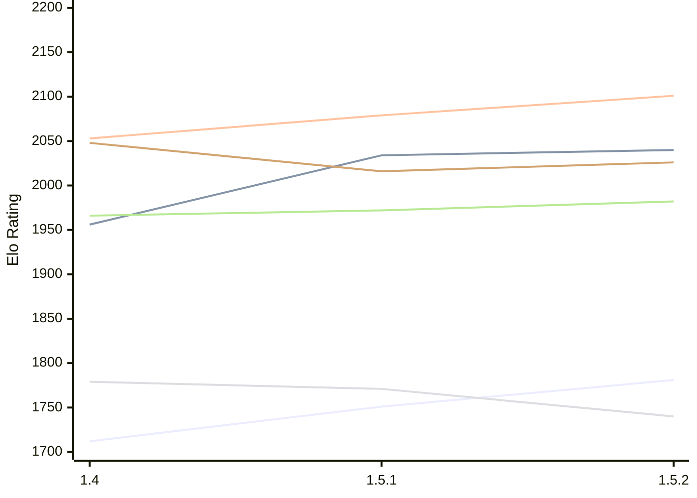

# Engine: Jace

Author: Glen Carbon

Home: https://github.com/jsgroby/jace

## Elo Ratings E1 (Ultra 7 265T (1.50 GHz) - E-Core)

| Version | Published | STC 8.0+0.08s  | LTC 60.0+0.60s | VLTC 2m24s+1.12s | Comment |
| --- | --- | --- | --- | --- | --- |
| 1.5.2 | 2026-11-16 | 1781(+30) | 2040(+6) | 2101(+22) |  |
| 1.5.1 | 2026-11-05 | 1751(+39) | 2034(+78) | 2079(+26) |  |
| 1.4 | 2026-10-15 | 1712 | 1956 | 2053 |  |
 | | | cElo (∆ prev) | cElo (∆ prev) | cElo (∆ prev) | 

## Elo Ratings P1 (Ultra 7 265T (1.50 GHz) - P-Core)

| Version | Published | STC 8.0+0.08s  | LTC 60.0+0.60s | VLTC 2m24s+1.12s | Comment |
| --- | --- | --- | --- | --- | --- |
| 1.5.2 | 2026-11-16 | 1740(-31) | 1982(+10) | 2026(+10) |  |
| 1.5.1 | 2026-11-05 | 1771(-8) | 1972(+6) | 2016(-32) |  |
| 1.4 | 2026-10-15 | 1779 | 1966 | 2048 |  |
 | | | cElo (∆ prev) | cElo (∆ prev) | cElo (∆ prev) | 

## Elo Ratings T1 (i5-7500T 2.70GHz)

| Version | Published | STC 8.0+0.08s  | LTC 60.0+0.60s | VLTC 2m24s+1.12s | Comment |
| --- | --- | --- | --- | --- | --- |
| 1.4 | 2026-10-15 | 1779 | 1966 | 2048 |  |
 | | | cElo (∆ prev) | cElo (∆ prev) | cElo (∆ prev) | 

<a href="https://github.com/computer-chess-index/cci/issues/new?template=submit-version.yml&title=[VERSION]+Jace+<version>&body=###%20Engine%20name%0AJace%0A%0A###%20Version%0A1.5.2" target="_blank">Submit new version</a>

 Test Conditions:

GUI/CLI: <a href=https://github.com/cutechess/cutechess target="_blank">Cute-Chess</a> 
Elo Calculation: <a href=https://www.remi-coulom.fr/Bayesian-Elo/ target="_blank">Bayesian-Elo</a> 
CPU for P1: Intel(R) Core(TM) Ultra 7 265T (1.50 GHz) - P-Core 
CPU for E1: Intel(R) Core(TM) Ultra 7 265T (1.50 GHz) - E-Core 
CPU for T1: Intel(R) Core(TM) i5-7500T 2.70GHz 
Opening book: 8_moves_v3 
\* STC: 8.0+0.08s, LTC: 60.0+0.60s, VLTC: 2m24s+1.12s

 Lists:
Ratings: <a href=https://github.com/computer-chess-index/cci/blob/main/lists/CCIRatings.csv target="_blank">Complete list</a>

Generated: 2026-11-23 05:39:16

## Ratings Verlauf E1 / P1

## Detailed Evaluation Results

| Version | Time Control | Variant | Elo  | Range +/- | Matches | Score | Average Opponent Elo | Draws |
| --- | --- |--- | --- | --- | --- | --- | --- | --- |
| 1.5.2 | VLTC (2m24s+1.12s) | P1 | 2026 | 45 | 176 | 51% | 2018 | 19% |
|  |  | E1 | 2101 | 44 | 188 | 44% | 2176 | 23% |
|  | LTC (60.0+0.60s) | P1 | 1982 | 58 | 96 | 50% | 1986 | 29% |
|  |  | E1 | 2040 | 36 | 286 | 44% | 2144 | 23% |
|  | STC (8.0+0.08s) | P1 | 1740 | 59 | 96 | 52% | 1717 | 25% |
|  |  | E1 | 1781 | 47 | 164 | 47% | 1808 | 20% |
| --- | --- |--- | --- | --- | --- | --- | --- | --- |
| 1.5.1 | VLTC (2m24s+1.12s) | P1 | 2016 | 40 | 244 | 44% | 2061 | 18% |
|  |  | E1 | 2079 | 33 | 344 | 46% | 2121 | 21% |
|  | LTC (60.0+0.60s) | P1 | 1972 | 44 | 178 | 48% | 1995 | 24% |
|  |  | E1 | 2034 | 38 | 256 | 51% | 2024 | 20% |
|  | STC (8.0+0.08s) | P1 | 1771 | 42 | 204 | 52% | 1752 | 20% |
|  |  | E1 | 1751 | 37 | 262 | 50% | 1750 | 18% |
| --- | --- |--- | --- | --- | --- | --- | --- | --- |
| 1.4 | VLTC (2m24s+1.12s) | P1 | 2048 | 74 | 64 | 54% | 2012 | 20% |
|  |  | E1 | 2053 | 45 | 178 | 53% | 2028 | 20% |
|  | LTC (60.0+0.60s) | P1 | 1966 | 72 | 64 | 52% | 1951 | 25% |
|  |  | E1 | 1956 | 36 | 262 | 52% | 1935 | 23% |
|  | STC (8.0+0.08s) | P1 | 1779 | 90 | 44 | 56% | 1723 | 16% |
|  |  | E1 | 1712 | 51 | 138 | 49% | 1721 | 17% |