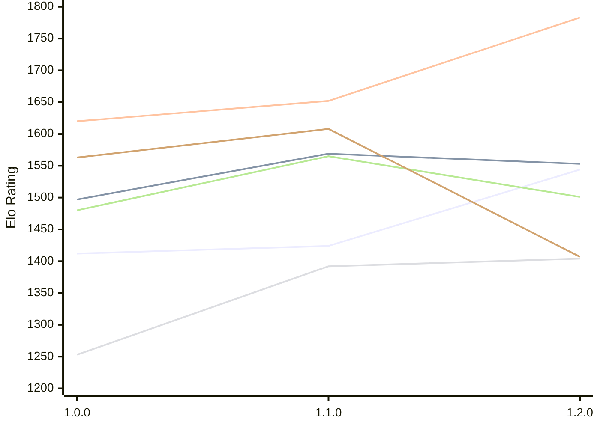

# Engine: Klak

Author: Daniele Marpino

Home: https://github.com/Spunc595/Klak

## Elo Ratings E1 (Ultra 7 265T (1.50 GHz) - E-Core)

| Version | Published | STC 8.0+0.08s  | LTC 60.0+0.60s | VLTC 2m24s+1.12s | Comment |
| --- | --- | --- | --- | --- | --- |
| 1.2.0 | 2026-11-14 | 1544(+120) | 1553(-16) | 1783(+131) |  |
| 1.1.0 | 2026-11-08 | 1424(+12) | 1569(+72) | 1652(+32) |  |
| 1.0.0 | 2026-11-06 | 1412 | 1497 | 1620 |  |
 | | | cElo (∆ prev) | cElo (∆ prev) | cElo (∆ prev) | 

## Elo Ratings P1 (Ultra 7 265T (1.50 GHz) - P-Core)

| Version | Published | STC 8.0+0.08s  | LTC 60.0+0.60s | VLTC 2m24s+1.12s | Comment |
| --- | --- | --- | --- | --- | --- |
| 1.2.0 | 2026-11-14 | 1404(+12) | 1501(-64) | 1407(-201) |  |
| 1.1.0 | 2026-11-08 | 1392(+139) | 1565(+85) | 1608(+45) |  |
| 1.0.0 | 2026-11-06 | 1253 | 1480 | 1563 |  |
 | | | cElo (∆ prev) | cElo (∆ prev) | cElo (∆ prev) | 

## Elo Ratings T1 (i5-7500T 2.70GHz)

| Version | Published | STC 8.0+0.08s  | LTC 60.0+0.60s | VLTC 2m24s+1.12s | Comment |
| --- | --- | --- | --- | --- | --- |
| 1.0.0 | 2026-11-06 | 1253 | 1480 | 1563 |  |
 | | | cElo (∆ prev) | cElo (∆ prev) | cElo (∆ prev) | 

<a href="https://github.com/computer-chess-index/cci/issues/new?template=submit-version.yml&title=[VERSION]+Klak+<version>&body=###%20Engine%20name%0AKlak%0A%0A###%20Version%0A1.2.0" target="_blank">Submit new version</a>

 Test Conditions:

GUI/CLI: <a href=https://github.com/cutechess/cutechess target="_blank">Cute-Chess</a> 
Elo Calculation: <a href=https://www.remi-coulom.fr/Bayesian-Elo/ target="_blank">Bayesian-Elo</a> 
CPU for P1: Intel(R) Core(TM) Ultra 7 265T (1.50 GHz) - P-Core 
CPU for E1: Intel(R) Core(TM) Ultra 7 265T (1.50 GHz) - E-Core 
CPU for T1: Intel(R) Core(TM) i5-7500T 2.70GHz 
Opening book: 8_moves_v3 
\* STC: 8.0+0.08s, LTC: 60.0+0.60s, VLTC: 2m24s+1.12s

 Lists:
Ratings: <a href=https://github.com/computer-chess-index/cci/blob/main/lists/CCIRatings.csv target="_blank">Complete list</a>

Generated: 2026-11-16 05:39:17

## Ratings Verlauf E1 / P1

## Detailed Evaluation Results

| Version | Time Control | Variant | Elo  | Range +/- | Matches | Score | Average Opponent Elo | Draws |
| --- | --- |--- | --- | --- | --- | --- | --- | --- |
| 1.2.0 | VLTC (2m24s+1.12s) | P1 | 1407 | 278 | 4 | 25% | 1607 | 0% |
|  |  | E1 | 1783 | 125 | 22 | 55% | 1747 | 18% |
|  | LTC (60.0+0.60s) | P1 | 1501 | 158 | 14 | 46% | 1535 | 7% |
|  |  | E1 | 1553 | 124 | 24 | 50% | 1553 | 8% |
|  | STC (8.0+0.08s) | P1 | 1404 | 168 | 12 | 46% | 1445 | 8% |
|  |  | E1 | 1544 | 116 | 24 | 58% | 1472 | 25% |
| --- | --- |--- | --- | --- | --- | --- | --- | --- |
| 1.1.0 | VLTC (2m24s+1.12s) | P1 | 1608 | 46 | 166 | 53% | 1570 | 19% |
|  |  | E1 | 1652 | 37 | 268 | 49% | 1666 | 19% |
|  | LTC (60.0+0.60s) | P1 | 1565 | 43 | 184 | 53% | 1538 | 24% |
|  |  | E1 | 1569 | 35 | 284 | 49% | 1574 | 23% |
|  | STC (8.0+0.08s) | P1 | 1392 | 38 | 246 | 58% | 1316 | 20% |
|  |  | E1 | 1424 | 38 | 252 | 47% | 1450 | 22% |
| --- | --- |--- | --- | --- | --- | --- | --- | --- |
| 1.0.0 | VLTC (2m24s+1.12s) | P1 | 1563 | 45 | 176 | 65% | 1357 | 36% |
|  |  | E1 | 1620 | 34 | 312 | 57% | 1482 | 34% |
|  | LTC (60.0+0.60s) | P1 | 1480 | 41 | 212 | 60% | 1338 | 31% |
|  |  | E1 | 1497 | 35 | 280 | 60% | 1350 | 41% |
|  | STC (8.0+0.08s) | E1 | 1412 | 34 | 304 | 60% | 1269 | 38% |
|  |  | P1 | 1253 | 42 | 196 | 65% | 1061 | 38% |