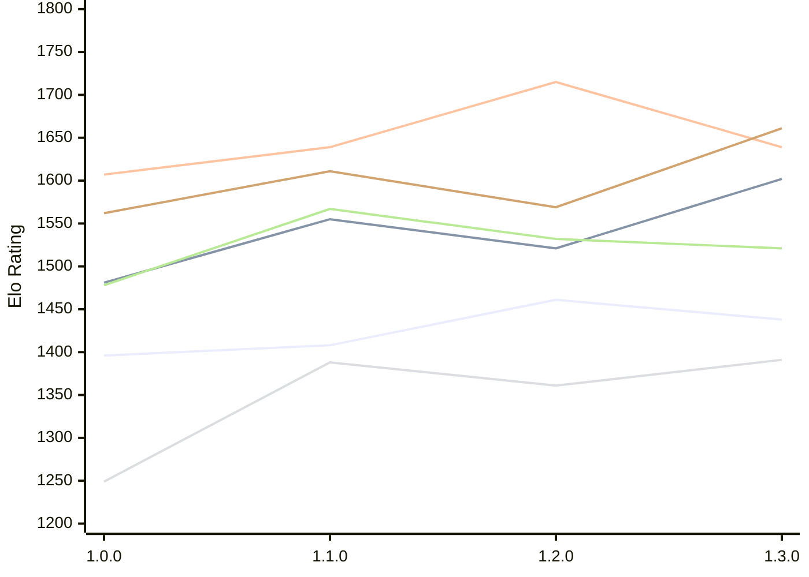

# Engine: Klak

Author: Daniele Marpino

Home: https://github.com/Spunc595/Klak

## Elo Ratings E1 (Ultra 7 265T (1.50 GHz) - E-Core)

| Version | Published | STC 8.0+0.08s  | LTC 60.0+0.60s | VLTC 2m24s+1.12s | Comment |
| --- | --- | --- | --- | --- | --- |
| 1.3.0 | 2026-11-16 | 1438(-23) | 1602(+81) | 1639(-76) |  |
| 1.2.0 | 2026-11-14 | 1461(+53) | 1521(-34) | 1715(+76) |  |
| 1.1.0 | 2026-11-08 | 1408(+12) | 1555(+74) | 1639(+32) |  |
| 1.0.0 | 2026-11-06 | 1396 | 1481 | 1607 |  |
 | | | cElo (∆ prev) | cElo (∆ prev) | cElo (∆ prev) | 

## Elo Ratings P1 (Ultra 7 265T (1.50 GHz) - P-Core)

| Version | Published | STC 8.0+0.08s  | LTC 60.0+0.60s | VLTC 2m24s+1.12s | Comment |
| --- | --- | --- | --- | --- | --- |
| 1.3.0 | 2026-11-16 | 1391(+30) | 1521(-11) | 1661(+92) |  |
| 1.2.0 | 2026-11-14 | 1361(-27) | 1532(-35) | 1569(-42) |  |
| 1.1.0 | 2026-11-08 | 1388(+139) | 1567(+89) | 1611(+49) |  |
| 1.0.0 | 2026-11-06 | 1249 | 1478 | 1562 |  |
 | | | cElo (∆ prev) | cElo (∆ prev) | cElo (∆ prev) | 

## Elo Ratings T1 (i5-7500T 2.70GHz)

| Version | Published | STC 8.0+0.08s  | LTC 60.0+0.60s | VLTC 2m24s+1.12s | Comment |
| --- | --- | --- | --- | --- | --- |
| 1.0.0 | 2026-11-06 | 1249 | 1478 | 1562 |  |
 | | | cElo (∆ prev) | cElo (∆ prev) | cElo (∆ prev) | 

<a href="https://github.com/computer-chess-index/cci/issues/new?template=submit-version.yml&title=[VERSION]+Klak+<version>&body=###%20Engine%20name%0AKlak%0A%0A###%20Version%0A1.3.0" target="_blank">Submit new version</a>

 Test Conditions:

GUI/CLI: <a href=https://github.com/cutechess/cutechess target="_blank">Cute-Chess</a> 
Elo Calculation: <a href=https://www.remi-coulom.fr/Bayesian-Elo/ target="_blank">Bayesian-Elo</a> 
CPU for P1: Intel(R) Core(TM) Ultra 7 265T (1.50 GHz) - P-Core 
CPU for E1: Intel(R) Core(TM) Ultra 7 265T (1.50 GHz) - E-Core 
CPU for T1: Intel(R) Core(TM) i5-7500T 2.70GHz 
Opening book: 8_moves_v3 
\* STC: 8.0+0.08s, LTC: 60.0+0.60s, VLTC: 2m24s+1.12s

 Lists:
Ratings: <a href=https://github.com/computer-chess-index/cci/blob/main/lists/CCIRatings.csv target="_blank">Complete list</a>

Generated: 2026-11-24 05:39:26

## Ratings Verlauf E1 / P1

## Detailed Evaluation Results

| Version | Time Control | Variant | Elo  | Range +/- | Matches | Score | Average Opponent Elo | Draws |
| --- | --- |--- | --- | --- | --- | --- | --- | --- |
| 1.3.0 | VLTC (2m24s+1.12s) | P1 | 1661 | 59 | 96 | 51% | 1654 | 26% |
|  |  | E1 | 1639 | 45 | 172 | 49% | 1654 | 24% |
|  | LTC (60.0+0.60s) | P1 | 1521 | 54 | 112 | 50% | 1517 | 29% |
|  |  | E1 | 1602 | 42 | 204 | 48% | 1625 | 22% |
|  | STC (8.0+0.08s) | P1 | 1391 | 63 | 84 | 51% | 1384 | 27% |
|  |  | E1 | 1438 | 43 | 186 | 44% | 1503 | 25% |
| --- | --- |--- | --- | --- | --- | --- | --- | --- |
| 1.2.0 | VLTC (2m24s+1.12s) | P1 | 1569 | 109 | 30 | 50% | 1563 | 13% |
|  |  | E1 | 1715 | 83 | 50 | 48% | 1733 | 20% |
|  | LTC (60.0+0.60s) | E1 | 1521 | 72 | 70 | 50% | 1523 | 14% |
|  |  | P1 | 1532 | 92 | 42 | 49% | 1542 | 17% |
|  | STC (8.0+0.08s) | E1 | 1461 | 72 | 64 | 50% | 1463 | 25% |
|  |  | P1 | 1361 | 101 | 32 | 47% | 1396 | 25% |
| --- | --- |--- | --- | --- | --- | --- | --- | --- |
| 1.1.0 | VLTC (2m24s+1.12s) | P1 | 1611 | 46 | 166 | 53% | 1573 | 19% |
|  |  | E1 | 1639 | 37 | 268 | 49% | 1652 | 19% |
|  | LTC (60.0+0.60s) | P1 | 1567 | 42 | 192 | 53% | 1540 | 24% |
|  |  | E1 | 1555 | 35 | 284 | 49% | 1561 | 23% |
|  | STC (8.0+0.08s) | P1 | 1388 | 38 | 250 | 57% | 1315 | 20% |
|  |  | E1 | 1408 | 38 | 252 | 47% | 1434 | 22% |
| --- | --- |--- | --- | --- | --- | --- | --- | --- |
| 1.0.0 | VLTC (2m24s+1.12s) | P1 | 1562 | 45 | 176 | 65% | 1355 | 36% |
|  |  | E1 | 1607 | 34 | 312 | 57% | 1469 | 34% |
|  | LTC (60.0+0.60s) | P1 | 1478 | 42 | 212 | 60% | 1337 | 31% |
|  |  | E1 | 1481 | 35 | 280 | 60% | 1334 | 41% |
|  | STC (8.0+0.08s) | P1 | 1249 | 42 | 196 | 65% | 1057 | 38% |
|  |  | E1 | 1396 | 34 | 304 | 60% | 1254 | 38% |