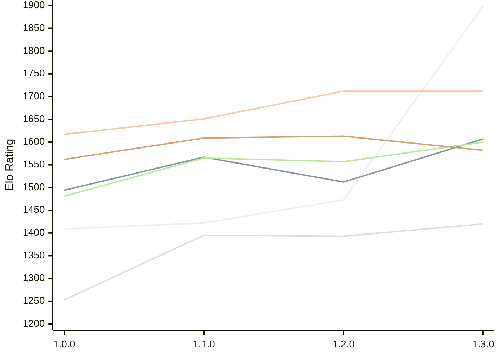

# Engine: Klak

Author: Daniele Marpino

Home: https://github.com/Spunc595/Klak

## Elo Ratings E1 (Ultra 7 265T (1.50 GHz) - E-Core)

| Version | Published | STC 8.0+0.08s  | LTC 60.0+0.60s | VLTC 2m24s+1.12s | Comment |
| --- | --- | --- | --- | --- | --- |
| 1.3.0 | 2026-11-16 | 1899(+426) | 1607(+95) | 1712(0) |  |
| 1.2.0 | 2026-11-14 | 1473(+51) | 1512(-55) | 1712(+61) |  |
| 1.1.0 | 2026-11-08 | 1422(+13) | 1567(+73) | 1651(+34) |  |
| 1.0.0 | 2026-11-06 | 1409 | 1494 | 1617 |  |
 | | | cElo (∆ prev) | cElo (∆ prev) | cElo (∆ prev) | 

## Elo Ratings P1 (Ultra 7 265T (1.50 GHz) - P-Core)

| Version | Published | STC 8.0+0.08s  | LTC 60.0+0.60s | VLTC 2m24s+1.12s | Comment |
| --- | --- | --- | --- | --- | --- |
| 1.3.0 | 2026-11-16 | 1420(+27) | 1600(+43) | 1582(-31) |  |
| 1.2.0 | 2026-11-14 | 1393(-2) | 1557(-8) | 1613(+4) |  |
| 1.1.0 | 2026-11-08 | 1395(+142) | 1565(+84) | 1609(+47) |  |
| 1.0.0 | 2026-11-06 | 1253 | 1481 | 1562 |  |
 | | | cElo (∆ prev) | cElo (∆ prev) | cElo (∆ prev) | 

## Elo Ratings T1 (i5-7500T 2.70GHz)

| Version | Published | STC 8.0+0.08s  | LTC 60.0+0.60s | VLTC 2m24s+1.12s | Comment |
| --- | --- | --- | --- | --- | --- |
| 1.0.0 | 2026-11-06 | 1253 | 1481 | 1562 |  |
 | | | cElo (∆ prev) | cElo (∆ prev) | cElo (∆ prev) | 

<a href="https://github.com/computer-chess-index/cci/issues/new?template=submit-version.yml&title=[VERSION]+Klak+<version>&body=###%20Engine%20name%0AKlak%0A%0A###%20Version%0A1.3.0" target="_blank">Submit new version</a>

 Test Conditions:

GUI/CLI: <a href=https://github.com/cutechess/cutechess target="_blank">Cute-Chess</a> 
Elo Calculation: <a href=https://www.remi-coulom.fr/Bayesian-Elo/ target="_blank">Bayesian-Elo</a> 
CPU for P1: Intel(R) Core(TM) Ultra 7 265T (1.50 GHz) - P-Core 
CPU for E1: Intel(R) Core(TM) Ultra 7 265T (1.50 GHz) - E-Core 
CPU for T1: Intel(R) Core(TM) i5-7500T 2.70GHz 
Opening book: 8_moves_v3 
\* STC: 8.0+0.08s, LTC: 60.0+0.60s, VLTC: 2m24s+1.12s

 Lists:
Ratings: <a href=https://github.com/computer-chess-index/cci/blob/main/lists/CCIRatings.csv target="_blank">Complete list</a>

Generated: 2026-11-17 05:39:25

## Ratings Verlauf E1 / P1

## Detailed Evaluation Results

| Version | Time Control | Variant | Elo  | Range +/- | Matches | Score | Average Opponent Elo | Draws |
| --- | --- |--- | --- | --- | --- | --- | --- | --- |
| 1.3.0 | VLTC (2m24s+1.12s) | P1 | 1582 | 268 | 4 | 50% | 1582 | 0% |
|  |  | E1 | 1712 | 268 | 4 | 50% | 1712 | 0% |
|  | LTC (60.0+0.60s) | P1 | 1600 | 238 | 4 | 38% | 1673 | 25% |
|  |  | E1 | 1607 | 250 | 4 | 63% | 1515 | 25% |
|  | STC (8.0+0.08s) | P1 | 1420 | 230 | 4 | 50% | 1420 | 50% |
|  |  | E1 | 1899 | 346 | 4 | 100% | 1458 | 0% |
| --- | --- |--- | --- | --- | --- | --- | --- | --- |
| 1.2.0 | VLTC (2m24s+1.12s) | P1 | 1613 | 161 | 14 | 61% | 1501 | 7% |
|  |  | E1 | 1712 | 87 | 46 | 47% | 1744 | 20% |
|  | LTC (60.0+0.60s) | E1 | 1512 | 84 | 54 | 47% | 1542 | 9% |
|  |  | P1 | 1557 | 113 | 26 | 52% | 1534 | 19% |
|  | STC (8.0+0.08s) | E1 | 1473 | 75 | 60 | 50% | 1476 | 23% |
|  |  | P1 | 1393 | 117 | 24 | 48% | 1415 | 21% |
| --- | --- |--- | --- | --- | --- | --- | --- | --- |
| 1.1.0 | VLTC (2m24s+1.12s) | P1 | 1609 | 46 | 166 | 53% | 1571 | 19% |
|  |  | E1 | 1651 | 37 | 268 | 49% | 1663 | 19% |
|  | LTC (60.0+0.60s) | P1 | 1565 | 42 | 192 | 53% | 1539 | 24% |
|  |  | E1 | 1567 | 35 | 284 | 49% | 1573 | 23% |
|  | STC (8.0+0.08s) | P1 | 1395 | 38 | 250 | 57% | 1322 | 20% |
|  |  | E1 | 1422 | 38 | 252 | 47% | 1447 | 22% |
| --- | --- |--- | --- | --- | --- | --- | --- | --- |
| 1.0.0 | VLTC (2m24s+1.12s) | P1 | 1562 | 45 | 176 | 65% | 1357 | 36% |
|  |  | E1 | 1617 | 34 | 312 | 57% | 1481 | 34% |
|  | LTC (60.0+0.60s) | P1 | 1481 | 41 | 212 | 60% | 1339 | 31% |
|  |  | E1 | 1494 | 35 | 280 | 60% | 1347 | 41% |
|  | STC (8.0+0.08s) | P1 | 1253 | 42 | 196 | 65% | 1061 | 38% |
|  |  | E1 | 1409 | 34 | 304 | 60% | 1266 | 38% |