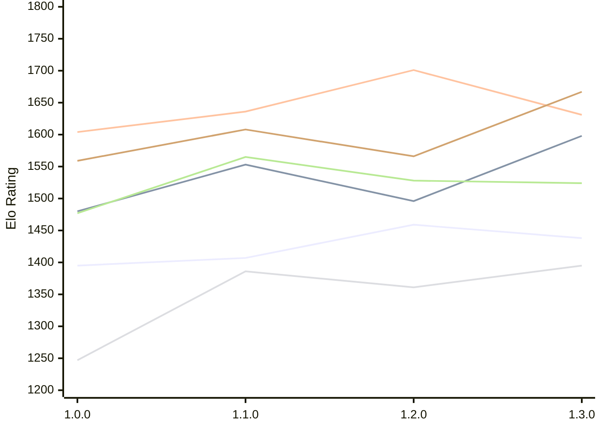

# Engine: Klak

Author: Daniele Marpino

Home: https://github.com/Spunc595/Klak

## Elo Ratings E1 (Ultra 7 265T (1.50 GHz) - E-Core)

| Version | Published | STC 8.0+0.08s  | LTC 60.0+0.60s | VLTC 2m24s+1.12s | Comment |
| --- | --- | --- | --- | --- | --- |
| 1.3.0 | 2026-11-16 | 1438(-21) | 1598(+102) | 1631(-70) |  |
| 1.2.0 | 2026-11-14 | 1459(+52) | 1496(-57) | 1701(+65) |  |
| 1.1.0 | 2026-11-08 | 1407(+12) | 1553(+73) | 1636(+32) |  |
| 1.0.0 | 2026-11-06 | 1395 | 1480 | 1604 |  |
 | | | cElo (∆ prev) | cElo (∆ prev) | cElo (∆ prev) | 

## Elo Ratings P1 (Ultra 7 265T (1.50 GHz) - P-Core)

| Version | Published | STC 8.0+0.08s  | LTC 60.0+0.60s | VLTC 2m24s+1.12s | Comment |
| --- | --- | --- | --- | --- | --- |
| 1.3.0 | 2026-11-16 | 1395(+34) | 1524(-4) | 1667(+101) |  |
| 1.2.0 | 2026-11-14 | 1361(-25) | 1528(-37) | 1566(-42) |  |
| 1.1.0 | 2026-11-08 | 1386(+139) | 1565(+88) | 1608(+49) |  |
| 1.0.0 | 2026-11-06 | 1247 | 1477 | 1559 |  |
 | | | cElo (∆ prev) | cElo (∆ prev) | cElo (∆ prev) | 

## Elo Ratings T1 (i5-7500T 2.70GHz)

| Version | Published | STC 8.0+0.08s  | LTC 60.0+0.60s | VLTC 2m24s+1.12s | Comment |
| --- | --- | --- | --- | --- | --- |
| 1.0.0 | 2026-11-06 | 1247 | 1477 | 1559 |  |
 | | | cElo (∆ prev) | cElo (∆ prev) | cElo (∆ prev) | 

<a href="https://github.com/computer-chess-index/cci/issues/new?template=submit-version.yml&title=[VERSION]+Klak+<version>&body=###%20Engine%20name%0AKlak%0A%0A###%20Version%0A1.3.0" target="_blank">Submit new version</a>

 Test Conditions:

GUI/CLI: <a href=https://github.com/cutechess/cutechess target="_blank">Cute-Chess</a> 
Elo Calculation: <a href=https://www.remi-coulom.fr/Bayesian-Elo/ target="_blank">Bayesian-Elo</a> 
CPU for P1: Intel(R) Core(TM) Ultra 7 265T (1.50 GHz) - P-Core 
CPU for E1: Intel(R) Core(TM) Ultra 7 265T (1.50 GHz) - E-Core 
CPU for T1: Intel(R) Core(TM) i5-7500T 2.70GHz 
Opening book: 8_moves_v3 
\* STC: 8.0+0.08s, LTC: 60.0+0.60s, VLTC: 2m24s+1.12s

 Lists:
Ratings: <a href=https://github.com/computer-chess-index/cci/blob/main/lists/CCIRatings.csv target="_blank">Complete list</a>

Generated: 2026-11-21 05:39:17

## Ratings Verlauf E1 / P1

## Detailed Evaluation Results

| Version | Time Control | Variant | Elo  | Range +/- | Matches | Score | Average Opponent Elo | Draws |
| --- | --- |--- | --- | --- | --- | --- | --- | --- |
| 1.3.0 | VLTC (2m24s+1.12s) | P1 | 1667 | 61 | 92 | 52% | 1650 | 25% |
|  |  | E1 | 1631 | 45 | 168 | 48% | 1652 | 23% |
|  | LTC (60.0+0.60s) | P1 | 1524 | 55 | 108 | 51% | 1516 | 30% |
|  |  | E1 | 1598 | 42 | 196 | 48% | 1624 | 22% |
|  | STC (8.0+0.08s) | P1 | 1395 | 64 | 80 | 51% | 1382 | 28% |
|  |  | E1 | 1438 | 45 | 174 | 43% | 1505 | 26% |
| --- | --- |--- | --- | --- | --- | --- | --- | --- |
| 1.2.0 | VLTC (2m24s+1.12s) | P1 | 1566 | 109 | 30 | 50% | 1561 | 13% |
|  |  | E1 | 1701 | 87 | 46 | 47% | 1733 | 20% |
|  | LTC (60.0+0.60s) | P1 | 1528 | 92 | 42 | 49% | 1538 | 17% |
|  |  | E1 | 1496 | 84 | 54 | 47% | 1526 | 9% |
|  | STC (8.0+0.08s) | E1 | 1459 | 75 | 60 | 50% | 1461 | 23% |
|  |  | P1 | 1361 | 101 | 32 | 47% | 1396 | 25% |
| --- | --- |--- | --- | --- | --- | --- | --- | --- |
| 1.1.0 | VLTC (2m24s+1.12s) | P1 | 1608 | 46 | 166 | 53% | 1570 | 19% |
|  |  | E1 | 1636 | 37 | 268 | 49% | 1650 | 19% |
|  | LTC (60.0+0.60s) | P1 | 1565 | 42 | 192 | 53% | 1538 | 24% |
|  |  | E1 | 1553 | 35 | 284 | 49% | 1558 | 23% |
|  | STC (8.0+0.08s) | P1 | 1386 | 38 | 250 | 57% | 1314 | 20% |
|  |  | E1 | 1407 | 38 | 252 | 47% | 1432 | 22% |
| --- | --- |--- | --- | --- | --- | --- | --- | --- |
| 1.0.0 | VLTC (2m24s+1.12s) | E1 | 1604 | 34 | 312 | 57% | 1467 | 34% |
|  |  | P1 | 1559 | 45 | 176 | 65% | 1354 | 36% |
|  | LTC (60.0+0.60s) | P1 | 1477 | 41 | 212 | 60% | 1337 | 31% |
|  |  | E1 | 1480 | 35 | 280 | 60% | 1332 | 41% |
|  | STC (8.0+0.08s) | P1 | 1247 | 42 | 196 | 65% | 1056 | 38% |
|  |  | E1 | 1395 | 34 | 304 | 60% | 1253 | 38% |