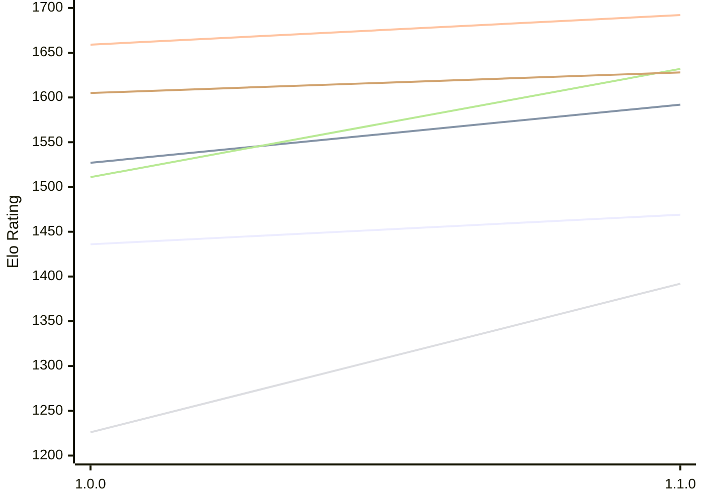

# Engine: Klak

Author: Daniele Marpino

Home: https://github.com/Spunc595/Klak

## Elo Ratings E1 (Ultra 7 265T (1.50 GHz) - E-Core)

| Version | Published | STC 8.0+0.08s  | LTC 60.0+0.60s | VLTC 2m24s+1.12s | Comment |
| --- | --- | --- | --- | --- | --- |
| 1.1.0 | 2026-11-08 | 1469(+33) | 1592(+65) | 1692(+33) |  |
| 1.0.0 | 2026-11-06 | 1436 | 1527 | 1659 |  |
 | | | cElo (∆ prev) | cElo (∆ prev) | cElo (∆ prev) | 

## Elo Ratings P1 (Ultra 7 265T (1.50 GHz) - P-Core)

| Version | Published | STC 8.0+0.08s  | LTC 60.0+0.60s | VLTC 2m24s+1.12s | Comment |
| --- | --- | --- | --- | --- | --- |
| 1.1.0 | 2026-11-08 | 1392(+166) | 1632(+121) | 1628(+23) |  |
| 1.0.0 | 2026-11-06 | 1226 | 1511 | 1605 |  |
 | | | cElo (∆ prev) | cElo (∆ prev) | cElo (∆ prev) | 

## Elo Ratings T1 (i5-7500T 2.70GHz)

| Version | Published | STC 8.0+0.08s  | LTC 60.0+0.60s | VLTC 2m24s+1.12s | Comment |
| --- | --- | --- | --- | --- | --- |
| 1.0.0 | 2026-11-06 | 1226 | 1511 | 1605 |  |
 | | | cElo (∆ prev) | cElo (∆ prev) | cElo (∆ prev) | 

<a href="https://github.com/computer-chess-index/cci/issues/new?template=submit-version.yml&title=[VERSION]+Klak+<version>&body=###%20Engine%20name%0AKlak%0A%0A###%20Version%0A1.1.0" target="_blank">Submit new version</a>

 Test Conditions:

GUI/CLI: <a href=https://github.com/cutechess/cutechess target="_blank">Cute-Chess</a> 
Elo Calculation: <a href=https://www.remi-coulom.fr/Bayesian-Elo/ target="_blank">Bayesian-Elo</a> 
CPU for P1: Intel(R) Core(TM) Ultra 7 265T (1.50 GHz) - P-Core 
CPU for E1: Intel(R) Core(TM) Ultra 7 265T (1.50 GHz) - E-Core 
CPU for T1: Intel(R) Core(TM) i5-7500T 2.70GHz 
Opening book: 8_moves_v3 
\* STC: 8.0+0.08s, LTC: 60.0+0.60s, VLTC: 2m24s+1.12s

 Lists:
Ratings: <a href=https://github.com/computer-chess-index/cci/blob/main/lists/CCIRatings.csv target="_blank">Complete list</a>

Generated: 2026-11-12 05:39:04

## Ratings Verlauf E1 / P1

## Detailed Evaluation Results

| Version | Time Control | Variant | Elo  | Range +/- | Matches | Score | Average Opponent Elo | Draws |
| --- | --- |--- | --- | --- | --- | --- | --- | --- |
| 1.1.0 | VLTC (2m24s+1.12s) | P1 | 1628 | 51 | 136 | 49% | 1638 | 20% |
|  |  | E1 | 1692 | 38 | 244 | 49% | 1705 | 20% |
|  | LTC (60.0+0.60s) | P1 | 1632 | 46 | 164 | 54% | 1593 | 26% |
|  |  | E1 | 1592 | 36 | 264 | 49% | 1601 | 22% |
|  | STC (8.0+0.08s) | P1 | 1392 | 39 | 234 | 56% | 1331 | 21% |
|  |  | E1 | 1469 | 39 | 228 | 48% | 1486 | 23% |
| --- | --- |--- | --- | --- | --- | --- | --- | --- |
| 1.0.0 | VLTC (2m24s+1.12s) | P1 | 1605 | 46 | 164 | 63% | 1405 | 37% |
|  |  | E1 | 1659 | 35 | 292 | 59% | 1501 | 34% |
|  | LTC (60.0+0.60s) | P1 | 1511 | 43 | 196 | 61% | 1361 | 32% |
|  |  | E1 | 1527 | 36 | 264 | 60% | 1377 | 42% |
|  | STC (8.0+0.08s) | P1 | 1226 | 48 | 156 | 65% | 1031 | 37% |
|  |  | E1 | 1436 | 36 | 272 | 61% | 1281 | 38% |