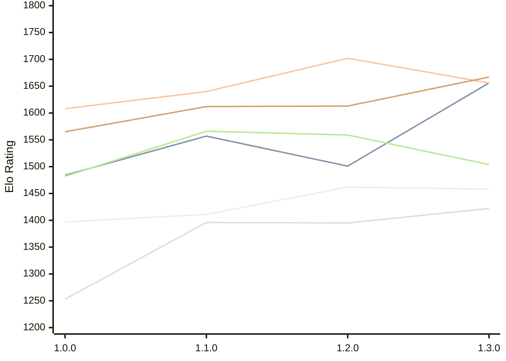

# Engine: Klak

Author: Daniele Marpino

Home: https://github.com/Spunc595/Klak

## Elo Ratings E1 (Ultra 7 265T (1.50 GHz) - E-Core)

| Version | Published | STC 8.0+0.08s  | LTC 60.0+0.60s | VLTC 2m24s+1.12s | Comment |
| --- | --- | --- | --- | --- | --- |
| 1.3.0 | 2026-11-16 | 1458(-4) | 1656(+155) | 1656(-46) |  |
| 1.2.0 | 2026-11-14 | 1462(+51) | 1501(-56) | 1702(+62) |  |
| 1.1.0 | 2026-11-08 | 1411(+14) | 1557(+73) | 1640(+32) |  |
| 1.0.0 | 2026-11-06 | 1397 | 1484 | 1608 |  |
 | | | cElo (∆ prev) | cElo (∆ prev) | cElo (∆ prev) | 

## Elo Ratings P1 (Ultra 7 265T (1.50 GHz) - P-Core)

| Version | Published | STC 8.0+0.08s  | LTC 60.0+0.60s | VLTC 2m24s+1.12s | Comment |
| --- | --- | --- | --- | --- | --- |
| 1.3.0 | 2026-11-16 | 1422(+27) | 1504(-55) | 1667(+54) |  |
| 1.2.0 | 2026-11-14 | 1395(-1) | 1559(-7) | 1613(+1) |  |
| 1.1.0 | 2026-11-08 | 1396(+143) | 1566(+84) | 1612(+47) |  |
| 1.0.0 | 2026-11-06 | 1253 | 1482 | 1565 |  |
 | | | cElo (∆ prev) | cElo (∆ prev) | cElo (∆ prev) | 

## Elo Ratings T1 (i5-7500T 2.70GHz)

| Version | Published | STC 8.0+0.08s  | LTC 60.0+0.60s | VLTC 2m24s+1.12s | Comment |
| --- | --- | --- | --- | --- | --- |
| 1.0.0 | 2026-11-06 | 1253 | 1482 | 1565 |  |
 | | | cElo (∆ prev) | cElo (∆ prev) | cElo (∆ prev) | 

<a href="https://github.com/computer-chess-index/cci/issues/new?template=submit-version.yml&title=[VERSION]+Klak+<version>&body=###%20Engine%20name%0AKlak%0A%0A###%20Version%0A1.3.0" target="_blank">Submit new version</a>

 Test Conditions:

GUI/CLI: <a href=https://github.com/cutechess/cutechess target="_blank">Cute-Chess</a> 
Elo Calculation: <a href=https://www.remi-coulom.fr/Bayesian-Elo/ target="_blank">Bayesian-Elo</a> 
CPU for P1: Intel(R) Core(TM) Ultra 7 265T (1.50 GHz) - P-Core 
CPU for E1: Intel(R) Core(TM) Ultra 7 265T (1.50 GHz) - E-Core 
CPU for T1: Intel(R) Core(TM) i5-7500T 2.70GHz 
Opening book: 8_moves_v3 
\* STC: 8.0+0.08s, LTC: 60.0+0.60s, VLTC: 2m24s+1.12s

 Lists:
Ratings: <a href=https://github.com/computer-chess-index/cci/blob/main/lists/CCIRatings.csv target="_blank">Complete list</a>

Generated: 2026-11-18 05:39:43

## Ratings Verlauf E1 / P1

## Detailed Evaluation Results

| Version | Time Control | Variant | Elo  | Range +/- | Matches | Score | Average Opponent Elo | Draws |
| --- | --- |--- | --- | --- | --- | --- | --- | --- |
| 1.3.0 | VLTC (2m24s+1.12s) | P1 | 1667 | 65 | 80 | 52% | 1647 | 24% |
|  |  | E1 | 1656 | 55 | 110 | 49% | 1666 | 25% |
|  | LTC (60.0+0.60s) | P1 | 1504 | 65 | 76 | 48% | 1521 | 33% |
|  |  | E1 | 1656 | 74 | 68 | 49% | 1667 | 13% |
|  | STC (8.0+0.08s) | P1 | 1422 | 190 | 8 | 50% | 1422 | 25% |
|  |  | E1 | 1458 | 59 | 102 | 40% | 1562 | 25% |
| --- | --- |--- | --- | --- | --- | --- | --- | --- |
| 1.2.0 | VLTC (2m24s+1.12s) | E1 | 1702 | 87 | 46 | 47% | 1735 | 20% |
|  |  | P1 | 1613 | 161 | 14 | 61% | 1501 | 7% |
|  | LTC (60.0+0.60s) | E1 | 1501 | 84 | 54 | 47% | 1531 | 9% |
|  |  | P1 | 1559 | 113 | 26 | 52% | 1538 | 19% |
|  | STC (8.0+0.08s) | E1 | 1462 | 75 | 60 | 50% | 1465 | 23% |
|  |  | P1 | 1395 | 117 | 24 | 48% | 1416 | 21% |
| --- | --- |--- | --- | --- | --- | --- | --- | --- |
| 1.1.0 | VLTC (2m24s+1.12s) | P1 | 1612 | 46 | 166 | 53% | 1574 | 19% |
|  |  | E1 | 1640 | 37 | 268 | 49% | 1654 | 19% |
|  | LTC (60.0+0.60s) | P1 | 1566 | 42 | 192 | 53% | 1540 | 24% |
|  |  | E1 | 1557 | 35 | 284 | 49% | 1562 | 23% |
|  | STC (8.0+0.08s) | P1 | 1396 | 38 | 250 | 57% | 1323 | 20% |
|  |  | E1 | 1411 | 38 | 252 | 47% | 1436 | 22% |
| --- | --- |--- | --- | --- | --- | --- | --- | --- |
| 1.0.0 | VLTC (2m24s+1.12s) | P1 | 1565 | 45 | 176 | 65% | 1359 | 36% |
|  |  | E1 | 1608 | 34 | 312 | 57% | 1470 | 34% |
|  | LTC (60.0+0.60s) | P1 | 1482 | 41 | 212 | 60% | 1341 | 31% |
|  |  | E1 | 1484 | 35 | 280 | 60% | 1337 | 41% |
|  | STC (8.0+0.08s) | P1 | 1253 | 42 | 196 | 65% | 1061 | 38% |
|  |  | E1 | 1397 | 34 | 304 | 60% | 1256 | 38% |