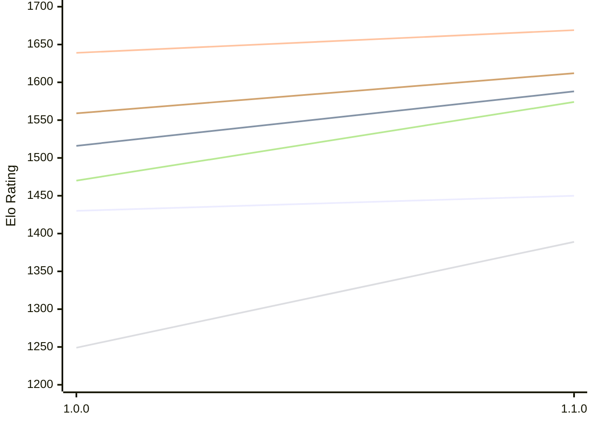

# Engine: Klak

Author: Daniele Marpino

Home: https://github.com/Spunc595/Klak

## Elo Ratings E1 (Ultra 7 265T (1.50 GHz) - E-Core)

| Version | Published | STC 8.0+0.08s  | LTC 60.0+0.60s | VLTC 2m24s+1.12s | Comment |
| --- | --- | --- | --- | --- | --- |
| 1.1.0 | 2026-11-08 | 1450(+20) | 1588(+72) | 1669(+30) |  |
| 1.0.0 | 2026-11-06 | 1430 | 1516 | 1639 |  |
 | | | cElo (∆ prev) | cElo (∆ prev) | cElo (∆ prev) | 

## Elo Ratings P1 (Ultra 7 265T (1.50 GHz) - P-Core)

| Version | Published | STC 8.0+0.08s  | LTC 60.0+0.60s | VLTC 2m24s+1.12s | Comment |
| --- | --- | --- | --- | --- | --- |
| 1.1.0 | 2026-11-08 | 1389(+140) | 1574(+104) | 1612(+53) |  |
| 1.0.0 | 2026-11-06 | 1249 | 1470 | 1559 |  |
 | | | cElo (∆ prev) | cElo (∆ prev) | cElo (∆ prev) | 

## Elo Ratings T1 (i5-7500T 2.70GHz)

| Version | Published | STC 8.0+0.08s  | LTC 60.0+0.60s | VLTC 2m24s+1.12s | Comment |
| --- | --- | --- | --- | --- | --- |
| 1.0.0 | 2026-11-06 | 1249 | 1470 | 1559 |  |
 | | | cElo (∆ prev) | cElo (∆ prev) | cElo (∆ prev) | 

<a href="https://github.com/computer-chess-index/cci/issues/new?template=submit-version.yml&title=[VERSION]+Klak+<version>&body=###%20Engine%20name%0AKlak%0A%0A###%20Version%0A1.1.0" target="_blank">Submit new version</a>

 Test Conditions:

GUI/CLI: <a href=https://github.com/cutechess/cutechess target="_blank">Cute-Chess</a> 
Elo Calculation: <a href=https://www.remi-coulom.fr/Bayesian-Elo/ target="_blank">Bayesian-Elo</a> 
CPU for P1: Intel(R) Core(TM) Ultra 7 265T (1.50 GHz) - P-Core 
CPU for E1: Intel(R) Core(TM) Ultra 7 265T (1.50 GHz) - E-Core 
CPU for T1: Intel(R) Core(TM) i5-7500T 2.70GHz 
Opening book: 8_moves_v3 
\* STC: 8.0+0.08s, LTC: 60.0+0.60s, VLTC: 2m24s+1.12s

 Lists:
Ratings: <a href=https://github.com/computer-chess-index/cci/blob/main/lists/CCIRatings.csv target="_blank">Complete list</a>

Generated: 2026-11-14 05:39:05

## Ratings Verlauf E1 / P1

## Detailed Evaluation Results

| Version | Time Control | Variant | Elo  | Range +/- | Matches | Score | Average Opponent Elo | Draws |
| --- | --- |--- | --- | --- | --- | --- | --- | --- |
| 1.1.0 | VLTC (2m24s+1.12s) | E1 | 1669 | 37 | 268 | 49% | 1682 | 19% |
|  |  | P1 | 1612 | 47 | 162 | 54% | 1569 | 18% |
|  | LTC (60.0+0.60s) | P1 | 1574 | 45 | 168 | 55% | 1531 | 26% |
|  |  | E1 | 1588 | 35 | 280 | 49% | 1592 | 23% |
|  | STC (8.0+0.08s) | P1 | 1389 | 39 | 242 | 57% | 1316 | 20% |
|  |  | E1 | 1450 | 38 | 240 | 48% | 1476 | 23% |
| --- | --- |--- | --- | --- | --- | --- | --- | --- |
| 1.0.0 | VLTC (2m24s+1.12s) | P1 | 1559 | 46 | 172 | 65% | 1354 | 35% |
|  |  | E1 | 1639 | 34 | 304 | 58% | 1494 | 34% |
|  | LTC (60.0+0.60s) | P1 | 1470 | 42 | 204 | 60% | 1334 | 32% |
|  |  | E1 | 1516 | 35 | 272 | 60% | 1365 | 42% |
|  | STC (8.0+0.08s) | P1 | 1249 | 45 | 180 | 66% | 1045 | 37% |
|  |  | E1 | 1430 | 34 | 300 | 60% | 1285 | 37% |