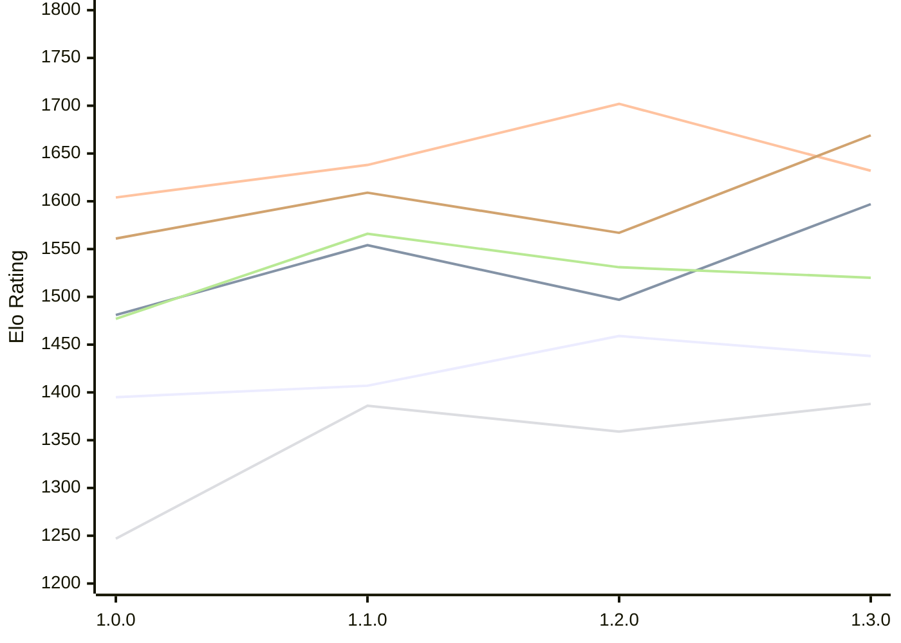

# Engine: Klak

Author: Daniele Marpino

Home: https://github.com/Spunc595/Klak

## Elo Ratings E1 (Ultra 7 265T (1.50 GHz) - E-Core)

| Version | Published | STC 8.0+0.08s  | LTC 60.0+0.60s | VLTC 2m24s+1.12s | Comment |
| --- | --- | --- | --- | --- | --- |
| 1.3.0 | 2026-11-16 | 1438(-21) | 1597(+100) | 1632(-70) |  |
| 1.2.0 | 2026-11-14 | 1459(+52) | 1497(-57) | 1702(+64) |  |
| 1.1.0 | 2026-11-08 | 1407(+12) | 1554(+73) | 1638(+34) |  |
| 1.0.0 | 2026-11-06 | 1395 | 1481 | 1604 |  |
 | | | cElo (∆ prev) | cElo (∆ prev) | cElo (∆ prev) | 

## Elo Ratings P1 (Ultra 7 265T (1.50 GHz) - P-Core)

| Version | Published | STC 8.0+0.08s  | LTC 60.0+0.60s | VLTC 2m24s+1.12s | Comment |
| --- | --- | --- | --- | --- | --- |
| 1.3.0 | 2026-11-16 | 1388(+29) | 1520(-11) | 1669(+102) |  |
| 1.2.0 | 2026-11-14 | 1359(-27) | 1531(-35) | 1567(-42) |  |
| 1.1.0 | 2026-11-08 | 1386(+139) | 1566(+89) | 1609(+48) |  |
| 1.0.0 | 2026-11-06 | 1247 | 1477 | 1561 |  |
 | | | cElo (∆ prev) | cElo (∆ prev) | cElo (∆ prev) | 

## Elo Ratings T1 (i5-7500T 2.70GHz)

| Version | Published | STC 8.0+0.08s  | LTC 60.0+0.60s | VLTC 2m24s+1.12s | Comment |
| --- | --- | --- | --- | --- | --- |
| 1.0.0 | 2026-11-06 | 1247 | 1477 | 1561 |  |
 | | | cElo (∆ prev) | cElo (∆ prev) | cElo (∆ prev) | 

<a href="https://github.com/computer-chess-index/cci/issues/new?template=submit-version.yml&title=[VERSION]+Klak+<version>&body=###%20Engine%20name%0AKlak%0A%0A###%20Version%0A1.3.0" target="_blank">Submit new version</a>

 Test Conditions:

GUI/CLI: <a href=https://github.com/cutechess/cutechess target="_blank">Cute-Chess</a> 
Elo Calculation: <a href=https://www.remi-coulom.fr/Bayesian-Elo/ target="_blank">Bayesian-Elo</a> 
CPU for P1: Intel(R) Core(TM) Ultra 7 265T (1.50 GHz) - P-Core 
CPU for E1: Intel(R) Core(TM) Ultra 7 265T (1.50 GHz) - E-Core 
CPU for T1: Intel(R) Core(TM) i5-7500T 2.70GHz 
Opening book: 8_moves_v3 
\* STC: 8.0+0.08s, LTC: 60.0+0.60s, VLTC: 2m24s+1.12s

 Lists:
Ratings: <a href=https://github.com/computer-chess-index/cci/blob/main/lists/CCIRatings.csv target="_blank">Complete list</a>

Generated: 2026-11-23 05:39:24

## Ratings Verlauf E1 / P1

## Detailed Evaluation Results

| Version | Time Control | Variant | Elo  | Range +/- | Matches | Score | Average Opponent Elo | Draws |
| --- | --- |--- | --- | --- | --- | --- | --- | --- |
| 1.3.0 | VLTC (2m24s+1.12s) | P1 | 1669 | 61 | 92 | 52% | 1651 | 25% |
|  |  | E1 | 1632 | 45 | 168 | 48% | 1654 | 23% |
|  | LTC (60.0+0.60s) | P1 | 1520 | 54 | 112 | 50% | 1516 | 29% |
|  |  | E1 | 1597 | 42 | 200 | 48% | 1624 | 22% |
|  | STC (8.0+0.08s) | P1 | 1388 | 63 | 84 | 51% | 1382 | 27% |
|  |  | E1 | 1438 | 45 | 174 | 43% | 1507 | 26% |
| --- | --- |--- | --- | --- | --- | --- | --- | --- |
| 1.2.0 | VLTC (2m24s+1.12s) | E1 | 1702 | 87 | 46 | 47% | 1735 | 20% |
|  |  | P1 | 1567 | 109 | 30 | 50% | 1562 | 13% |
|  | LTC (60.0+0.60s) | E1 | 1497 | 84 | 54 | 47% | 1528 | 9% |
|  |  | P1 | 1531 | 92 | 42 | 49% | 1540 | 17% |
|  | STC (8.0+0.08s) | P1 | 1359 | 101 | 32 | 47% | 1395 | 25% |
|  |  | E1 | 1459 | 75 | 60 | 50% | 1462 | 23% |
| --- | --- |--- | --- | --- | --- | --- | --- | --- |
| 1.1.0 | VLTC (2m24s+1.12s) | P1 | 1609 | 46 | 166 | 53% | 1571 | 19% |
|  |  | E1 | 1638 | 37 | 268 | 49% | 1651 | 19% |
|  | LTC (60.0+0.60s) | P1 | 1566 | 42 | 192 | 53% | 1539 | 24% |
|  |  | E1 | 1554 | 35 | 284 | 49% | 1559 | 23% |
|  | STC (8.0+0.08s) | P1 | 1386 | 38 | 250 | 57% | 1314 | 20% |
|  |  | E1 | 1407 | 38 | 252 | 47% | 1432 | 22% |
| --- | --- |--- | --- | --- | --- | --- | --- | --- |
| 1.0.0 | VLTC (2m24s+1.12s) | P1 | 1561 | 45 | 176 | 65% | 1354 | 36% |
|  |  | E1 | 1604 | 34 | 312 | 57% | 1467 | 34% |
|  | LTC (60.0+0.60s) | P1 | 1477 | 42 | 212 | 60% | 1337 | 31% |
|  |  | E1 | 1481 | 35 | 280 | 60% | 1334 | 41% |
|  | STC (8.0+0.08s) | P1 | 1247 | 42 | 196 | 65% | 1056 | 38% |
|  |  | E1 | 1395 | 34 | 304 | 60% | 1253 | 38% |