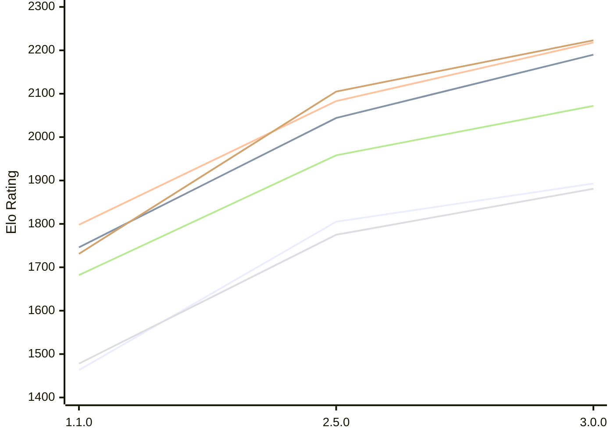

# Engine: KnightStalker

Author: Ted Summers

Home: https://github.com/tedsummers/KnightStalker

## Elo Ratings E1 (Ultra 7 265T (1.50 GHz) - E-Core)

| Version | Published | STC 8.0+0.08s  | LTC 60.0+0.60s | VLTC 2m24s+1.12s | Comment |
| --- | --- | --- | --- | --- | --- |
| 3.0.0 | 2026-11-26 | 1893(+88) | 2190(+146) | 2218(+135) |  |
| 2.5.0 | 2026-11-24 | 1805(+342) | 2044(+298) | 2083(+285) |  |
| 1.1.0 | 2026-11-15 | 1463 | 1746 | 1798 |  |
 | | | cElo (∆ prev) | cElo (∆ prev) | cElo (∆ prev) | 

## Elo Ratings P1 (Ultra 7 265T (1.50 GHz) - P-Core)

| Version | Published | STC 8.0+0.08s  | LTC 60.0+0.60s | VLTC 2m24s+1.12s | Comment |
| --- | --- | --- | --- | --- | --- |
| 3.0.0 | 2026-11-26 | 1881(+106) | 2072(+114) | 2223(+118) |  |
| 2.5.0 | 2026-11-24 | 1775(+297) | 1958(+276) | 2105(+374) |  |
| 1.1.0 | 2026-11-15 | 1478 | 1682 | 1731 |  |
 | | | cElo (∆ prev) | cElo (∆ prev) | cElo (∆ prev) | 

## Elo Ratings T1 (i5-7500T 2.70GHz)

| Version | Published | STC 8.0+0.08s  | LTC 60.0+0.60s | VLTC 2m24s+1.12s | Comment |
| --- | --- | --- | --- | --- | --- |
| 1.1.0 | 2026-11-15 | 1478 | 1682 | 1731 |  |
 | | | cElo (∆ prev) | cElo (∆ prev) | cElo (∆ prev) | 

<a href="https://github.com/computer-chess-index/cci/issues/new?template=submit-version.yml&title=[VERSION]+KnightStalker+<version>&body=###%20Engine%20name%0AKnightStalker%0A%0A###%20Version%0A3.0.0" target="_blank">Submit new version</a>

 Test Conditions:

GUI/CLI: <a href=https://github.com/cutechess/cutechess target="_blank">Cute-Chess</a> 
Elo Calculation: <a href=https://www.remi-coulom.fr/Bayesian-Elo/ target="_blank">Bayesian-Elo</a> 
CPU for P1: Intel(R) Core(TM) Ultra 7 265T (1.50 GHz) - P-Core 
CPU for E1: Intel(R) Core(TM) Ultra 7 265T (1.50 GHz) - E-Core 
CPU for T1: Intel(R) Core(TM) i5-7500T 2.70GHz 
Opening book: 8_moves_v3 
\* STC: 8.0+0.08s, LTC: 60.0+0.60s, VLTC: 2m24s+1.12s

 Lists:
Ratings: <a href=https://github.com/computer-chess-index/cci/blob/main/lists/CCIRatings.csv target="_blank">Complete list</a>

Generated: 2026-11-28 05:39:34

## Ratings Verlauf E1 / P1

## Detailed Evaluation Results

| Version | Time Control | Variant | Elo  | Range +/- | Matches | Score | Average Opponent Elo | Draws |
| --- | --- |--- | --- | --- | --- | --- | --- | --- |
| 3.0.0 | VLTC (2m24s+1.12s) | P1 | 2223 | 56 | 108 | 54% | 2188 | 26% |
|  |  | E1 | 2218 | 44 | 172 | 52% | 2195 | 31% |
|  | LTC (60.0+0.60s) | P1 | 2072 | 53 | 120 | 52% | 2053 | 28% |
|  |  | E1 | 2190 | 45 | 170 | 54% | 2148 | 26% |
|  | STC (8.0+0.08s) | P1 | 1881 | 42 | 192 | 47% | 1902 | 28% |
|  |  | E1 | 1893 | 45 | 172 | 51% | 1879 | 22% |
| --- | --- |--- | --- | --- | --- | --- | --- | --- |
| 2.5.0 | VLTC (2m24s+1.12s) | E1 | 2083 | 39 | 218 | 53% | 2057 | 28% |
|  |  | P1 | 2105 | 57 | 104 | 55% | 2060 | 29% |
|  | LTC (60.0+0.60s) | E1 | 2044 | 44 | 178 | 54% | 2003 | 28% |
|  |  | P1 | 1958 | 58 | 108 | 51% | 1948 | 20% |
|  | STC (8.0+0.08s) | E1 | 1805 | 43 | 192 | 48% | 1816 | 23% |
|  |  | P1 | 1775 | 62 | 98 | 53% | 1742 | 14% |
| --- | --- |--- | --- | --- | --- | --- | --- | --- |
| 1.1.0 | VLTC (2m24s+1.12s) | P1 | 1731 | 55 | 118 | 45% | 1796 | 24% |
|  |  | E1 | 1798 | 43 | 192 | 51% | 1809 | 20% |
|  | LTC (60.0+0.60s) | P1 | 1682 | 48 | 148 | 51% | 1674 | 26% |
|  |  | E1 | 1746 | 46 | 180 | 48% | 1794 | 19% |
|  | STC (8.0+0.08s) | P1 | 1478 | 50 | 148 | 43% | 1608 | 24% |
|  |  | E1 | 1463 | 44 | 196 | 46% | 1534 | 20% |