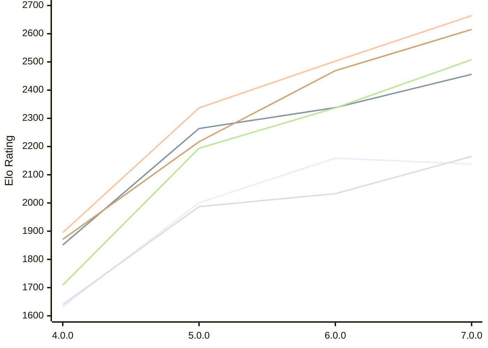
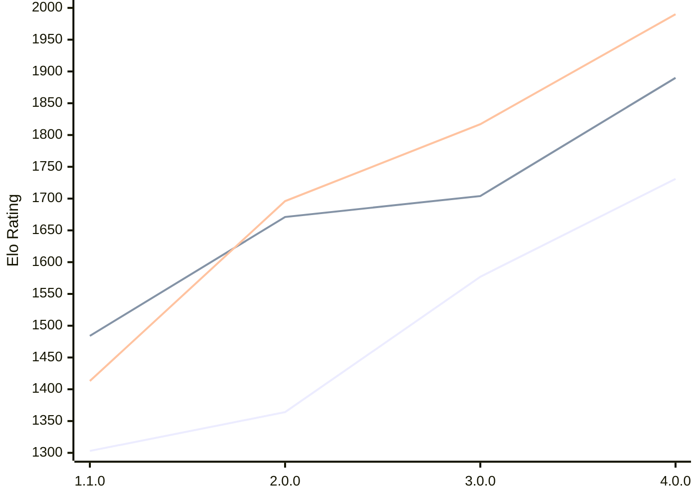

# Engine: Laura

Author: Hans Tibberio

Home: https://github.com/HansTibberio/Laura

## Elo Ratings E1 (Ultra 7 265T (1.50 GHz) - E-Core)

| Version | Published | STC 8.0+0.08s  | LTC 60.0+0.60s | VLTC 2m24s+1.12s | Comment |
| --- | --- | --- | --- | --- | --- |
| 7.0.0 | 2026-11-14 | 2138(-21) | 2456(+118) | 2664(+161) |  |
| 6.0.0 | 2026-11-12 | 2159(+158) | 2338(+74) | 2503(+166) |  |
| 5.0.0 | 2026-11-10 | 2001(+369) | 2264(+413) | 2337(+442) |  |
| 4.0.0 | 2026-05-09 | 1632 | 1851 | 1895 |  |
 | | | cElo (∆ prev) | cElo (∆ prev) | cElo (∆ prev) | 

## Elo Ratings P1 (Ultra 7 265T (1.50 GHz) - P-Core)

| Version | Published | STC 8.0+0.08s  | LTC 60.0+0.60s | VLTC 2m24s+1.12s | Comment |
| --- | --- | --- | --- | --- | --- |
| 7.0.0 | 2026-11-14 | 2165(+132) | 2508(+171) | 2615(+146) |  |
| 6.0.0 | 2026-11-12 | 2033(+46) | 2337(+143) | 2469(+252) |  |
| 5.0.0 | 2026-11-10 | 1987(+347) | 2194(+485) | 2217(+346) |  |
| 4.0.0 | 2026-05-09 | 1640 | 1709 | 1871 |  |
 | | | cElo (∆ prev) | cElo (∆ prev) | cElo (∆ prev) | 

## Elo Ratings T1 (i5-7500T 2.70GHz)

| Version | Published | STC 8.0+0.08s  | LTC 60.0+0.60s | VLTC 2m24s+1.12s | Comment |
| --- | --- | --- | --- | --- | --- |
| 4.0.0 | 2026-05-09 | 1731(+154) | 1890(+186) | 1990(+173) |  |
| 3.0.0 | 2026-04-29 | 1577(+213) | 1704(+33) | 1817(+121) |  |
| 2.0.0 | 2026-04-23 | 1364(+61) | 1671(+187) | 1696(+283) |  |
| 1.1.0 | 2026-01-26 | 1303 | 1484 | 1413 |  |
 | | | cElo (∆ prev) | cElo (∆ prev) | cElo (∆ prev) | 

<a href="https://github.com/computer-chess-index/cci/issues/new?template=submit-version.yml&title=[VERSION]+Laura+<version>&body=###%20Engine%20name%0ALaura%0A%0A###%20Version%0A4.0.0" target="_blank">Submit new version</a>

 Test Conditions:

GUI/CLI: <a href=https://github.com/cutechess/cutechess target="_blank">Cute-Chess</a> 
Elo Calculation: <a href=https://www.remi-coulom.fr/Bayesian-Elo/ target="_blank">Bayesian-Elo</a> 
CPU for P1: Intel(R) Core(TM) Ultra 7 265T (1.50 GHz) - P-Core 
CPU for E1: Intel(R) Core(TM) Ultra 7 265T (1.50 GHz) - E-Core 
CPU for T1: Intel(R) Core(TM) i5-7500T 2.70GHz 
Opening book: 8_moves_v3 
\* STC: 8.0+0.08s, LTC: 60.0+0.60s, VLTC: 2m24s+1.12s

 Lists:
Ratings: <a href=https://github.com/computer-chess-index/cci/blob/main/lists/CCIRatings.csv target="_blank">Complete list</a>

Generated: 2026-11-23 05:39:42

## Ratings Verlauf E1 / P1

## Ratings Verlauf T1

## Detailed Evaluation Results

| Version | Time Control | Variant | Elo  | Range +/- | Matches | Score | Average Opponent Elo | Draws |
| --- | --- |--- | --- | --- | --- | --- | --- | --- |
| 7.0.0 | VLTC (2m24s+1.12s) | P1 | 2615 | 53 | 126 | 45% | 2662 | 22% |
|  |  | E1 | 2664 | 46 | 172 | 56% | 2608 | 19% |
|  | LTC (60.0+0.60s) | P1 | 2508 | 58 | 98 | 49% | 2514 | 27% |
|  |  | E1 | 2456 | 49 | 150 | 52% | 2438 | 19% |
|  | STC (8.0+0.08s) | P1 | 2165 | 70 | 68 | 52% | 2145 | 25% |
|  |  | E1 | 2138 | 55 | 124 | 50% | 2129 | 17% |
| --- | --- |--- | --- | --- | --- | --- | --- | --- |
| 6.0.0 | VLTC (2m24s+1.12s) | P1 | 2469 | 64 | 86 | 53% | 2438 | 21% |
|  |  | E1 | 2503 | 62 | 92 | 51% | 2489 | 20% |
|  | LTC (60.0+0.60s) | P1 | 2337 | 60 | 92 | 47% | 2365 | 27% |
|  |  | E1 | 2338 | 60 | 92 | 47% | 2368 | 25% |
|  | STC (8.0+0.08s) | P1 | 2033 | 104 | 32 | 52% | 2020 | 16% |
|  |  | E1 | 2159 | 68 | 72 | 53% | 2121 | 28% |
| --- | --- |--- | --- | --- | --- | --- | --- | --- |
| 5.0.0 | VLTC (2m24s+1.12s) | P1 | 2217 | 69 | 72 | 49% | 2221 | 24% |
|  |  | E1 | 2337 | 54 | 120 | 48% | 2354 | 22% |
|  | LTC (60.0+0.60s) | P1 | 2194 | 77 | 68 | 61% | 2072 | 10% |
|  |  | E1 | 2264 | 55 | 122 | 54% | 2192 | 23% |
|  | STC (8.0+0.08s) | P1 | 1987 | 85 | 50 | 55% | 1932 | 18% |
|  |  | E1 | 2001 | 60 | 106 | 53% | 1943 | 17% |
| --- | --- |--- | --- | --- | --- | --- | --- | --- |
| 4.0.0 | VLTC (2m24s+1.12s) | T1 | 1990 | 39 | 238 | 50% | 1995 | 19% |
|  |  | P1 | 1871 | 59 | 116 | 41% | 2016 | 16% |
|  |  | E1 | 1895 | 46 | 192 | 42% | 2040 | 16% |
|  | LTC (60.0+0.60s) | T1 | 1890 | 38 | 268 | 48% | 1910 | 13% |
|  |  | P1 | 1709 | 67 | 100 | 38% | 1914 | 12% |
|  |  | E1 | 1851 | 49 | 168 | 49% | 1901 | 15% |
|  | STC (8.0+0.08s) | T1 | 1731 | 37 | 280 | 51% | 1725 | 14% |
|  |  | P1 | 1640 | 72 | 92 | 39% | 1856 | 9% |
|  |  | E1 | 1632 | 50 | 170 | 48% | 1737 | 15% |
| --- | --- |--- | --- | --- | --- | --- | --- | --- |
| 3.0.0 | VLTC (2m24s+1.12s) | T1 | 1817 | 51 | 152 | 50% | 1797 | 13% |
|  | LTC (60.0+0.60s) | T1 | 1704 | 53 | 136 | 50% | 1712 | 15% |
|  | STC (8.0+0.08s) | T1 | 1577 | 54 | 126 | 49% | 1585 | 21% |
| --- | --- |--- | --- | --- | --- | --- | --- | --- |
| 2.0.0 | VLTC (2m24s+1.12s) | T1 | 1696 | 56 | 98 | 53% | 1675 | 45% |
|  | LTC (60.0+0.60s) | T1 | 1671 | 55 | 104 | 48% | 1698 | 39% |
|  | STC (8.0+0.08s) | T1 | 1364 | 56 | 108 | 55% | 1293 | 37% |
| --- | --- |--- | --- | --- | --- | --- | --- | --- |
| 1.1.0 | VLTC (2m24s+1.12s) | T1 | 1413 | 52 | 132 | 43% | 1589 | 37% |
|  | LTC (60.0+0.60s) | T1 | 1484 | 51 | 134 | 43% | 1611 | 34% |
|  | STC (8.0+0.08s) | T1 | 1303 | 62 | 134 | 47% | 1347 | 25% |