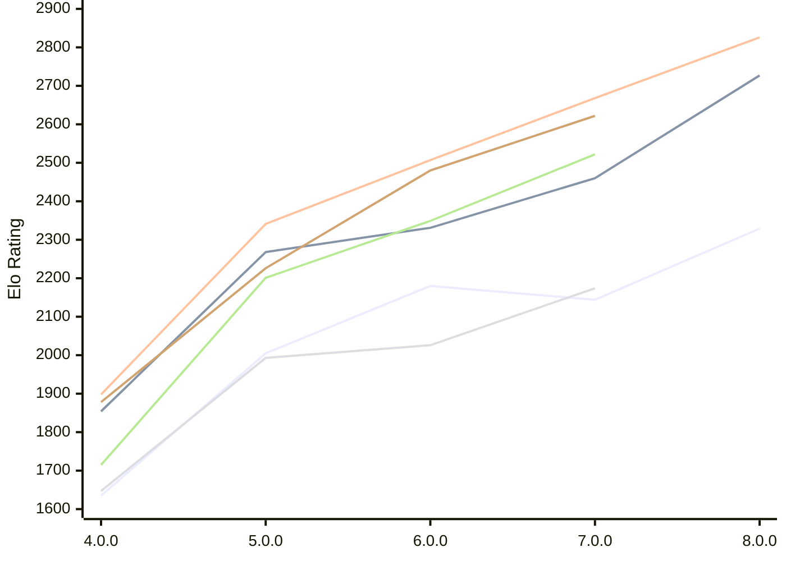
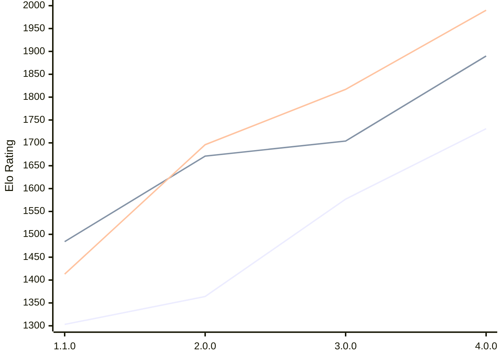

# Engine: Laura

Author: Hans Tibberio

Home: https://github.com/HansTibberio/Laura

## Elo Ratings E1 (Ultra 7 265T (1.50 GHz) - E-Core)

| Version | Published | STC 8.0+0.08s  | LTC 60.0+0.60s | VLTC 2m24s+1.12s | Comment |
| --- | --- | --- | --- | --- | --- |
| 8.0.0 | 2026-11-22 | 2329(+185) | 2727(+267) | 2826(+158) |  |
| 7.0.0 | 2026-11-14 | 2144(-36) | 2460(+129) | 2668(+161) |  |
| 6.0.0 | 2026-11-12 | 2180(+175) | 2331(+63) | 2507(+166) |  |
| 5.0.0 | 2026-11-10 | 2005(+370) | 2268(+414) | 2341(+443) |  |
| 4.0.0 | 2026-05-09 | 1635 | 1854 | 1898 |  |
 | | | cElo (∆ prev) | cElo (∆ prev) | cElo (∆ prev) | 

## Elo Ratings P1 (Ultra 7 265T (1.50 GHz) - P-Core)

| Version | Published | STC 8.0+0.08s  | LTC 60.0+0.60s | VLTC 2m24s+1.12s | Comment |
| --- | --- | --- | --- | --- | --- |
| 7.0.0 | 2026-11-14 | 2174(+148) | 2522(+173) | 2622(+142) |  |
| 6.0.0 | 2026-11-12 | 2026(+33) | 2349(+148) | 2480(+254) |  |
| 5.0.0 | 2026-11-10 | 1993(+346) | 2201(+486) | 2226(+348) |  |
| 4.0.0 | 2026-05-09 | 1647 | 1715 | 1878 |  |
 | | | cElo (∆ prev) | cElo (∆ prev) | cElo (∆ prev) | 

## Elo Ratings T1 (i5-7500T 2.70GHz)

| Version | Published | STC 8.0+0.08s  | LTC 60.0+0.60s | VLTC 2m24s+1.12s | Comment |
| --- | --- | --- | --- | --- | --- |
| 4.0.0 | 2026-05-09 | 1731(+154) | 1890(+186) | 1990(+173) |  |
| 3.0.0 | 2026-04-29 | 1577(+213) | 1704(+33) | 1817(+121) |  |
| 2.0.0 | 2026-04-23 | 1364(+61) | 1671(+187) | 1696(+283) |  |
| 1.1.0 | 2026-01-26 | 1303 | 1484 | 1413 |  |
 | | | cElo (∆ prev) | cElo (∆ prev) | cElo (∆ prev) | 

<a href="https://github.com/computer-chess-index/cci/issues/new?template=submit-version.yml&title=[VERSION]+Laura+<version>&body=###%20Engine%20name%0ALaura%0A%0A###%20Version%0A4.0.0" target="_blank">Submit new version</a>

 Test Conditions:

GUI/CLI: <a href=https://github.com/cutechess/cutechess target="_blank">Cute-Chess</a> 
Elo Calculation: <a href=https://www.remi-coulom.fr/Bayesian-Elo/ target="_blank">Bayesian-Elo</a> 
CPU for P1: Intel(R) Core(TM) Ultra 7 265T (1.50 GHz) - P-Core 
CPU for E1: Intel(R) Core(TM) Ultra 7 265T (1.50 GHz) - E-Core 
CPU for T1: Intel(R) Core(TM) i5-7500T 2.70GHz 
Opening book: 8_moves_v3 
\* STC: 8.0+0.08s, LTC: 60.0+0.60s, VLTC: 2m24s+1.12s

 Lists:
Ratings: <a href=https://github.com/computer-chess-index/cci/blob/main/lists/CCIRatings.csv target="_blank">Complete list</a>

Generated: 2026-11-25 05:39:49

## Ratings Verlauf E1 / P1

## Ratings Verlauf T1

## Detailed Evaluation Results

| Version | Time Control | Variant | Elo  | Range +/- | Matches | Score | Average Opponent Elo | Draws |
| --- | --- |--- | --- | --- | --- | --- | --- | --- |
| 8.0.0 | VLTC (2m24s+1.12s) | E1 | 2826 | 76 | 58 | 60% | 2727 | 28% |
|  | LTC (60.0+0.60s) | E1 | 2727 | 83 | 52 | 47% | 2730 | 21% |
|  | STC (8.0+0.08s) | E1 | 2329 | 86 | 44 | 55% | 2287 | 27% |
| --- | --- |--- | --- | --- | --- | --- | --- | --- |
| 7.0.0 | VLTC (2m24s+1.12s) | P1 | 2622 | 52 | 130 | 45% | 2672 | 22% |
|  |  | E1 | 2668 | 46 | 172 | 56% | 2612 | 19% |
|  | LTC (60.0+0.60s) | E1 | 2460 | 48 | 154 | 52% | 2441 | 20% |
|  |  | P1 | 2522 | 55 | 110 | 49% | 2527 | 25% |
|  | STC (8.0+0.08s) | E1 | 2144 | 53 | 128 | 50% | 2134 | 18% |
|  |  | P1 | 2174 | 70 | 68 | 52% | 2153 | 25% |
| --- | --- |--- | --- | --- | --- | --- | --- | --- |
| 6.0.0 | VLTC (2m24s+1.12s) | P1 | 2480 | 64 | 86 | 53% | 2448 | 21% |
|  |  | E1 | 2507 | 62 | 92 | 51% | 2493 | 20% |
|  | LTC (60.0+0.60s) | P1 | 2349 | 60 | 92 | 47% | 2376 | 27% |
|  |  | E1 | 2331 | 60 | 96 | 46% | 2371 | 24% |
|  | STC (8.0+0.08s) | P1 | 2026 | 94 | 40 | 50% | 2026 | 15% |
|  |  | E1 | 2180 | 65 | 82 | 54% | 2129 | 26% |
| --- | --- |--- | --- | --- | --- | --- | --- | --- |
| 5.0.0 | VLTC (2m24s+1.12s) | P1 | 2226 | 69 | 72 | 49% | 2230 | 24% |
|  |  | E1 | 2341 | 54 | 120 | 48% | 2357 | 22% |
|  | LTC (60.0+0.60s) | P1 | 2201 | 77 | 68 | 61% | 2080 | 10% |
|  |  | E1 | 2268 | 55 | 122 | 54% | 2198 | 23% |
|  | STC (8.0+0.08s) | P1 | 1993 | 85 | 50 | 55% | 1937 | 18% |
|  |  | E1 | 2005 | 60 | 106 | 53% | 1947 | 17% |
| --- | --- |--- | --- | --- | --- | --- | --- | --- |
| 4.0.0 | VLTC (2m24s+1.12s) | E1 | 1898 | 46 | 192 | 42% | 2044 | 16% |
|  |  | T1 | 1990 | 39 | 238 | 50% | 1995 | 19% |
|  |  | P1 | 1878 | 59 | 116 | 41% | 2024 | 16% |
|  | LTC (60.0+0.60s) | E1 | 1854 | 49 | 168 | 49% | 1904 | 15% |
|  |  | T1 | 1890 | 38 | 268 | 48% | 1910 | 13% |
|  |  | P1 | 1715 | 67 | 100 | 38% | 1921 | 12% |
|  | STC (8.0+0.08s) | T1 | 1731 | 37 | 280 | 51% | 1725 | 14% |
|  |  | P1 | 1647 | 72 | 92 | 39% | 1862 | 9% |
|  |  | E1 | 1635 | 50 | 170 | 48% | 1740 | 15% |
| --- | --- |--- | --- | --- | --- | --- | --- | --- |
| 3.0.0 | VLTC (2m24s+1.12s) | T1 | 1817 | 51 | 152 | 50% | 1797 | 13% |
|  | LTC (60.0+0.60s) | T1 | 1704 | 53 | 136 | 50% | 1712 | 15% |
|  | STC (8.0+0.08s) | T1 | 1577 | 54 | 126 | 49% | 1585 | 21% |
| --- | --- |--- | --- | --- | --- | --- | --- | --- |
| 2.0.0 | VLTC (2m24s+1.12s) | T1 | 1696 | 56 | 98 | 53% | 1675 | 45% |
|  | LTC (60.0+0.60s) | T1 | 1671 | 55 | 104 | 48% | 1698 | 39% |
|  | STC (8.0+0.08s) | T1 | 1364 | 56 | 108 | 55% | 1293 | 37% |
| --- | --- |--- | --- | --- | --- | --- | --- | --- |
| 1.1.0 | VLTC (2m24s+1.12s) | T1 | 1413 | 52 | 132 | 43% | 1589 | 37% |
|  | LTC (60.0+0.60s) | T1 | 1484 | 51 | 134 | 43% | 1611 | 34% |
|  | STC (8.0+0.08s) | T1 | 1303 | 62 | 134 | 47% | 1347 | 25% |