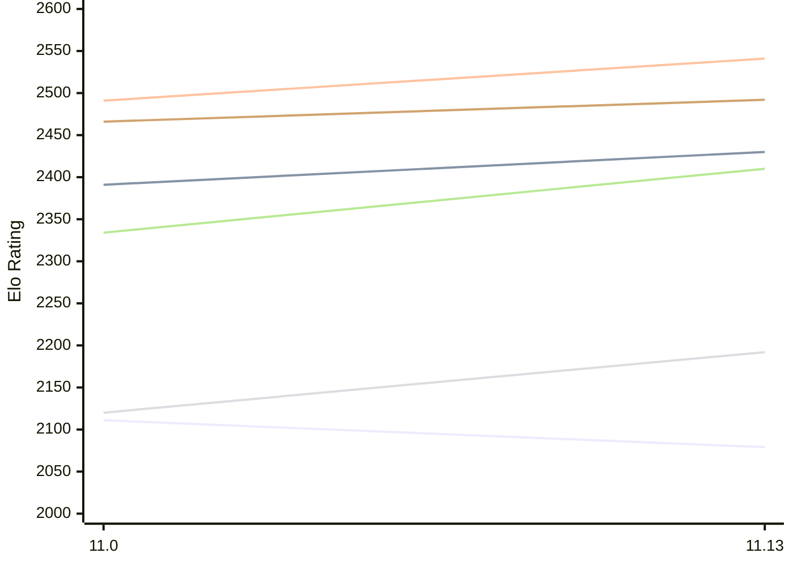

# Engine: Liora

Author: Louis Simonet

Home: https://github.com/LFM57/liora-chess-engine

## Elo Ratings E1 (Ultra 7 265T (1.50 GHz) - E-Core)

| Version | Published | STC 8.0+0.08s  | LTC 60.0+0.60s | VLTC 2m24s+1.12s | Comment |
| --- | --- | --- | --- | --- | --- |
| 11.13 | 2026-11-19 | 2079(-32) | 2430(+39) | 2541(+50) |  |
| 11.0 | 2026-10-29 | 2111 | 2391 | 2491 |  |
 | | | cElo (∆ prev) | cElo (∆ prev) | cElo (∆ prev) | 

## Elo Ratings P1 (Ultra 7 265T (1.50 GHz) - P-Core)

| Version | Published | STC 8.0+0.08s  | LTC 60.0+0.60s | VLTC 2m24s+1.12s | Comment |
| --- | --- | --- | --- | --- | --- |
| 11.13 | 2026-11-19 | 2192(+72) | 2410(+76) | 2492(+26) |  |
| 11.0 | 2026-10-29 | 2120 | 2334 | 2466 |  |
 | | | cElo (∆ prev) | cElo (∆ prev) | cElo (∆ prev) | 

## Elo Ratings T1 (i5-7500T 2.70GHz)

| Version | Published | STC 8.0+0.08s  | LTC 60.0+0.60s | VLTC 2m24s+1.12s | Comment |
| --- | --- | --- | --- | --- | --- |
| 11.0 | 2026-10-29 | 2120 | 2334 | 2466 |  |
 | | | cElo (∆ prev) | cElo (∆ prev) | cElo (∆ prev) | 

<a href="https://github.com/computer-chess-index/cci/issues/new?template=submit-version.yml&title=[VERSION]+Liora+<version>&body=###%20Engine%20name%0ALiora%0A%0A###%20Version%0A11.13" target="_blank">Submit new version</a>

 Test Conditions:

GUI/CLI: <a href=https://github.com/cutechess/cutechess target="_blank">Cute-Chess</a> 
Elo Calculation: <a href=https://www.remi-coulom.fr/Bayesian-Elo/ target="_blank">Bayesian-Elo</a> 
CPU for P1: Intel(R) Core(TM) Ultra 7 265T (1.50 GHz) - P-Core 
CPU for E1: Intel(R) Core(TM) Ultra 7 265T (1.50 GHz) - E-Core 
CPU for T1: Intel(R) Core(TM) i5-7500T 2.70GHz 
Opening book: 8_moves_v3 
\* STC: 8.0+0.08s, LTC: 60.0+0.60s, VLTC: 2m24s+1.12s

 Lists:
Ratings: <a href=https://github.com/computer-chess-index/cci/blob/main/lists/CCIRatings.csv target="_blank">Complete list</a>

Generated: 2026-11-28 05:40:00

## Ratings Verlauf E1 / P1

## Detailed Evaluation Results

| Version | Time Control | Variant | Elo  | Range +/- | Matches | Score | Average Opponent Elo | Draws |
| --- | --- |--- | --- | --- | --- | --- | --- | --- |
| 11.13 | VLTC (2m24s+1.12s) | E1 | 2541 | 40 | 232 | 52% | 2514 | 22% |
|  |  | P1 | 2492 | 51 | 128 | 51% | 2476 | 30% |
|  | LTC (60.0+0.60s) | E1 | 2430 | 40 | 220 | 51% | 2415 | 21% |
|  |  | P1 | 2410 | 60 | 94 | 56% | 2348 | 29% |
|  | STC (8.0+0.08s) | P1 | 2192 | 52 | 132 | 52% | 2171 | 20% |
|  |  | E1 | 2079 | 45 | 174 | 50% | 2076 | 21% |
| --- | --- |--- | --- | --- | --- | --- | --- | --- |
| 11.0 | VLTC (2m24s+1.12s) | P1 | 2466 | 51 | 138 | 55% | 2412 | 21% |
|  |  | E1 | 2491 | 45 | 180 | 50% | 2492 | 18% |
|  | LTC (60.0+0.60s) | P1 | 2334 | 62 | 98 | 49% | 2338 | 13% |
|  |  | E1 | 2391 | 36 | 284 | 45% | 2449 | 15% |
|  | STC (8.0+0.08s) | P1 | 2120 | 53 | 132 | 49% | 2126 | 15% |
|  |  | E1 | 2111 | 32 | 366 | 55% | 2059 | 14% |