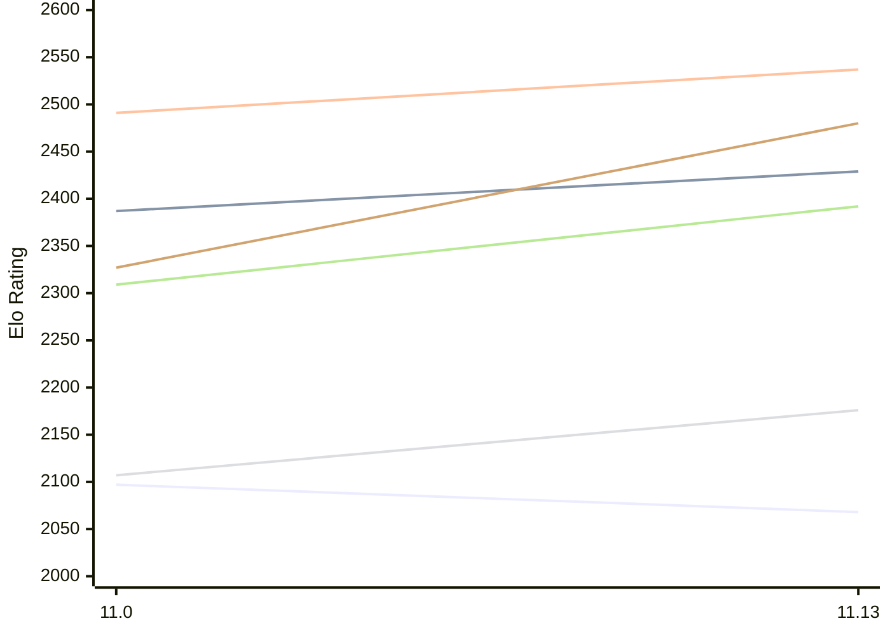

# Engine: Liora

Author: Louis Simonet

Home: https://github.com/LFM57/liora-chess-engine

## Elo Ratings E1 (Ultra 7 265T (1.50 GHz) - E-Core)

| Version | Published | STC 8.0+0.08s  | LTC 60.0+0.60s | VLTC 2m24s+1.12s | Comment |
| --- | --- | --- | --- | --- | --- |
| 11.13 | 2026-11-19 | 2068(-29) | 2429(+42) | 2537(+46) |  |
| 11.0 | 2026-10-29 | 2097 | 2387 | 2491 |  |
 | | | cElo (∆ prev) | cElo (∆ prev) | cElo (∆ prev) | 

## Elo Ratings P1 (Ultra 7 265T (1.50 GHz) - P-Core)

| Version | Published | STC 8.0+0.08s  | LTC 60.0+0.60s | VLTC 2m24s+1.12s | Comment |
| --- | --- | --- | --- | --- | --- |
| 11.13 | 2026-11-19 | 2176(+69) | 2392(+83) | 2480(+153) |  |
| 11.0 | 2026-10-29 | 2107 | 2309 | 2327 |  |
 | | | cElo (∆ prev) | cElo (∆ prev) | cElo (∆ prev) | 

## Elo Ratings T1 (i5-7500T 2.70GHz)

| Version | Published | STC 8.0+0.08s  | LTC 60.0+0.60s | VLTC 2m24s+1.12s | Comment |
| --- | --- | --- | --- | --- | --- |
| 11.0 | 2026-10-29 | 2107 | 2309 | 2327 |  |
 | | | cElo (∆ prev) | cElo (∆ prev) | cElo (∆ prev) | 

<a href="https://github.com/computer-chess-index/cci/issues/new?template=submit-version.yml&title=[VERSION]+Liora+<version>&body=###%20Engine%20name%0ALiora%0A%0A###%20Version%0A11.13" target="_blank">Submit new version</a>

 Test Conditions:

GUI/CLI: <a href=https://github.com/cutechess/cutechess target="_blank">Cute-Chess</a> 
Elo Calculation: <a href=https://www.remi-coulom.fr/Bayesian-Elo/ target="_blank">Bayesian-Elo</a> 
CPU for P1: Intel(R) Core(TM) Ultra 7 265T (1.50 GHz) - P-Core 
CPU for E1: Intel(R) Core(TM) Ultra 7 265T (1.50 GHz) - E-Core 
CPU for T1: Intel(R) Core(TM) i5-7500T 2.70GHz 
Opening book: 8_moves_v3 
\* STC: 8.0+0.08s, LTC: 60.0+0.60s, VLTC: 2m24s+1.12s

 Lists:
Ratings: <a href=https://github.com/computer-chess-index/cci/blob/main/lists/CCIRatings.csv target="_blank">Complete list</a>

Generated: 2026-11-23 05:39:50

## Ratings Verlauf E1 / P1

## Detailed Evaluation Results

| Version | Time Control | Variant | Elo  | Range +/- | Matches | Score | Average Opponent Elo | Draws |
| --- | --- |--- | --- | --- | --- | --- | --- | --- |
| 11.13 | VLTC (2m24s+1.12s) | P1 | 2480 | 51 | 128 | 51% | 2464 | 30% |
|  |  | E1 | 2537 | 40 | 224 | 52% | 2510 | 23% |
|  | LTC (60.0+0.60s) | P1 | 2392 | 62 | 90 | 56% | 2333 | 27% |
|  |  | E1 | 2429 | 43 | 200 | 52% | 2410 | 20% |
|  | STC (8.0+0.08s) | E1 | 2068 | 47 | 158 | 50% | 2072 | 22% |
|  |  | P1 | 2176 | 54 | 120 | 52% | 2159 | 18% |
| --- | --- |--- | --- | --- | --- | --- | --- | --- |
| 11.0 | VLTC (2m24s+1.12s) | P1 | 2327 | 115 | 28 | 50% | 2326 | 7% |
|  |  | E1 | 2491 | 46 | 172 | 50% | 2489 | 18% |
|  | LTC (60.0+0.60s) | P1 | 2309 | 88 | 46 | 47% | 2338 | 15% |
|  |  | E1 | 2387 | 39 | 248 | 44% | 2450 | 16% |
|  | STC (8.0+0.08s) | P1 | 2107 | 58 | 106 | 49% | 2115 | 17% |
|  |  | E1 | 2097 | 35 | 308 | 55% | 2041 | 16% |