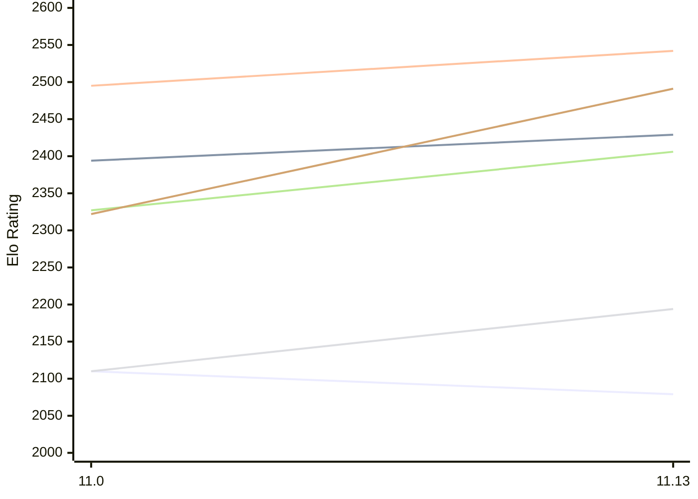

# Engine: Liora

Author: Louis Simonet

Home: https://github.com/LFM57/liora-chess-engine

## Elo Ratings E1 (Ultra 7 265T (1.50 GHz) - E-Core)

| Version | Published | STC 8.0+0.08s  | LTC 60.0+0.60s | VLTC 2m24s+1.12s | Comment |
| --- | --- | --- | --- | --- | --- |
| 11.13 | 2026-11-19 | 2079(-31) | 2429(+35) | 2542(+47) |  |
| 11.0 | 2026-10-29 | 2110 | 2394 | 2495 |  |
 | | | cElo (∆ prev) | cElo (∆ prev) | cElo (∆ prev) | 

## Elo Ratings P1 (Ultra 7 265T (1.50 GHz) - P-Core)

| Version | Published | STC 8.0+0.08s  | LTC 60.0+0.60s | VLTC 2m24s+1.12s | Comment |
| --- | --- | --- | --- | --- | --- |
| 11.13 | 2026-11-19 | 2194(+84) | 2406(+79) | 2491(+169) |  |
| 11.0 | 2026-10-29 | 2110 | 2327 | 2322 |  |
 | | | cElo (∆ prev) | cElo (∆ prev) | cElo (∆ prev) | 

## Elo Ratings T1 (i5-7500T 2.70GHz)

| Version | Published | STC 8.0+0.08s  | LTC 60.0+0.60s | VLTC 2m24s+1.12s | Comment |
| --- | --- | --- | --- | --- | --- |
| 11.0 | 2026-10-29 | 2110 | 2327 | 2322 |  |
 | | | cElo (∆ prev) | cElo (∆ prev) | cElo (∆ prev) | 

<a href="https://github.com/computer-chess-index/cci/issues/new?template=submit-version.yml&title=[VERSION]+Liora+<version>&body=###%20Engine%20name%0ALiora%0A%0A###%20Version%0A11.13" target="_blank">Submit new version</a>

 Test Conditions:

GUI/CLI: <a href=https://github.com/cutechess/cutechess target="_blank">Cute-Chess</a> 
Elo Calculation: <a href=https://www.remi-coulom.fr/Bayesian-Elo/ target="_blank">Bayesian-Elo</a> 
CPU for P1: Intel(R) Core(TM) Ultra 7 265T (1.50 GHz) - P-Core 
CPU for E1: Intel(R) Core(TM) Ultra 7 265T (1.50 GHz) - E-Core 
CPU for T1: Intel(R) Core(TM) i5-7500T 2.70GHz 
Opening book: 8_moves_v3 
\* STC: 8.0+0.08s, LTC: 60.0+0.60s, VLTC: 2m24s+1.12s

 Lists:
Ratings: <a href=https://github.com/computer-chess-index/cci/blob/main/lists/CCIRatings.csv target="_blank">Complete list</a>

Generated: 2026-11-25 05:39:57

## Ratings Verlauf E1 / P1

## Detailed Evaluation Results

| Version | Time Control | Variant | Elo  | Range +/- | Matches | Score | Average Opponent Elo | Draws |
| --- | --- |--- | --- | --- | --- | --- | --- | --- |
| 11.13 | VLTC (2m24s+1.12s) | E1 | 2542 | 40 | 228 | 52% | 2515 | 22% |
|  |  | P1 | 2491 | 51 | 128 | 51% | 2475 | 30% |
|  | LTC (60.0+0.60s) | E1 | 2429 | 41 | 216 | 51% | 2415 | 21% |
|  |  | P1 | 2406 | 60 | 94 | 56% | 2344 | 29% |
|  | STC (8.0+0.08s) | P1 | 2194 | 53 | 128 | 53% | 2167 | 20% |
|  |  | E1 | 2079 | 46 | 162 | 50% | 2076 | 22% |
| --- | --- |--- | --- | --- | --- | --- | --- | --- |
| 11.0 | VLTC (2m24s+1.12s) | P1 | 2322 | 104 | 32 | 48% | 2337 | 16% |
|  |  | E1 | 2495 | 45 | 176 | 50% | 2492 | 18% |
|  | LTC (60.0+0.60s) | P1 | 2327 | 79 | 58 | 48% | 2342 | 14% |
|  |  | E1 | 2394 | 37 | 280 | 45% | 2449 | 15% |
|  | STC (8.0+0.08s) | P1 | 2110 | 54 | 128 | 49% | 2122 | 15% |
|  |  | E1 | 2110 | 33 | 354 | 55% | 2055 | 15% |