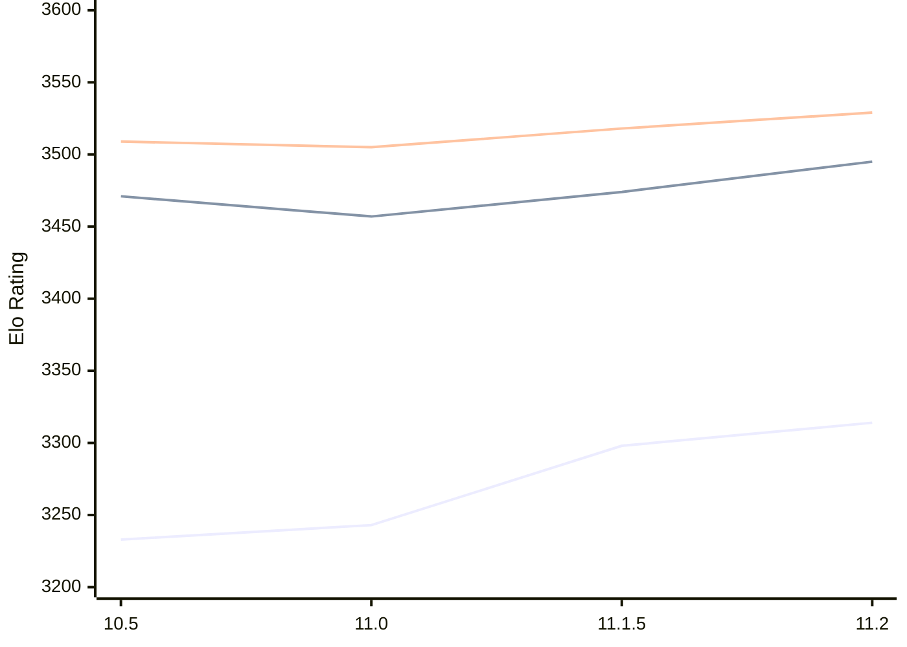

# Engine: Lizard

Author: Liam McGuire

Home: https://github.com/liamt19/Lizard

## Elo Ratings E1 (Ultra 7 265T (1.50 GHz) - E-Core)

| Version | Published | STC 8.0+0.08s  | LTC 60.0+0.60s | VLTC 2m24s+1.12s | Comment |
| --- | --- | --- | --- | --- | --- |
| 11.2 | 2025-01-08 | 3258 | 3497 | 3590 |  |
 | | | cElo (∆ prev) | cElo (∆ prev) | cElo (∆ prev) | 

## Elo Ratings P1 (Ultra 7 265T (1.50 GHz) - P-Core)

| Version | Published | STC 8.0+0.08s  | LTC 60.0+0.60s | VLTC 2m24s+1.12s | Comment |
| --- | --- | --- | --- | --- | --- |
| 11.2 | 2025-01-08 | 3399 | 3603 | 3664 |  |
 | | | cElo (∆ prev) | cElo (∆ prev) | cElo (∆ prev) | 

## Elo Ratings T1 (i5-7500T 2.70GHz)

| Version | Published | STC 8.0+0.08s  | LTC 60.0+0.60s | VLTC 2m24s+1.12s | Comment |
| --- | --- | --- | --- | --- | --- |
| 11.2 | 2025-01-08 | 3314(+16) | 3495(+21) | 3529(+11) |  |
| 11.1.5 | 2024-12-30 | 3298(+55) | 3474(+17) | 3518(+13) |  |
| 11.0 | 2024-09-26 | 3243(+10) | 3457(-14) | 3505(-4) |  |
| 10.5 | 2024-07-13 | 3233 | 3471 | 3509 |  |
 | | | cElo (∆ prev) | cElo (∆ prev) | cElo (∆ prev) | 

<a href="https://github.com/computer-chess-index/cci/issues/new?template=submit-version.yml&title=[VERSION]+Lizard+<version>&body=###%20Engine%20name%0ALizard%0A%0A###%20Version%0A11.2" target="_blank">Submit new version</a>

 Test Conditions:

GUI/CLI: <a href=https://github.com/cutechess/cutechess target="_blank">Cute-Chess</a> 
Elo Calculation: <a href=https://www.remi-coulom.fr/Bayesian-Elo/ target="_blank">Bayesian-Elo</a> 
CPU for P1: Intel(R) Core(TM) Ultra 7 265T (1.50 GHz) - P-Core 
CPU for E1: Intel(R) Core(TM) Ultra 7 265T (1.50 GHz) - E-Core 
CPU for T1: Intel(R) Core(TM) i5-7500T 2.70GHz 
Opening book: 8_moves_v3 
\* STC: 8.0+0.08s, LTC: 60.0+0.60s, VLTC: 2m24s+1.12s

 Lists:
Ratings: <a href=https://github.com/computer-chess-index/cci/blob/main/lists/CCIRatings.csv target="_blank">Complete list</a>

Generated: 2026-10-19 04:40:06

## Ratings Verlauf T1

## Detailed Evaluation Results

| Version | Time Control | Variant | Elo  | Range +/- | Matches | Score | Average Opponent Elo | Draws |
| --- | --- |--- | --- | --- | --- | --- | --- | --- |
| 11.2 | VLTC (2m24s+1.12s) | P1 | 3664 | 41 | 140 | 52% | 3650 | 84% |
|  |  | E1 | 3590 | 36 | 180 | 52% | 3578 | 87% |
|  |  | T1 | 3529 | 12 | 1692 | 50% | 3530 | 87% |
|  | LTC (60.0+0.60s) | E1 | 3497 | 37 | 176 | 50% | 3497 | 77% |
|  |  | T1 | 3495 | 12 | 1678 | 50% | 3494 | 82% |
|  |  | P1 | 3603 | 37 | 164 | 51% | 3598 | 85% |
|  | STC (8.0+0.08s) | E1 | 3258 | 28 | 338 | 45% | 3293 | 62% |
|  |  | T1 | 3314 | 12 | 1734 | 51% | 3308 | 63% |
|  |  | P1 | 3399 | 34 | 220 | 50% | 3399 | 64% |
| --- | --- |--- | --- | --- | --- | --- | --- | --- |
| 11.1.5 | VLTC (2m24s+1.12s) | T1 | 3518 | 21 | 544 | 50% | 3515 | 85% |
|  | LTC (60.0+0.60s) | T1 | 3474 | 21 | 544 | 50% | 3475 | 83% |
|  | STC (8.0+0.08s) | T1 | 3298 | 22 | 552 | 49% | 3306 | 65% |
| --- | --- |--- | --- | --- | --- | --- | --- | --- |
| 11.0 | VLTC (2m24s+1.12s) | T1 | 3505 | 18 | 760 | 50% | 3503 | 81% |
|  | LTC (60.0+0.60s) | T1 | 3457 | 18 | 768 | 49% | 3465 | 80% |
|  | STC (8.0+0.08s) | T1 | 3243 | 18 | 816 | 49% | 3245 | 64% |
| --- | --- |--- | --- | --- | --- | --- | --- | --- |
| 10.5 | VLTC (2m24s+1.12s) | T1 | 3509 | 31 | 252 | 52% | 3455 | 77% |
|  | LTC (60.0+0.60s) | T1 | 3471 | 35 | 192 | 50% | 3468 | 83% |
|  | STC (8.0+0.08s) | T1 | 3233 | 31 | 272 | 48% | 3244 | 61% |