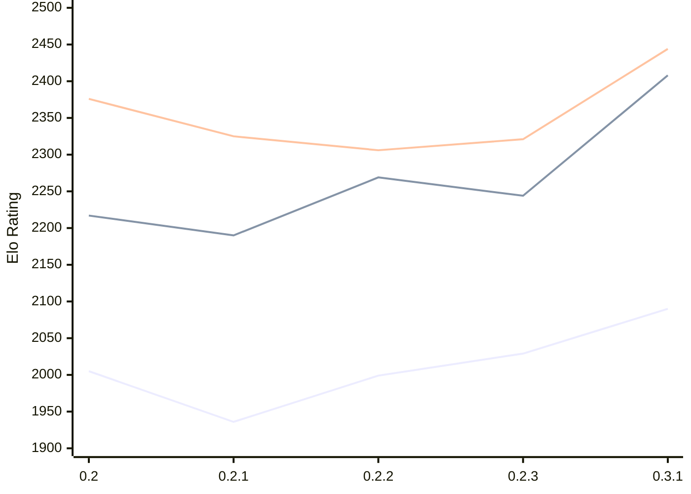

# Engine: Lolbot

Author: Lorentz Vedeler

Home: https://github.com/loldot/lolbot

## Elo Ratings E1 (Ultra 7 265T (1.50 GHz) - E-Core)

| Version | Published | STC 8.0+0.08s  | LTC 60.0+0.60s | VLTC 2m24s+1.12s | Comment |
| --- | --- | --- | --- | --- | --- |
| 0.3.1 | 2026-04-13 | 1978 | 2228 | 2338 |  |
 | | | cElo (∆ prev) | cElo (∆ prev) | cElo (∆ prev) | 

## Elo Ratings P1 (Ultra 7 265T (1.50 GHz) - P-Core)

| Version | Published | STC 8.0+0.08s  | LTC 60.0+0.60s | VLTC 2m24s+1.12s | Comment |
| --- | --- | --- | --- | --- | --- |
| 0.3.1 | 2026-04-13 | 2110 | 2395 | 2538 |  |
 | | | cElo (∆ prev) | cElo (∆ prev) | cElo (∆ prev) | 

## Elo Ratings T1 (i5-7500T 2.70GHz)

| Version | Published | STC 8.0+0.08s  | LTC 60.0+0.60s | VLTC 2m24s+1.12s | Comment |
| --- | --- | --- | --- | --- | --- |
| 0.3.1 | 2026-04-13 | 2090(+61) | 2408(+164) | 2444(+123) |  |
| 0.2.3 | 2025-12-08 | 2029(+30) | 2244(-25) | 2321(+15) |  |
| 0.2.2 | 2025-11-29 | 1999(+63) | 2269(+79) | 2306(-19) |  |
| 0.2.1 | 2025-11-16 | 1936(-69) | 2190(-27) | 2325(-51) |  |
| 0.2 | 2025-11-15 | 2005 | 2217 | 2376 |  |
 | | | cElo (∆ prev) | cElo (∆ prev) | cElo (∆ prev) | 

<a href="https://github.com/computer-chess-index/cci/issues/new?template=submit-version.yml&title=[VERSION]+Lolbot+<version>&body=###%20Engine%20name%0ALolbot%0A%0A###%20Version%0A0.3.1" target="_blank">Submit new version</a>

 Test Conditions:

GUI/CLI: <a href=https://github.com/cutechess/cutechess target="_blank">Cute-Chess</a> 
Elo Calculation: <a href=https://www.remi-coulom.fr/Bayesian-Elo/ target="_blank">Bayesian-Elo</a> 
CPU for P1: Intel(R) Core(TM) Ultra 7 265T (1.50 GHz) - P-Core 
CPU for E1: Intel(R) Core(TM) Ultra 7 265T (1.50 GHz) - E-Core 
CPU for T1: Intel(R) Core(TM) i5-7500T 2.70GHz 
Opening book: 8_moves_v3 
\* STC: 8.0+0.08s, LTC: 60.0+0.60s, VLTC: 2m24s+1.12s

 Lists:
Ratings: <a href=https://github.com/computer-chess-index/cci/blob/main/lists/CCIRatings.csv target="_blank">Complete list</a>

Generated: 2026-10-16 04:40:27

## Ratings Verlauf T1

## Detailed Evaluation Results

| Version | Time Control | Variant | Elo  | Range +/- | Matches | Score | Average Opponent Elo | Draws |
| --- | --- |--- | --- | --- | --- | --- | --- | --- |
| 0.3.1 | VLTC (2m24s+1.12s) | P1 | 2538 | 49 | 158 | 53% | 2502 | 23% |
|  |  | E1 | 2338 | 40 | 220 | 51% | 2330 | 25% |
|  |  | T1 | 2444 | 26 | 524 | 51% | 2422 | 24% |
|  | LTC (60.0+0.60s) | P1 | 2395 | 48 | 156 | 46% | 2458 | 22% |
|  |  | E1 | 2228 | 41 | 220 | 52% | 2194 | 24% |
|  |  | T1 | 2408 | 25 | 542 | 53% | 2384 | 23% |
|  | STC (8.0+0.08s) | E1 | 1978 | 38 | 244 | 49% | 2002 | 23% |
|  |  | T1 | 2090 | 25 | 556 | 49% | 2087 | 22% |
|  |  | P1 | 2110 | 46 | 176 | 49% | 2130 | 20% |
| --- | --- |--- | --- | --- | --- | --- | --- | --- |
| 0.2.3 | VLTC (2m24s+1.12s) | T1 | 2321 | 31 | 362 | 48% | 2340 | 26% |
|  | LTC (60.0+0.60s) | T1 | 2244 | 31 | 376 | 51% | 2229 | 22% |
|  | STC (8.0+0.08s) | T1 | 2029 | 28 | 468 | 49% | 2037 | 20% |
| --- | --- |--- | --- | --- | --- | --- | --- | --- |
| 0.2.2 | VLTC (2m24s+1.12s) | T1 | 2306 | 53 | 128 | 53% | 2276 | 20% |
|  | LTC (60.0+0.60s) | T1 | 2269 | 66 | 76 | 51% | 2267 | 28% |
|  | STC (8.0+0.08s) | T1 | 1999 | 59 | 104 | 49% | 2013 | 16% |
| --- | --- |--- | --- | --- | --- | --- | --- | --- |
| 0.2.1 | VLTC (2m24s+1.12s) | T1 | 2325 | 55 | 132 | 44% | 2400 | 14% |
|  | LTC (60.0+0.60s) | T1 | 2190 | 64 | 88 | 46% | 2229 | 17% |
|  | STC (8.0+0.08s) | T1 | 1936 | 70 | 76 | 50% | 1935 | 16% |
| --- | --- |--- | --- | --- | --- | --- | --- | --- |
| 0.2 | VLTC (2m24s+1.12s) | T1 | 2376 | 56 | 116 | 52% | 2356 | 16% |
|  | LTC (60.0+0.60s) | T1 | 2217 | 47 | 160 | 49% | 2229 | 20% |
|  | STC (8.0+0.08s) | T1 | 2005 | 59 | 100 | 54% | 1964 | 22% |