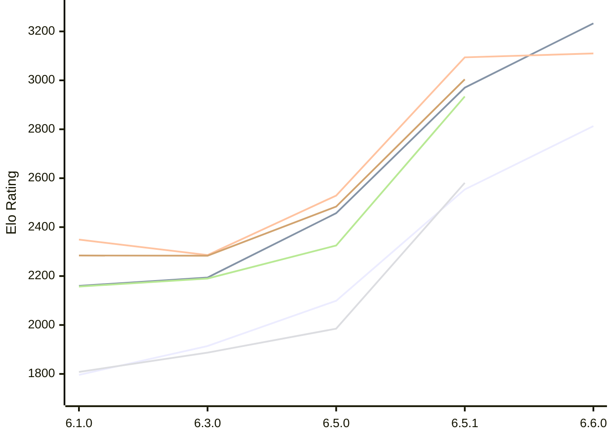

# Engine: Luminex

Author: Cheng Chang

Home: https://github.com/changcheng967/Luminex

## Elo Ratings E1 (Ultra 7 265T (1.50 GHz) - E-Core)

| Version | Published | STC 8.0+0.08s  | LTC 60.0+0.60s | VLTC 2m24s+1.12s | Comment |
| --- | --- | --- | --- | --- | --- |
| 6.6.0 | 2026-11-14 | 2813(+259) | 3233(+263) | 3110(+16) |  |
| 6.5.1 | 2026-11-07 | 2554(+455) | 2970(+513) | 3094(+565) |  |
| 6.5.0 | 2026-11-06 | 2099(+185) | 2457(+263) | 2529(+243) |  |
| 6.3.0 | 2026-10-27 | 1914(+118) | 2194(+34) | 2286(-63) |  |
| 6.1.0 | 2026-09-24 | 1796 | 2160 | 2349 |  |
 | | | cElo (∆ prev) | cElo (∆ prev) | cElo (∆ prev) | 

## Elo Ratings P1 (Ultra 7 265T (1.50 GHz) - P-Core)

| Version | Published | STC 8.0+0.08s  | LTC 60.0+0.60s | VLTC 2m24s+1.12s | Comment |
| --- | --- | --- | --- | --- | --- |
| 6.5.1 | 2026-11-07 | 2581(+596) | 2934(+609) | 3004(+520) |  |
| 6.5.0 | 2026-11-06 | 1985(+98) | 2325(+135) | 2484(+201) |  |
| 6.3.0 | 2026-10-27 | 1887(+79) | 2190(+33) | 2283(-1) |  |
| 6.1.0 | 2026-09-24 | 1808 | 2157 | 2284 |  |
 | | | cElo (∆ prev) | cElo (∆ prev) | cElo (∆ prev) | 

## Elo Ratings T1 (i5-7500T 2.70GHz)

| Version | Published | STC 8.0+0.08s  | LTC 60.0+0.60s | VLTC 2m24s+1.12s | Comment |
| --- | --- | --- | --- | --- | --- |
| 6.1.0 | 2026-09-24 | 1808 | 2157 | 2284 |  |
 | | | cElo (∆ prev) | cElo (∆ prev) | cElo (∆ prev) | 

<a href="https://github.com/computer-chess-index/cci/issues/new?template=submit-version.yml&title=[VERSION]+Luminex+<version>&body=###%20Engine%20name%0ALuminex%0A%0A###%20Version%0A6.5.1" target="_blank">Submit new version</a>

 Test Conditions:

GUI/CLI: <a href=https://github.com/cutechess/cutechess target="_blank">Cute-Chess</a> 
Elo Calculation: <a href=https://www.remi-coulom.fr/Bayesian-Elo/ target="_blank">Bayesian-Elo</a> 
CPU for P1: Intel(R) Core(TM) Ultra 7 265T (1.50 GHz) - P-Core 
CPU for E1: Intel(R) Core(TM) Ultra 7 265T (1.50 GHz) - E-Core 
CPU for T1: Intel(R) Core(TM) i5-7500T 2.70GHz 
Opening book: 8_moves_v3 
\* STC: 8.0+0.08s, LTC: 60.0+0.60s, VLTC: 2m24s+1.12s

 Lists:
Ratings: <a href=https://github.com/computer-chess-index/cci/blob/main/lists/CCIRatings.csv target="_blank">Complete list</a>

Generated: 2026-11-15 05:39:54

## Ratings Verlauf E1 / P1

## Detailed Evaluation Results

| Version | Time Control | Variant | Elo  | Range +/- | Matches | Score | Average Opponent Elo | Draws |
| --- | --- |--- | --- | --- | --- | --- | --- | --- |
| 6.6.0 | VLTC (2m24s+1.12s) | E1 | 3110 | 229 | 4 | 50% | 3110 | 50% |
|  | LTC (60.0+0.60s) | E1 | 3233 | 268 | 4 | 88% | 2966 | 25% |
|  | STC (8.0+0.08s) | P1 | 2847 | 268 | 4 | 88% | 2580 | 25% |
|  |  | E1 | 2813 | 270 | 4 | 88% | 2553 | 25% |
| --- | --- |--- | --- | --- | --- | --- | --- | --- |
| 6.5.1 | VLTC (2m24s+1.12s) | E1 | 3094 | 31 | 328 | 57% | 3016 | 43% |
|  |  | P1 | 3004 | 33 | 286 | 58% | 2920 | 43% |
|  | LTC (60.0+0.60s) | P1 | 2934 | 47 | 156 | 55% | 2867 | 31% |
|  |  | E1 | 2970 | 27 | 418 | 49% | 2974 | 41% |
|  | STC (8.0+0.08s) | P1 | 2581 | 44 | 180 | 56% | 2515 | 34% |
|  |  | E1 | 2554 | 35 | 282 | 56% | 2477 | 32% |
| --- | --- |--- | --- | --- | --- | --- | --- | --- |
| 6.5.0 | VLTC (2m24s+1.12s) | P1 | 2484 | 50 | 144 | 52% | 2452 | 23% |
|  |  | E1 | 2529 | 41 | 208 | 53% | 2489 | 25% |
|  | LTC (60.0+0.60s) | P1 | 2325 | 51 | 144 | 49% | 2345 | 19% |
|  |  | E1 | 2457 | 39 | 228 | 53% | 2419 | 27% |
|  | STC (8.0+0.08s) | P1 | 1985 | 46 | 164 | 48% | 2007 | 22% |
|  |  | E1 | 2099 | 41 | 200 | 52% | 2080 | 26% |
| --- | --- |--- | --- | --- | --- | --- | --- | --- |
| 6.3.0 | VLTC (2m24s+1.12s) | E1 | 2286 | 39 | 240 | 50% | 2279 | 18% |
|  |  | P1 | 2283 | 50 | 140 | 53% | 2261 | 24% |
|  | LTC (60.0+0.60s) | P1 | 2190 | 45 | 176 | 53% | 2164 | 18% |
|  |  | E1 | 2194 | 42 | 204 | 51% | 2187 | 15% |
|  | STC (8.0+0.08s) | P1 | 1887 | 42 | 204 | 47% | 1920 | 21% |
|  |  | E1 | 1914 | 42 | 212 | 51% | 1905 | 16% |
| --- | --- |--- | --- | --- | --- | --- | --- | --- |
| 6.1.0 | VLTC (2m24s+1.12s) | P1 | 2284 | 63 | 80 | 50% | 2284 | 30% |
|  |  | E1 | 2349 | 44 | 182 | 49% | 2361 | 22% |
|  | LTC (60.0+0.60s) | P1 | 2157 | 48 | 164 | 55% | 2097 | 18% |
|  |  | E1 | 2160 | 43 | 200 | 52% | 2129 | 16% |
|  | STC (8.0+0.08s) | P1 | 1808 | 44 | 212 | 59% | 1681 | 18% |
|  |  | E1 | 1796 | 40 | 250 | 55% | 1701 | 17% |