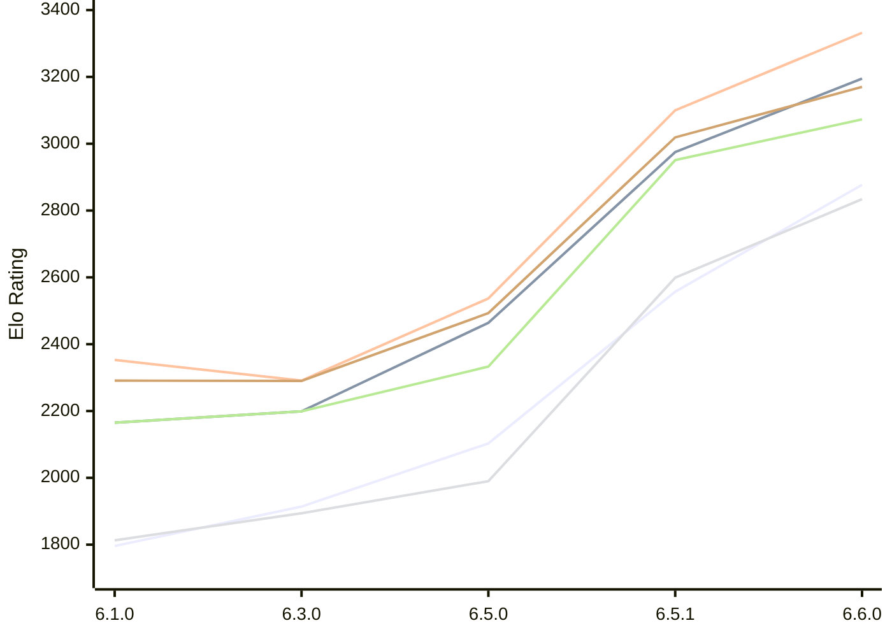

# Engine: Luminex

Author: Cheng Chang

Home: https://github.com/changcheng967/Luminex

## Elo Ratings E1 (Ultra 7 265T (1.50 GHz) - E-Core)

| Version | Published | STC 8.0+0.08s  | LTC 60.0+0.60s | VLTC 2m24s+1.12s | Comment |
| --- | --- | --- | --- | --- | --- |
| 6.6.0 | 2026-11-14 | 2877(+320) | 3195(+220) | 3332(+232) |  |
| 6.5.1 | 2026-11-07 | 2557(+454) | 2975(+511) | 3100(+563) |  |
| 6.5.0 | 2026-11-06 | 2103(+189) | 2464(+265) | 2537(+246) |  |
| 6.3.0 | 2026-10-27 | 1914(+118) | 2199(+34) | 2291(-62) |  |
| 6.1.0 | 2026-09-24 | 1796 | 2165 | 2353 |  |
 | | | cElo (∆ prev) | cElo (∆ prev) | cElo (∆ prev) | 

## Elo Ratings P1 (Ultra 7 265T (1.50 GHz) - P-Core)

| Version | Published | STC 8.0+0.08s  | LTC 60.0+0.60s | VLTC 2m24s+1.12s | Comment |
| --- | --- | --- | --- | --- | --- |
| 6.6.0 | 2026-11-14 | 2834(+235) | 3073(+122) | 3170(+151) |  |
| 6.5.1 | 2026-11-07 | 2599(+609) | 2951(+618) | 3019(+526) |  |
| 6.5.0 | 2026-11-06 | 1990(+96) | 2333(+134) | 2493(+203) |  |
| 6.3.0 | 2026-10-27 | 1894(+81) | 2199(+34) | 2290(-1) |  |
| 6.1.0 | 2026-09-24 | 1813 | 2165 | 2291 |  |
 | | | cElo (∆ prev) | cElo (∆ prev) | cElo (∆ prev) | 

## Elo Ratings T1 (i5-7500T 2.70GHz)

| Version | Published | STC 8.0+0.08s  | LTC 60.0+0.60s | VLTC 2m24s+1.12s | Comment |
| --- | --- | --- | --- | --- | --- |
| 6.1.0 | 2026-09-24 | 1813 | 2165 | 2291 |  |
 | | | cElo (∆ prev) | cElo (∆ prev) | cElo (∆ prev) | 

<a href="https://github.com/computer-chess-index/cci/issues/new?template=submit-version.yml&title=[VERSION]+Luminex+<version>&body=###%20Engine%20name%0ALuminex%0A%0A###%20Version%0A6.6.0" target="_blank">Submit new version</a>

 Test Conditions:

GUI/CLI: <a href=https://github.com/cutechess/cutechess target="_blank">Cute-Chess</a> 
Elo Calculation: <a href=https://www.remi-coulom.fr/Bayesian-Elo/ target="_blank">Bayesian-Elo</a> 
CPU for P1: Intel(R) Core(TM) Ultra 7 265T (1.50 GHz) - P-Core 
CPU for E1: Intel(R) Core(TM) Ultra 7 265T (1.50 GHz) - E-Core 
CPU for T1: Intel(R) Core(TM) i5-7500T 2.70GHz 
Opening book: 8_moves_v3 
\* STC: 8.0+0.08s, LTC: 60.0+0.60s, VLTC: 2m24s+1.12s

 Lists:
Ratings: <a href=https://github.com/computer-chess-index/cci/blob/main/lists/CCIRatings.csv target="_blank">Complete list</a>

Generated: 2026-11-17 05:40:03

## Ratings Verlauf E1 / P1

## Detailed Evaluation Results

| Version | Time Control | Variant | Elo  | Range +/- | Matches | Score | Average Opponent Elo | Draws |
| --- | --- |--- | --- | --- | --- | --- | --- | --- |
| 6.6.0 | VLTC (2m24s+1.12s) | P1 | 3170 | 116 | 20 | 45% | 3202 | 50% |
|  |  | E1 | 3332 | 90 | 32 | 61% | 3249 | 66% |
|  | LTC (60.0+0.60s) | P1 | 3073 | 119 | 20 | 63% | 2965 | 45% |
|  |  | E1 | 3195 | 89 | 36 | 53% | 3171 | 44% |
|  | STC (8.0+0.08s) | P1 | 2834 | 123 | 20 | 53% | 2805 | 35% |
|  |  | E1 | 2877 | 93 | 36 | 56% | 2820 | 33% |
| --- | --- |--- | --- | --- | --- | --- | --- | --- |
| 6.5.1 | VLTC (2m24s+1.12s) | P1 | 3019 | 32 | 302 | 58% | 2938 | 43% |
|  |  | E1 | 3100 | 30 | 344 | 57% | 3029 | 43% |
|  | LTC (60.0+0.60s) | P1 | 2951 | 46 | 160 | 56% | 2884 | 33% |
|  |  | E1 | 2975 | 27 | 430 | 48% | 2984 | 40% |
|  | STC (8.0+0.08s) | P1 | 2599 | 43 | 188 | 56% | 2535 | 34% |
|  |  | E1 | 2557 | 33 | 302 | 55% | 2489 | 33% |
| --- | --- |--- | --- | --- | --- | --- | --- | --- |
| 6.5.0 | VLTC (2m24s+1.12s) | P1 | 2493 | 50 | 144 | 52% | 2461 | 23% |
|  |  | E1 | 2537 | 41 | 208 | 53% | 2498 | 25% |
|  | LTC (60.0+0.60s) | P1 | 2333 | 51 | 144 | 49% | 2357 | 19% |
|  |  | E1 | 2464 | 39 | 228 | 53% | 2426 | 27% |
|  | STC (8.0+0.08s) | E1 | 2103 | 41 | 200 | 52% | 2084 | 26% |
|  |  | P1 | 1990 | 46 | 164 | 48% | 2012 | 22% |
| --- | --- |--- | --- | --- | --- | --- | --- | --- |
| 6.3.0 | VLTC (2m24s+1.12s) | P1 | 2290 | 50 | 140 | 53% | 2268 | 24% |
|  |  | E1 | 2291 | 39 | 240 | 50% | 2284 | 18% |
|  | LTC (60.0+0.60s) | P1 | 2199 | 45 | 176 | 53% | 2172 | 18% |
|  |  | E1 | 2199 | 42 | 204 | 51% | 2192 | 15% |
|  | STC (8.0+0.08s) | P1 | 1894 | 42 | 204 | 47% | 1926 | 21% |
|  |  | E1 | 1914 | 42 | 212 | 51% | 1906 | 16% |
| --- | --- |--- | --- | --- | --- | --- | --- | --- |
| 6.1.0 | VLTC (2m24s+1.12s) | P1 | 2291 | 63 | 80 | 50% | 2290 | 30% |
|  |  | E1 | 2353 | 44 | 182 | 49% | 2365 | 22% |
|  | LTC (60.0+0.60s) | P1 | 2165 | 48 | 164 | 55% | 2105 | 18% |
|  |  | E1 | 2165 | 44 | 200 | 52% | 2134 | 16% |
|  | STC (8.0+0.08s) | P1 | 1813 | 44 | 212 | 59% | 1685 | 18% |
|  |  | E1 | 1796 | 40 | 250 | 55% | 1700 | 17% |