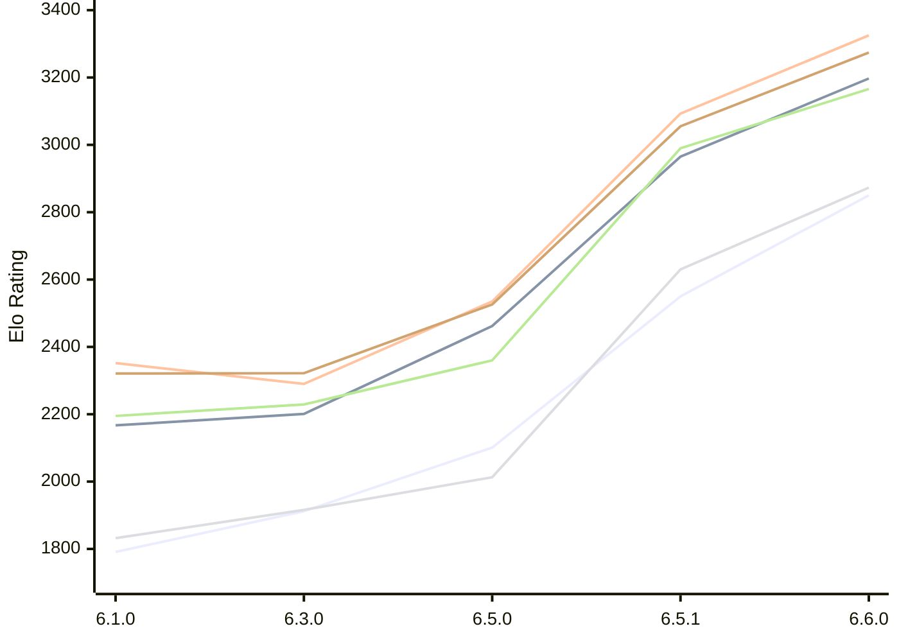

# Engine: Luminex

Author: Cheng Chang

Home: https://github.com/changcheng967/Luminex

## Elo Ratings E1 (Ultra 7 265T (1.50 GHz) - E-Core)

| Version | Published | STC 8.0+0.08s  | LTC 60.0+0.60s | VLTC 2m24s+1.12s | Comment |
| --- | --- | --- | --- | --- | --- |
| 6.6.0 | 2026-11-14 | 2850(+300) | 3197(+232) | 3325(+232) |  |
| 6.5.1 | 2026-11-07 | 2550(+449) | 2965(+503) | 3093(+558) |  |
| 6.5.0 | 2026-11-06 | 2101(+189) | 2462(+261) | 2535(+245) |  |
| 6.3.0 | 2026-10-27 | 1912(+121) | 2201(+34) | 2290(-62) |  |
| 6.1.0 | 2026-09-24 | 1791 | 2167 | 2352 |  |
 | | | cElo (∆ prev) | cElo (∆ prev) | cElo (∆ prev) | 

## Elo Ratings P1 (Ultra 7 265T (1.50 GHz) - P-Core)

| Version | Published | STC 8.0+0.08s  | LTC 60.0+0.60s | VLTC 2m24s+1.12s | Comment |
| --- | --- | --- | --- | --- | --- |
| 6.6.0 | 2026-11-14 | 2873(+243) | 3166(+176) | 3274(+219) |  |
| 6.5.1 | 2026-11-07 | 2630(+617) | 2990(+630) | 3055(+529) |  |
| 6.5.0 | 2026-11-06 | 2013(+97) | 2360(+131) | 2526(+204) |  |
| 6.3.0 | 2026-10-27 | 1916(+84) | 2229(+34) | 2322(+1) |  |
| 6.1.0 | 2026-09-24 | 1832 | 2195 | 2321 |  |
 | | | cElo (∆ prev) | cElo (∆ prev) | cElo (∆ prev) | 

## Elo Ratings T1 (i5-7500T 2.70GHz)

| Version | Published | STC 8.0+0.08s  | LTC 60.0+0.60s | VLTC 2m24s+1.12s | Comment |
| --- | --- | --- | --- | --- | --- |
| 6.1.0 | 2026-09-24 | 1832 | 2195 | 2321 |  |
 | | | cElo (∆ prev) | cElo (∆ prev) | cElo (∆ prev) | 

<a href="https://github.com/computer-chess-index/cci/issues/new?template=submit-version.yml&title=[VERSION]+Luminex+<version>&body=###%20Engine%20name%0ALuminex%0A%0A###%20Version%0A6.6.0" target="_blank">Submit new version</a>

 Test Conditions:

GUI/CLI: <a href=https://github.com/cutechess/cutechess target="_blank">Cute-Chess</a> 
Elo Calculation: <a href=https://www.remi-coulom.fr/Bayesian-Elo/ target="_blank">Bayesian-Elo</a> 
CPU for P1: Intel(R) Core(TM) Ultra 7 265T (1.50 GHz) - P-Core 
CPU for E1: Intel(R) Core(TM) Ultra 7 265T (1.50 GHz) - E-Core 
CPU for T1: Intel(R) Core(TM) i5-7500T 2.70GHz 
Opening book: 8_moves_v3 
\* STC: 8.0+0.08s, LTC: 60.0+0.60s, VLTC: 2m24s+1.12s

 Lists:
Ratings: <a href=https://github.com/computer-chess-index/cci/blob/main/lists/CCIRatings.csv target="_blank">Complete list</a>

Generated: 2026-11-28 05:40:14

## Ratings Verlauf E1 / P1

## Detailed Evaluation Results

| Version | Time Control | Variant | Elo  | Range +/- | Matches | Score | Average Opponent Elo | Draws |
| --- | --- |--- | --- | --- | --- | --- | --- | --- |
| 6.6.0 | VLTC (2m24s+1.12s) | E1 | 3325 | 34 | 224 | 51% | 3320 | 62% |
|  |  | P1 | 3274 | 42 | 144 | 52% | 3258 | 67% |
|  | LTC (60.0+0.60s) | E1 | 3197 | 28 | 364 | 48% | 3210 | 55% |
|  |  | P1 | 3166 | 41 | 170 | 52% | 3150 | 52% |
|  | STC (8.0+0.08s) | P1 | 2873 | 34 | 262 | 52% | 2855 | 45% |
|  |  | E1 | 2850 | 34 | 264 | 51% | 2843 | 38% |
| --- | --- |--- | --- | --- | --- | --- | --- | --- |
| 6.5.1 | VLTC (2m24s+1.12s) | P1 | 3055 | 32 | 310 | 58% | 2977 | 44% |
|  |  | E1 | 3093 | 30 | 352 | 57% | 3023 | 43% |
|  | LTC (60.0+0.60s) | P1 | 2990 | 45 | 168 | 55% | 2928 | 34% |
|  |  | E1 | 2965 | 26 | 450 | 48% | 2974 | 40% |
|  | STC (8.0+0.08s) | P1 | 2630 | 41 | 208 | 55% | 2573 | 33% |
|  |  | E1 | 2550 | 32 | 326 | 54% | 2492 | 33% |
| --- | --- |--- | --- | --- | --- | --- | --- | --- |
| 6.5.0 | VLTC (2m24s+1.12s) | P1 | 2526 | 50 | 144 | 52% | 2493 | 23% |
|  |  | E1 | 2535 | 41 | 208 | 53% | 2498 | 25% |
|  | LTC (60.0+0.60s) | P1 | 2360 | 51 | 144 | 49% | 2385 | 19% |
|  |  | E1 | 2462 | 39 | 228 | 53% | 2425 | 27% |
|  | STC (8.0+0.08s) | P1 | 2013 | 46 | 164 | 48% | 2036 | 22% |
|  |  | E1 | 2101 | 41 | 200 | 52% | 2082 | 26% |
| --- | --- |--- | --- | --- | --- | --- | --- | --- |
| 6.3.0 | VLTC (2m24s+1.12s) | P1 | 2322 | 50 | 140 | 53% | 2299 | 24% |
|  |  | E1 | 2290 | 39 | 240 | 50% | 2283 | 18% |
|  | LTC (60.0+0.60s) | P1 | 2229 | 45 | 176 | 53% | 2202 | 18% |
|  |  | E1 | 2201 | 42 | 204 | 51% | 2194 | 15% |
|  | STC (8.0+0.08s) | P1 | 1916 | 42 | 204 | 47% | 1947 | 21% |
|  |  | E1 | 1912 | 42 | 212 | 51% | 1902 | 16% |
| --- | --- |--- | --- | --- | --- | --- | --- | --- |
| 6.1.0 | VLTC (2m24s+1.12s) | E1 | 2352 | 44 | 182 | 49% | 2364 | 22% |
|  |  | P1 | 2321 | 63 | 80 | 50% | 2319 | 30% |
|  | LTC (60.0+0.60s) | E1 | 2167 | 44 | 200 | 52% | 2134 | 16% |
|  |  | P1 | 2195 | 48 | 164 | 55% | 2134 | 18% |
|  | STC (8.0+0.08s) | P1 | 1832 | 44 | 212 | 59% | 1702 | 18% |
|  |  | E1 | 1791 | 40 | 250 | 55% | 1696 | 17% |