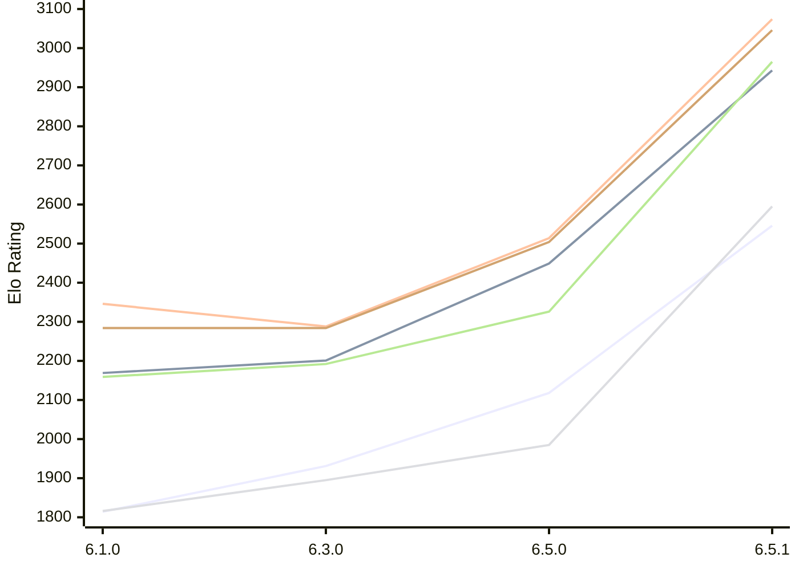

# Engine: Luminex

Author: Cheng Chang

Home: https://github.com/changcheng967/Luminex

## Elo Ratings E1 (Ultra 7 265T (1.50 GHz) - E-Core)

| Version | Published | STC 8.0+0.08s  | LTC 60.0+0.60s | VLTC 2m24s+1.12s | Comment |
| --- | --- | --- | --- | --- | --- |
| 6.5.1 | 2026-11-07 | 2546(+428) | 2943(+494) | 3074(+560) |  |
| 6.5.0 | 2026-11-06 | 2118(+187) | 2449(+248) | 2514(+226) |  |
| 6.3.0 | 2026-10-27 | 1931(+117) | 2201(+32) | 2288(-58) |  |
| 6.1.0 | 2026-09-24 | 1814 | 2169 | 2346 |  |
 | | | cElo (∆ prev) | cElo (∆ prev) | cElo (∆ prev) | 

## Elo Ratings P1 (Ultra 7 265T (1.50 GHz) - P-Core)

| Version | Published | STC 8.0+0.08s  | LTC 60.0+0.60s | VLTC 2m24s+1.12s | Comment |
| --- | --- | --- | --- | --- | --- |
| 6.5.1 | 2026-11-07 | 2595(+610) | 2965(+639) | 3046(+542) |  |
| 6.5.0 | 2026-11-06 | 1985(+90) | 2326(+134) | 2504(+220) |  |
| 6.3.0 | 2026-10-27 | 1895(+79) | 2192(+33) | 2284(0) |  |
| 6.1.0 | 2026-09-24 | 1816 | 2159 | 2284 |  |
 | | | cElo (∆ prev) | cElo (∆ prev) | cElo (∆ prev) | 

## Elo Ratings T1 (i5-7500T 2.70GHz)

| Version | Published | STC 8.0+0.08s  | LTC 60.0+0.60s | VLTC 2m24s+1.12s | Comment |
| --- | --- | --- | --- | --- | --- |
| 6.1.0 | 2026-09-24 | 1816 | 2159 | 2284 |  |
 | | | cElo (∆ prev) | cElo (∆ prev) | cElo (∆ prev) | 

<a href="https://github.com/computer-chess-index/cci/issues/new?template=submit-version.yml&title=[VERSION]+Luminex+<version>&body=###%20Engine%20name%0ALuminex%0A%0A###%20Version%0A6.5.1" target="_blank">Submit new version</a>

 Test Conditions:

GUI/CLI: <a href=https://github.com/cutechess/cutechess target="_blank">Cute-Chess</a> 
Elo Calculation: <a href=https://www.remi-coulom.fr/Bayesian-Elo/ target="_blank">Bayesian-Elo</a> 
CPU for P1: Intel(R) Core(TM) Ultra 7 265T (1.50 GHz) - P-Core 
CPU for E1: Intel(R) Core(TM) Ultra 7 265T (1.50 GHz) - E-Core 
CPU for T1: Intel(R) Core(TM) i5-7500T 2.70GHz 
Opening book: 8_moves_v3 
\* STC: 8.0+0.08s, LTC: 60.0+0.60s, VLTC: 2m24s+1.12s

 Lists:
Ratings: <a href=https://github.com/computer-chess-index/cci/blob/main/lists/CCIRatings.csv target="_blank">Complete list</a>

Generated: 2026-11-13 05:40:01

## Ratings Verlauf E1 / P1

## Detailed Evaluation Results

| Version | Time Control | Variant | Elo  | Range +/- | Matches | Score | Average Opponent Elo | Draws |
| --- | --- |--- | --- | --- | --- | --- | --- | --- |
| 6.5.1 | VLTC (2m24s+1.12s) | E1 | 3074 | 31 | 328 | 57% | 2996 | 43% |
|  |  | P1 | 3046 | 34 | 278 | 60% | 2947 | 44% |
|  | LTC (60.0+0.60s) | E1 | 2943 | 28 | 406 | 48% | 2955 | 42% |
|  |  | P1 | 2965 | 48 | 148 | 56% | 2892 | 32% |
|  | STC (8.0+0.08s) | P1 | 2595 | 44 | 176 | 55% | 2531 | 35% |
|  |  | E1 | 2546 | 36 | 264 | 56% | 2469 | 33% |
| --- | --- |--- | --- | --- | --- | --- | --- | --- |
| 6.5.0 | VLTC (2m24s+1.12s) | P1 | 2504 | 50 | 140 | 54% | 2452 | 24% |
|  |  | E1 | 2514 | 44 | 184 | 53% | 2473 | 24% |
|  | LTC (60.0+0.60s) | P1 | 2326 | 52 | 132 | 51% | 2313 | 20% |
|  |  | E1 | 2449 | 40 | 220 | 53% | 2414 | 26% |
|  | STC (8.0+0.08s) | P1 | 1985 | 50 | 136 | 46% | 2020 | 24% |
|  |  | E1 | 2118 | 42 | 192 | 53% | 2091 | 27% |
| --- | --- |--- | --- | --- | --- | --- | --- | --- |
| 6.3.0 | VLTC (2m24s+1.12s) | E1 | 2288 | 39 | 240 | 50% | 2282 | 18% |
|  |  | P1 | 2284 | 50 | 140 | 53% | 2263 | 24% |
|  | LTC (60.0+0.60s) | E1 | 2201 | 42 | 204 | 51% | 2194 | 15% |
|  |  | P1 | 2192 | 45 | 176 | 53% | 2165 | 18% |
|  | STC (8.0+0.08s) | P1 | 1895 | 42 | 204 | 47% | 1928 | 21% |
|  |  | E1 | 1931 | 42 | 212 | 51% | 1922 | 16% |
| --- | --- |--- | --- | --- | --- | --- | --- | --- |
| 6.1.0 | VLTC (2m24s+1.12s) | P1 | 2284 | 63 | 80 | 50% | 2284 | 30% |
|  |  | E1 | 2346 | 44 | 182 | 49% | 2358 | 22% |
|  | LTC (60.0+0.60s) | P1 | 2159 | 48 | 164 | 55% | 2098 | 18% |
|  |  | E1 | 2169 | 43 | 200 | 52% | 2138 | 16% |
|  | STC (8.0+0.08s) | P1 | 1816 | 44 | 212 | 59% | 1690 | 18% |
|  |  | E1 | 1814 | 40 | 250 | 55% | 1719 | 17% |