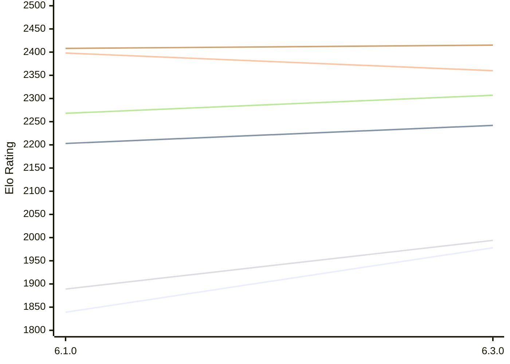

# Engine: Luminex

Author: Cheng Chang

Home: https://github.com/changcheng967/Luminex

## Elo Ratings E1 (Ultra 7 265T (1.50 GHz) - E-Core)

| Version | Published | STC 8.0+0.08s  | LTC 60.0+0.60s | VLTC 2m24s+1.12s | Comment |
| --- | --- | --- | --- | --- | --- |
| 6.3.0 | 2026-10-27 | 1978(+139) | 2242(+39) | 2360(-38) |  |
| 6.1.0 | 2026-09-24 | 1839 | 2203 | 2398 |  |
 | | | cElo (∆ prev) | cElo (∆ prev) | cElo (∆ prev) | 

## Elo Ratings P1 (Ultra 7 265T (1.50 GHz) - P-Core)

| Version | Published | STC 8.0+0.08s  | LTC 60.0+0.60s | VLTC 2m24s+1.12s | Comment |
| --- | --- | --- | --- | --- | --- |
| 6.3.0 | 2026-10-27 | 1994(+105) | 2307(+39) | 2415(+7) |  |
| 6.1.0 | 2026-09-24 | 1889 | 2268 | 2408 |  |
 | | | cElo (∆ prev) | cElo (∆ prev) | cElo (∆ prev) | 

## Elo Ratings T1 (i5-7500T 2.70GHz)

| Version | Published | STC 8.0+0.08s  | LTC 60.0+0.60s | VLTC 2m24s+1.12s | Comment |
| --- | --- | --- | --- | --- | --- |
| 6.1.0 | 2026-09-24 | 1889 | 2268 | 2408 |  |
 | | | cElo (∆ prev) | cElo (∆ prev) | cElo (∆ prev) | 

<a href="https://github.com/computer-chess-index/cci/issues/new?template=submit-version.yml&title=[VERSION]+Luminex+<version>&body=###%20Engine%20name%0ALuminex%0A%0A###%20Version%0A6.3.0" target="_blank">Submit new version</a>

 Test Conditions:

GUI/CLI: <a href=https://github.com/cutechess/cutechess target="_blank">Cute-Chess</a> 
Elo Calculation: <a href=https://www.remi-coulom.fr/Bayesian-Elo/ target="_blank">Bayesian-Elo</a> 
CPU for P1: Intel(R) Core(TM) Ultra 7 265T (1.50 GHz) - P-Core 
CPU for E1: Intel(R) Core(TM) Ultra 7 265T (1.50 GHz) - E-Core 
CPU for T1: Intel(R) Core(TM) i5-7500T 2.70GHz 
Opening book: 8_moves_v3 
\* STC: 8.0+0.08s, LTC: 60.0+0.60s, VLTC: 2m24s+1.12s

 Lists:
Ratings: <a href=https://github.com/computer-chess-index/cci/blob/main/lists/CCIRatings.csv target="_blank">Complete list</a>

Generated: 2026-11-03 05:39:52

## Ratings Verlauf E1 / P1

## Detailed Evaluation Results

| Version | Time Control | Variant | Elo  | Range +/- | Matches | Score | Average Opponent Elo | Draws |
| --- | --- |--- | --- | --- | --- | --- | --- | --- |
| 6.3.0 | VLTC (2m24s+1.12s) | P1 | 2415 | 54 | 116 | 54% | 2377 | 24% |
|  |  | E1 | 2360 | 45 | 172 | 53% | 2330 | 20% |
|  | LTC (60.0+0.60s) | P1 | 2307 | 50 | 144 | 53% | 2273 | 17% |
|  |  | E1 | 2242 | 46 | 172 | 51% | 2228 | 16% |
|  | STC (8.0+0.08s) | P1 | 1994 | 46 | 168 | 47% | 2024 | 21% |
|  |  | E1 | 1978 | 45 | 184 | 52% | 1955 | 14% |
| --- | --- |--- | --- | --- | --- | --- | --- | --- |
| 6.1.0 | VLTC (2m24s+1.12s) | P1 | 2408 | 63 | 80 | 50% | 2407 | 30% |
|  |  | E1 | 2398 | 44 | 182 | 49% | 2410 | 22% |
|  | LTC (60.0+0.60s) | E1 | 2203 | 43 | 200 | 52% | 2172 | 16% |
|  |  | P1 | 2268 | 48 | 164 | 55% | 2206 | 18% |
|  | STC (8.0+0.08s) | E1 | 1839 | 40 | 250 | 55% | 1740 | 17% |
|  |  | P1 | 1889 | 44 | 212 | 59% | 1756 | 18% |