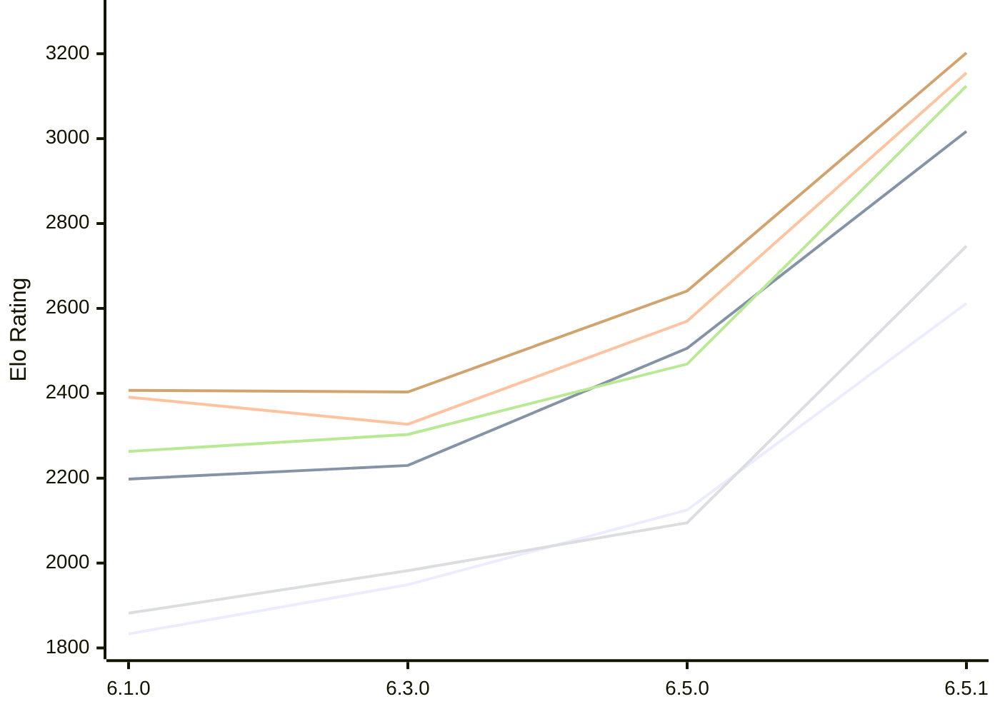

# Engine: Luminex

Author: Cheng Chang

Home: https://github.com/changcheng967/Luminex

## Elo Ratings E1 (Ultra 7 265T (1.50 GHz) - E-Core)

| Version | Published | STC 8.0+0.08s  | LTC 60.0+0.60s | VLTC 2m24s+1.12s | Comment |
| --- | --- | --- | --- | --- | --- |
| 6.5.1 | 2026-11-07 | 2612(+487) | 3017(+511) | 3155(+585) |  |
| 6.5.0 | 2026-11-06 | 2125(+176) | 2506(+276) | 2570(+243) |  |
| 6.3.0 | 2026-10-27 | 1949(+116) | 2230(+32) | 2327(-64) |  |
| 6.1.0 | 2026-09-24 | 1833 | 2198 | 2391 |  |
 | | | cElo (∆ prev) | cElo (∆ prev) | cElo (∆ prev) | 

## Elo Ratings P1 (Ultra 7 265T (1.50 GHz) - P-Core)

| Version | Published | STC 8.0+0.08s  | LTC 60.0+0.60s | VLTC 2m24s+1.12s | Comment |
| --- | --- | --- | --- | --- | --- |
| 6.5.1 | 2026-11-07 | 2747(+652) | 3124(+655) | 3202(+561) |  |
| 6.5.0 | 2026-11-06 | 2095(+113) | 2469(+166) | 2641(+238) |  |
| 6.3.0 | 2026-10-27 | 1982(+100) | 2303(+40) | 2403(-4) |  |
| 6.1.0 | 2026-09-24 | 1882 | 2263 | 2407 |  |
 | | | cElo (∆ prev) | cElo (∆ prev) | cElo (∆ prev) | 

## Elo Ratings T1 (i5-7500T 2.70GHz)

| Version | Published | STC 8.0+0.08s  | LTC 60.0+0.60s | VLTC 2m24s+1.12s | Comment |
| --- | --- | --- | --- | --- | --- |
| 6.1.0 | 2026-09-24 | 1882 | 2263 | 2407 |  |
 | | | cElo (∆ prev) | cElo (∆ prev) | cElo (∆ prev) | 

<a href="https://github.com/computer-chess-index/cci/issues/new?template=submit-version.yml&title=[VERSION]+Luminex+<version>&body=###%20Engine%20name%0ALuminex%0A%0A###%20Version%0A6.5.1" target="_blank">Submit new version</a>

 Test Conditions:

GUI/CLI: <a href=https://github.com/cutechess/cutechess target="_blank">Cute-Chess</a> 
Elo Calculation: <a href=https://www.remi-coulom.fr/Bayesian-Elo/ target="_blank">Bayesian-Elo</a> 
CPU for P1: Intel(R) Core(TM) Ultra 7 265T (1.50 GHz) - P-Core 
CPU for E1: Intel(R) Core(TM) Ultra 7 265T (1.50 GHz) - E-Core 
CPU for T1: Intel(R) Core(TM) i5-7500T 2.70GHz 
Opening book: 8_moves_v3 
\* STC: 8.0+0.08s, LTC: 60.0+0.60s, VLTC: 2m24s+1.12s

 Lists:
Ratings: <a href=https://github.com/computer-chess-index/cci/blob/main/lists/CCIRatings.csv target="_blank">Complete list</a>

Generated: 2026-11-09 05:39:49

## Ratings Verlauf E1 / P1

## Detailed Evaluation Results

| Version | Time Control | Variant | Elo  | Range +/- | Matches | Score | Average Opponent Elo | Draws |
| --- | --- |--- | --- | --- | --- | --- | --- | --- |
| 6.5.1 | VLTC (2m24s+1.12s) | P1 | 3202 | 34 | 274 | 60% | 3101 | 43% |
|  |  | E1 | 3155 | 32 | 306 | 58% | 3067 | 44% |
|  | LTC (60.0+0.60s) | P1 | 3124 | 51 | 132 | 57% | 3036 | 32% |
|  |  | E1 | 3017 | 28 | 382 | 48% | 3029 | 42% |
|  | STC (8.0+0.08s) | E1 | 2612 | 37 | 236 | 56% | 2547 | 34% |
|  |  | P1 | 2747 | 45 | 168 | 57% | 2670 | 36% |
| --- | --- |--- | --- | --- | --- | --- | --- | --- |
| 6.5.0 | VLTC (2m24s+1.12s) | P1 | 2641 | 52 | 124 | 52% | 2624 | 24% |
|  |  | E1 | 2570 | 45 | 172 | 52% | 2547 | 24% |
|  | LTC (60.0+0.60s) | P1 | 2469 | 54 | 120 | 52% | 2448 | 21% |
|  |  | E1 | 2506 | 40 | 208 | 52% | 2480 | 27% |
|  | STC (8.0+0.08s) | P1 | 2095 | 53 | 120 | 47% | 2122 | 26% |
|  |  | E1 | 2125 | 45 | 168 | 52% | 2109 | 27% |
| --- | --- |--- | --- | --- | --- | --- | --- | --- |
| 6.3.0 | VLTC (2m24s+1.12s) | P1 | 2403 | 50 | 140 | 53% | 2381 | 24% |
|  |  | E1 | 2327 | 39 | 240 | 50% | 2321 | 18% |
|  | LTC (60.0+0.60s) | P1 | 2303 | 45 | 176 | 53% | 2276 | 18% |
|  |  | E1 | 2230 | 42 | 204 | 51% | 2223 | 15% |
|  | STC (8.0+0.08s) | E1 | 1949 | 42 | 212 | 51% | 1941 | 16% |
|  |  | P1 | 1982 | 42 | 204 | 47% | 2013 | 21% |
| --- | --- |--- | --- | --- | --- | --- | --- | --- |
| 6.1.0 | VLTC (2m24s+1.12s) | P1 | 2407 | 63 | 80 | 50% | 2406 | 30% |
|  |  | E1 | 2391 | 44 | 182 | 49% | 2403 | 22% |
|  | LTC (60.0+0.60s) | P1 | 2263 | 48 | 164 | 55% | 2201 | 18% |
|  |  | E1 | 2198 | 43 | 200 | 52% | 2167 | 16% |
|  | STC (8.0+0.08s) | P1 | 1882 | 44 | 212 | 59% | 1750 | 18% |
|  |  | E1 | 1833 | 40 | 250 | 55% | 1736 | 17% |