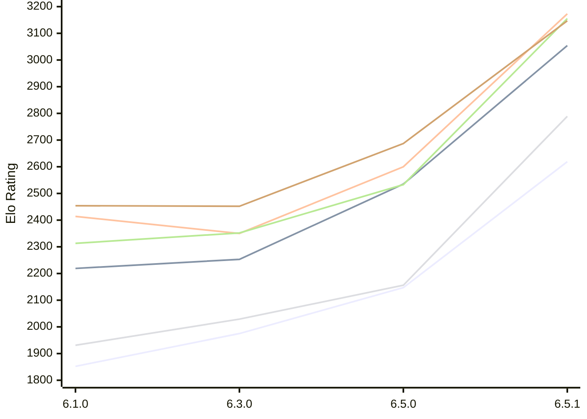

# Engine: Luminex

Author: Cheng Chang

Home: https://github.com/changcheng967/Luminex

## Elo Ratings E1 (Ultra 7 265T (1.50 GHz) - E-Core)

| Version | Published | STC 8.0+0.08s  | LTC 60.0+0.60s | VLTC 2m24s+1.12s | Comment |
| --- | --- | --- | --- | --- | --- |
| 6.5.1 | 2026-11-07 | 2619(+472) | 3054(+519) | 3173(+573) |  |
| 6.5.0 | 2026-11-06 | 2147(+172) | 2535(+282) | 2600(+250) |  |
| 6.3.0 | 2026-10-27 | 1975(+123) | 2253(+34) | 2350(-64) |  |
| 6.1.0 | 2026-09-24 | 1852 | 2219 | 2414 |  |
 | | | cElo (∆ prev) | cElo (∆ prev) | cElo (∆ prev) | 

## Elo Ratings P1 (Ultra 7 265T (1.50 GHz) - P-Core)

| Version | Published | STC 8.0+0.08s  | LTC 60.0+0.60s | VLTC 2m24s+1.12s | Comment |
| --- | --- | --- | --- | --- | --- |
| 6.5.1 | 2026-11-07 | 2789(+633) | 3155(+622) | 3147(+460) |  |
| 6.5.0 | 2026-11-06 | 2156(+127) | 2533(+181) | 2687(+235) |  |
| 6.3.0 | 2026-10-27 | 2029(+98) | 2352(+39) | 2452(-2) |  |
| 6.1.0 | 2026-09-24 | 1931 | 2313 | 2454 |  |
 | | | cElo (∆ prev) | cElo (∆ prev) | cElo (∆ prev) | 

## Elo Ratings T1 (i5-7500T 2.70GHz)

| Version | Published | STC 8.0+0.08s  | LTC 60.0+0.60s | VLTC 2m24s+1.12s | Comment |
| --- | --- | --- | --- | --- | --- |
| 6.1.0 | 2026-09-24 | 1931 | 2313 | 2454 |  |
 | | | cElo (∆ prev) | cElo (∆ prev) | cElo (∆ prev) | 

<a href="https://github.com/computer-chess-index/cci/issues/new?template=submit-version.yml&title=[VERSION]+Luminex+<version>&body=###%20Engine%20name%0ALuminex%0A%0A###%20Version%0A6.5.1" target="_blank">Submit new version</a>

 Test Conditions:

GUI/CLI: <a href=https://github.com/cutechess/cutechess target="_blank">Cute-Chess</a> 
Elo Calculation: <a href=https://www.remi-coulom.fr/Bayesian-Elo/ target="_blank">Bayesian-Elo</a> 
CPU for P1: Intel(R) Core(TM) Ultra 7 265T (1.50 GHz) - P-Core 
CPU for E1: Intel(R) Core(TM) Ultra 7 265T (1.50 GHz) - E-Core 
CPU for T1: Intel(R) Core(TM) i5-7500T 2.70GHz 
Opening book: 8_moves_v3 
\* STC: 8.0+0.08s, LTC: 60.0+0.60s, VLTC: 2m24s+1.12s

 Lists:
Ratings: <a href=https://github.com/computer-chess-index/cci/blob/main/lists/CCIRatings.csv target="_blank">Complete list</a>

Generated: 2026-11-07 06:43:44

## Ratings Verlauf E1 / P1

## Detailed Evaluation Results

| Version | Time Control | Variant | Elo  | Range +/- | Matches | Score | Average Opponent Elo | Draws |
| --- | --- |--- | --- | --- | --- | --- | --- | --- |
| 6.5.1 | VLTC (2m24s+1.12s) | E1 | 3173 | 43 | 184 | 63% | 3032 | 36% |
|  |  | P1 | 3147 | 72 | 72 | 67% | 2963 | 29% |
|  | LTC (60.0+0.60s) | E1 | 3054 | 44 | 164 | 47% | 3060 | 38% |
|  |  | P1 | 3155 | 70 | 76 | 61% | 3008 | 28% |
|  | STC (8.0+0.08s) | P1 | 2789 | 68 | 76 | 64% | 2624 | 38% |
|  |  | E1 | 2619 | 58 | 104 | 61% | 2496 | 30% |
| --- | --- |--- | --- | --- | --- | --- | --- | --- |
| 6.5.0 | VLTC (2m24s+1.12s) | P1 | 2687 | 52 | 124 | 52% | 2672 | 24% |
|  |  | E1 | 2600 | 46 | 160 | 53% | 2565 | 25% |
|  | LTC (60.0+0.60s) | P1 | 2533 | 55 | 116 | 54% | 2493 | 22% |
|  |  | E1 | 2535 | 41 | 200 | 53% | 2504 | 28% |
|  | STC (8.0+0.08s) | P1 | 2156 | 54 | 116 | 48% | 2172 | 26% |
|  |  | E1 | 2147 | 45 | 164 | 52% | 2129 | 27% |
| --- | --- |--- | --- | --- | --- | --- | --- | --- |
| 6.3.0 | VLTC (2m24s+1.12s) | E1 | 2350 | 39 | 240 | 50% | 2344 | 18% |
|  |  | P1 | 2452 | 50 | 140 | 53% | 2430 | 24% |
|  | LTC (60.0+0.60s) | E1 | 2253 | 42 | 204 | 51% | 2245 | 15% |
|  |  | P1 | 2352 | 45 | 176 | 53% | 2325 | 18% |
|  | STC (8.0+0.08s) | P1 | 2029 | 42 | 204 | 47% | 2061 | 21% |
|  |  | E1 | 1975 | 42 | 212 | 51% | 1966 | 16% |
| --- | --- |--- | --- | --- | --- | --- | --- | --- |
| 6.1.0 | VLTC (2m24s+1.12s) | P1 | 2454 | 63 | 80 | 50% | 2454 | 30% |
|  |  | E1 | 2414 | 44 | 182 | 49% | 2426 | 22% |
|  | LTC (60.0+0.60s) | P1 | 2313 | 48 | 164 | 55% | 2249 | 18% |
|  |  | E1 | 2219 | 43 | 200 | 52% | 2188 | 16% |
|  | STC (8.0+0.08s) | P1 | 1931 | 44 | 212 | 59% | 1796 | 18% |
|  |  | E1 | 1852 | 40 | 250 | 55% | 1754 | 17% |