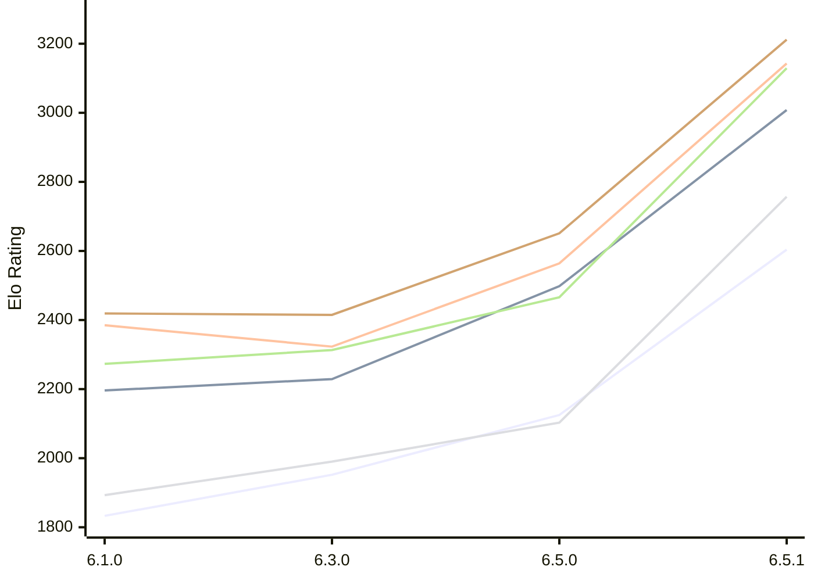

# Engine: Luminex

Author: Cheng Chang

Home: https://github.com/changcheng967/Luminex

## Elo Ratings E1 (Ultra 7 265T (1.50 GHz) - E-Core)

| Version | Published | STC 8.0+0.08s  | LTC 60.0+0.60s | VLTC 2m24s+1.12s | Comment |
| --- | --- | --- | --- | --- | --- |
| 6.5.1 | 2026-11-07 | 2604(+479) | 3008(+510) | 3143(+579) |  |
| 6.5.0 | 2026-11-06 | 2125(+173) | 2498(+269) | 2564(+241) |  |
| 6.3.0 | 2026-10-27 | 1952(+119) | 2229(+33) | 2323(-62) |  |
| 6.1.0 | 2026-09-24 | 1833 | 2196 | 2385 |  |
 | | | cElo (∆ prev) | cElo (∆ prev) | cElo (∆ prev) | 

## Elo Ratings P1 (Ultra 7 265T (1.50 GHz) - P-Core)

| Version | Published | STC 8.0+0.08s  | LTC 60.0+0.60s | VLTC 2m24s+1.12s | Comment |
| --- | --- | --- | --- | --- | --- |
| 6.5.1 | 2026-11-07 | 2757(+654) | 3129(+663) | 3212(+561) |  |
| 6.5.0 | 2026-11-06 | 2103(+113) | 2466(+153) | 2651(+236) |  |
| 6.3.0 | 2026-10-27 | 1990(+97) | 2313(+40) | 2415(-4) |  |
| 6.1.0 | 2026-09-24 | 1893 | 2273 | 2419 |  |
 | | | cElo (∆ prev) | cElo (∆ prev) | cElo (∆ prev) | 

## Elo Ratings T1 (i5-7500T 2.70GHz)

| Version | Published | STC 8.0+0.08s  | LTC 60.0+0.60s | VLTC 2m24s+1.12s | Comment |
| --- | --- | --- | --- | --- | --- |
| 6.1.0 | 2026-09-24 | 1893 | 2273 | 2419 |  |
 | | | cElo (∆ prev) | cElo (∆ prev) | cElo (∆ prev) | 

<a href="https://github.com/computer-chess-index/cci/issues/new?template=submit-version.yml&title=[VERSION]+Luminex+<version>&body=###%20Engine%20name%0ALuminex%0A%0A###%20Version%0A6.5.1" target="_blank">Submit new version</a>

 Test Conditions:

GUI/CLI: <a href=https://github.com/cutechess/cutechess target="_blank">Cute-Chess</a> 
Elo Calculation: <a href=https://www.remi-coulom.fr/Bayesian-Elo/ target="_blank">Bayesian-Elo</a> 
CPU for P1: Intel(R) Core(TM) Ultra 7 265T (1.50 GHz) - P-Core 
CPU for E1: Intel(R) Core(TM) Ultra 7 265T (1.50 GHz) - E-Core 
CPU for T1: Intel(R) Core(TM) i5-7500T 2.70GHz 
Opening book: 8_moves_v3 
\* STC: 8.0+0.08s, LTC: 60.0+0.60s, VLTC: 2m24s+1.12s

 Lists:
Ratings: <a href=https://github.com/computer-chess-index/cci/blob/main/lists/CCIRatings.csv target="_blank">Complete list</a>

Generated: 2026-11-12 05:39:40

## Ratings Verlauf E1 / P1

## Detailed Evaluation Results

| Version | Time Control | Variant | Elo  | Range +/- | Matches | Score | Average Opponent Elo | Draws |
| --- | --- |--- | --- | --- | --- | --- | --- | --- |
| 6.5.1 | VLTC (2m24s+1.12s) | P1 | 3212 | 34 | 278 | 60% | 3112 | 44% |
|  |  | E1 | 3143 | 31 | 324 | 58% | 3062 | 43% |
|  | LTC (60.0+0.60s) | E1 | 3008 | 28 | 394 | 48% | 3019 | 42% |
|  |  | P1 | 3129 | 48 | 148 | 56% | 3056 | 32% |
|  | STC (8.0+0.08s) | E1 | 2604 | 37 | 248 | 56% | 2538 | 33% |
|  |  | P1 | 2757 | 44 | 172 | 57% | 2678 | 35% |
| --- | --- |--- | --- | --- | --- | --- | --- | --- |
| 6.5.0 | VLTC (2m24s+1.12s) | P1 | 2651 | 52 | 128 | 53% | 2615 | 23% |
|  |  | E1 | 2564 | 45 | 176 | 53% | 2529 | 23% |
|  | LTC (60.0+0.60s) | P1 | 2466 | 53 | 124 | 50% | 2461 | 20% |
|  |  | E1 | 2498 | 40 | 208 | 52% | 2473 | 27% |
|  | STC (8.0+0.08s) | P1 | 2103 | 52 | 124 | 48% | 2125 | 26% |
|  |  | E1 | 2125 | 45 | 168 | 52% | 2107 | 27% |
| --- | --- |--- | --- | --- | --- | --- | --- | --- |
| 6.3.0 | VLTC (2m24s+1.12s) | P1 | 2415 | 50 | 140 | 53% | 2394 | 24% |
|  |  | E1 | 2323 | 39 | 240 | 50% | 2317 | 18% |
|  | LTC (60.0+0.60s) | E1 | 2229 | 42 | 204 | 51% | 2222 | 15% |
|  |  | P1 | 2313 | 45 | 176 | 53% | 2286 | 18% |
|  | STC (8.0+0.08s) | E1 | 1952 | 42 | 212 | 51% | 1944 | 16% |
|  |  | P1 | 1990 | 42 | 204 | 47% | 2022 | 21% |
| --- | --- |--- | --- | --- | --- | --- | --- | --- |
| 6.1.0 | VLTC (2m24s+1.12s) | P1 | 2419 | 63 | 80 | 50% | 2418 | 30% |
|  |  | E1 | 2385 | 44 | 182 | 49% | 2398 | 22% |
|  | LTC (60.0+0.60s) | P1 | 2273 | 48 | 164 | 55% | 2211 | 18% |
|  |  | E1 | 2196 | 43 | 200 | 52% | 2165 | 16% |
|  | STC (8.0+0.08s) | P1 | 1893 | 44 | 212 | 59% | 1759 | 18% |
|  |  | E1 | 1833 | 40 | 250 | 55% | 1736 | 17% |