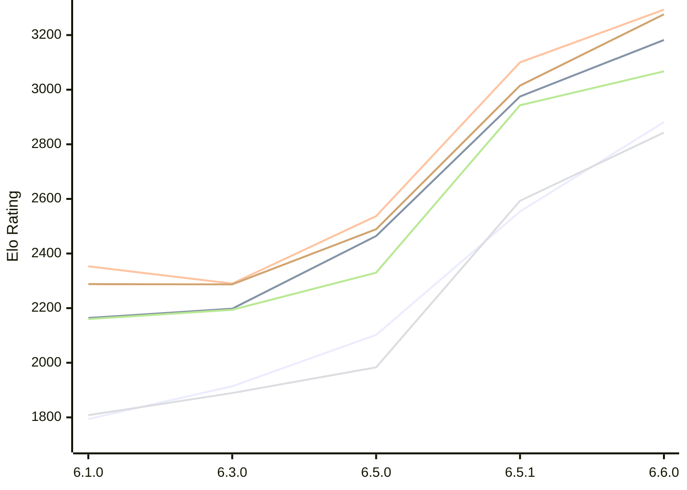

# Engine: Luminex

Author: Cheng Chang

Home: https://github.com/changcheng967/Luminex

## Elo Ratings E1 (Ultra 7 265T (1.50 GHz) - E-Core)

| Version | Published | STC 8.0+0.08s  | LTC 60.0+0.60s | VLTC 2m24s+1.12s | Comment |
| --- | --- | --- | --- | --- | --- |
| 6.6.0 | 2026-11-14 | 2881(+327) | 3182(+207) | 3293(+193) |  |
| 6.5.1 | 2026-11-07 | 2554(+452) | 2975(+511) | 3100(+563) |  |
| 6.5.0 | 2026-11-06 | 2102(+188) | 2464(+266) | 2537(+247) |  |
| 6.3.0 | 2026-10-27 | 1914(+120) | 2198(+34) | 2290(-63) |  |
| 6.1.0 | 2026-09-24 | 1794 | 2164 | 2353 |  |
 | | | cElo (∆ prev) | cElo (∆ prev) | cElo (∆ prev) | 

## Elo Ratings P1 (Ultra 7 265T (1.50 GHz) - P-Core)

| Version | Published | STC 8.0+0.08s  | LTC 60.0+0.60s | VLTC 2m24s+1.12s | Comment |
| --- | --- | --- | --- | --- | --- |
| 6.6.0 | 2026-11-14 | 2843(+250) | 3067(+124) | 3276(+261) |  |
| 6.5.1 | 2026-11-07 | 2593(+610) | 2943(+613) | 3015(+526) |  |
| 6.5.0 | 2026-11-06 | 1983(+94) | 2330(+136) | 2489(+202) |  |
| 6.3.0 | 2026-10-27 | 1889(+81) | 2194(+34) | 2287(-1) |  |
| 6.1.0 | 2026-09-24 | 1808 | 2160 | 2288 |  |
 | | | cElo (∆ prev) | cElo (∆ prev) | cElo (∆ prev) | 

## Elo Ratings T1 (i5-7500T 2.70GHz)

| Version | Published | STC 8.0+0.08s  | LTC 60.0+0.60s | VLTC 2m24s+1.12s | Comment |
| --- | --- | --- | --- | --- | --- |
| 6.1.0 | 2026-09-24 | 1808 | 2160 | 2288 |  |
 | | | cElo (∆ prev) | cElo (∆ prev) | cElo (∆ prev) | 

<a href="https://github.com/computer-chess-index/cci/issues/new?template=submit-version.yml&title=[VERSION]+Luminex+<version>&body=###%20Engine%20name%0ALuminex%0A%0A###%20Version%0A6.6.0" target="_blank">Submit new version</a>

 Test Conditions:

GUI/CLI: <a href=https://github.com/cutechess/cutechess target="_blank">Cute-Chess</a> 
Elo Calculation: <a href=https://www.remi-coulom.fr/Bayesian-Elo/ target="_blank">Bayesian-Elo</a> 
CPU for P1: Intel(R) Core(TM) Ultra 7 265T (1.50 GHz) - P-Core 
CPU for E1: Intel(R) Core(TM) Ultra 7 265T (1.50 GHz) - E-Core 
CPU for T1: Intel(R) Core(TM) i5-7500T 2.70GHz 
Opening book: 8_moves_v3 
\* STC: 8.0+0.08s, LTC: 60.0+0.60s, VLTC: 2m24s+1.12s

 Lists:
Ratings: <a href=https://github.com/computer-chess-index/cci/blob/main/lists/CCIRatings.csv target="_blank">Complete list</a>

Generated: 2026-11-16 05:39:54

## Ratings Verlauf E1 / P1

## Detailed Evaluation Results

| Version | Time Control | Variant | Elo  | Range +/- | Matches | Score | Average Opponent Elo | Draws |
| --- | --- |--- | --- | --- | --- | --- | --- | --- |
| 6.6.0 | VLTC (2m24s+1.12s) | P1 | 3276 | 268 | 4 | 88% | 3009 | 25% |
|  |  | E1 | 3293 | 128 | 16 | 66% | 3179 | 56% |
|  | LTC (60.0+0.60s) | P1 | 3067 | 164 | 12 | 71% | 2889 | 25% |
|  |  | E1 | 3182 | 122 | 20 | 53% | 3158 | 35% |
|  | STC (8.0+0.08s) | P1 | 2843 | 157 | 12 | 58% | 2768 | 33% |
|  |  | E1 | 2881 | 132 | 20 | 65% | 2742 | 20% |
| --- | --- |--- | --- | --- | --- | --- | --- | --- |
| 6.5.1 | VLTC (2m24s+1.12s) | E1 | 3100 | 31 | 336 | 57% | 3025 | 43% |
|  |  | P1 | 3015 | 32 | 298 | 59% | 2931 | 43% |
|  | LTC (60.0+0.60s) | E1 | 2975 | 27 | 426 | 49% | 2982 | 41% |
|  |  | P1 | 2943 | 46 | 160 | 56% | 2877 | 33% |
|  | STC (8.0+0.08s) | E1 | 2554 | 34 | 290 | 55% | 2485 | 32% |
|  |  | P1 | 2593 | 43 | 184 | 56% | 2525 | 34% |
| --- | --- |--- | --- | --- | --- | --- | --- | --- |
| 6.5.0 | VLTC (2m24s+1.12s) | P1 | 2489 | 50 | 144 | 52% | 2457 | 23% |
|  |  | E1 | 2537 | 41 | 208 | 53% | 2498 | 25% |
|  | LTC (60.0+0.60s) | P1 | 2330 | 51 | 144 | 49% | 2352 | 19% |
|  |  | E1 | 2464 | 39 | 228 | 53% | 2425 | 27% |
|  | STC (8.0+0.08s) | P1 | 1983 | 46 | 164 | 48% | 2006 | 22% |
|  |  | E1 | 2102 | 41 | 200 | 52% | 2083 | 26% |
| --- | --- |--- | --- | --- | --- | --- | --- | --- |
| 6.3.0 | VLTC (2m24s+1.12s) | E1 | 2290 | 39 | 240 | 50% | 2283 | 18% |
|  |  | P1 | 2287 | 50 | 140 | 53% | 2265 | 24% |
|  | LTC (60.0+0.60s) | E1 | 2198 | 42 | 204 | 51% | 2191 | 15% |
|  |  | P1 | 2194 | 45 | 176 | 53% | 2168 | 18% |
|  | STC (8.0+0.08s) | E1 | 1914 | 42 | 212 | 51% | 1906 | 16% |
|  |  | P1 | 1889 | 42 | 204 | 47% | 1921 | 21% |
| --- | --- |--- | --- | --- | --- | --- | --- | --- |
| 6.1.0 | VLTC (2m24s+1.12s) | P1 | 2288 | 63 | 80 | 50% | 2288 | 30% |
|  |  | E1 | 2353 | 44 | 182 | 49% | 2365 | 22% |
|  | LTC (60.0+0.60s) | P1 | 2160 | 48 | 164 | 55% | 2099 | 18% |
|  |  | E1 | 2164 | 44 | 200 | 52% | 2133 | 16% |
|  | STC (8.0+0.08s) | P1 | 1808 | 44 | 212 | 59% | 1681 | 18% |
|  |  | E1 | 1794 | 40 | 250 | 55% | 1700 | 17% |