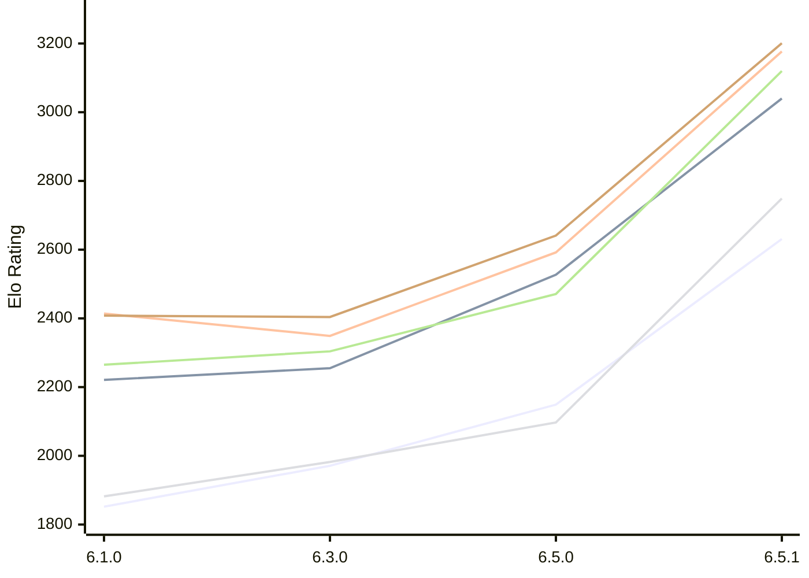

# Engine: Luminex

Author: Cheng Chang

Home: https://github.com/changcheng967/Luminex

## Elo Ratings E1 (Ultra 7 265T (1.50 GHz) - E-Core)

| Version | Published | STC 8.0+0.08s  | LTC 60.0+0.60s | VLTC 2m24s+1.12s | Comment |
| --- | --- | --- | --- | --- | --- |
| 6.5.1 | 2026-11-07 | 2631(+482) | 3040(+513) | 3177(+585) |  |
| 6.5.0 | 2026-11-06 | 2149(+178) | 2527(+272) | 2592(+243) |  |
| 6.3.0 | 2026-10-27 | 1971(+119) | 2255(+34) | 2349(-65) |  |
| 6.1.0 | 2026-09-24 | 1852 | 2221 | 2414 |  |
 | | | cElo (∆ prev) | cElo (∆ prev) | cElo (∆ prev) | 

## Elo Ratings P1 (Ultra 7 265T (1.50 GHz) - P-Core)

| Version | Published | STC 8.0+0.08s  | LTC 60.0+0.60s | VLTC 2m24s+1.12s | Comment |
| --- | --- | --- | --- | --- | --- |
| 6.5.1 | 2026-11-07 | 2749(+652) | 3120(+649) | 3201(+560) |  |
| 6.5.0 | 2026-11-06 | 2097(+115) | 2471(+167) | 2641(+237) |  |
| 6.3.0 | 2026-10-27 | 1982(+100) | 2304(+39) | 2404(-4) |  |
| 6.1.0 | 2026-09-24 | 1882 | 2265 | 2408 |  |
 | | | cElo (∆ prev) | cElo (∆ prev) | cElo (∆ prev) | 

## Elo Ratings T1 (i5-7500T 2.70GHz)

| Version | Published | STC 8.0+0.08s  | LTC 60.0+0.60s | VLTC 2m24s+1.12s | Comment |
| --- | --- | --- | --- | --- | --- |
| 6.1.0 | 2026-09-24 | 1882 | 2265 | 2408 |  |
 | | | cElo (∆ prev) | cElo (∆ prev) | cElo (∆ prev) | 

<a href="https://github.com/computer-chess-index/cci/issues/new?template=submit-version.yml&title=[VERSION]+Luminex+<version>&body=###%20Engine%20name%0ALuminex%0A%0A###%20Version%0A6.5.1" target="_blank">Submit new version</a>

 Test Conditions:

GUI/CLI: <a href=https://github.com/cutechess/cutechess target="_blank">Cute-Chess</a> 
Elo Calculation: <a href=https://www.remi-coulom.fr/Bayesian-Elo/ target="_blank">Bayesian-Elo</a> 
CPU for P1: Intel(R) Core(TM) Ultra 7 265T (1.50 GHz) - P-Core 
CPU for E1: Intel(R) Core(TM) Ultra 7 265T (1.50 GHz) - E-Core 
CPU for T1: Intel(R) Core(TM) i5-7500T 2.70GHz 
Opening book: 8_moves_v3 
\* STC: 8.0+0.08s, LTC: 60.0+0.60s, VLTC: 2m24s+1.12s

 Lists:
Ratings: <a href=https://github.com/computer-chess-index/cci/blob/main/lists/CCIRatings.csv target="_blank">Complete list</a>

Generated: 2026-11-11 05:39:44

## Ratings Verlauf E1 / P1

## Detailed Evaluation Results

| Version | Time Control | Variant | Elo  | Range +/- | Matches | Score | Average Opponent Elo | Draws |
| --- | --- |--- | --- | --- | --- | --- | --- | --- |
| 6.5.1 | VLTC (2m24s+1.12s) | P1 | 3201 | 34 | 278 | 60% | 3101 | 44% |
|  |  | E1 | 3177 | 31 | 320 | 58% | 3094 | 43% |
|  | LTC (60.0+0.60s) | P1 | 3120 | 48 | 148 | 56% | 3047 | 32% |
|  |  | E1 | 3040 | 28 | 394 | 48% | 3051 | 42% |
|  | STC (8.0+0.08s) | E1 | 2631 | 37 | 240 | 55% | 2572 | 34% |
|  |  | P1 | 2749 | 45 | 168 | 57% | 2670 | 36% |
| --- | --- |--- | --- | --- | --- | --- | --- | --- |
| 6.5.0 | VLTC (2m24s+1.12s) | P1 | 2641 | 52 | 124 | 52% | 2624 | 24% |
|  |  | E1 | 2592 | 45 | 172 | 52% | 2569 | 24% |
|  | LTC (60.0+0.60s) | P1 | 2471 | 54 | 120 | 52% | 2449 | 21% |
|  |  | E1 | 2527 | 40 | 208 | 52% | 2502 | 27% |
|  | STC (8.0+0.08s) | P1 | 2097 | 53 | 120 | 47% | 2124 | 26% |
|  |  | E1 | 2149 | 45 | 168 | 52% | 2132 | 27% |
| --- | --- |--- | --- | --- | --- | --- | --- | --- |
| 6.3.0 | VLTC (2m24s+1.12s) | P1 | 2404 | 50 | 140 | 53% | 2383 | 24% |
|  |  | E1 | 2349 | 39 | 240 | 50% | 2342 | 18% |
|  | LTC (60.0+0.60s) | P1 | 2304 | 45 | 176 | 53% | 2277 | 18% |
|  |  | E1 | 2255 | 42 | 204 | 51% | 2248 | 15% |
|  | STC (8.0+0.08s) | E1 | 1971 | 42 | 212 | 51% | 1963 | 16% |
|  |  | P1 | 1982 | 42 | 204 | 47% | 2014 | 21% |
| --- | --- |--- | --- | --- | --- | --- | --- | --- |
| 6.1.0 | VLTC (2m24s+1.12s) | P1 | 2408 | 63 | 80 | 50% | 2407 | 30% |
|  |  | E1 | 2414 | 44 | 182 | 49% | 2426 | 22% |
|  | LTC (60.0+0.60s) | P1 | 2265 | 48 | 164 | 55% | 2202 | 18% |
|  |  | E1 | 2221 | 43 | 200 | 52% | 2190 | 16% |
|  | STC (8.0+0.08s) | P1 | 1882 | 44 | 212 | 59% | 1750 | 18% |
|  |  | E1 | 1852 | 40 | 250 | 55% | 1754 | 17% |