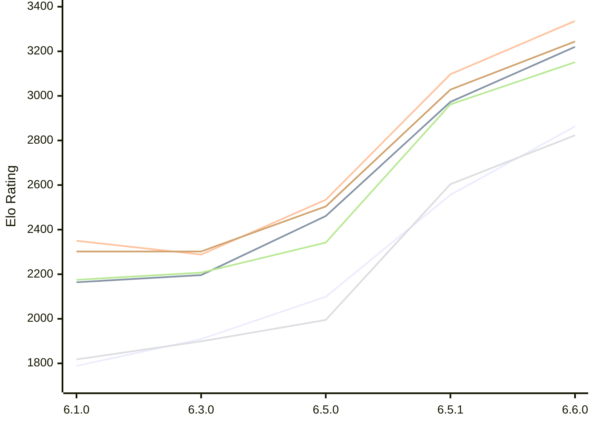

# Engine: Luminex

Author: Cheng Chang

Home: https://github.com/changcheng967/Luminex

## Elo Ratings E1 (Ultra 7 265T (1.50 GHz) - E-Core)

| Version | Published | STC 8.0+0.08s  | LTC 60.0+0.60s | VLTC 2m24s+1.12s | Comment |
| --- | --- | --- | --- | --- | --- |
| 6.6.0 | 2026-11-14 | 2863(+307) | 3220(+247) | 3336(+239) |  |
| 6.5.1 | 2026-11-07 | 2556(+457) | 2973(+512) | 3097(+563) |  |
| 6.5.0 | 2026-11-06 | 2099(+190) | 2461(+265) | 2534(+246) |  |
| 6.3.0 | 2026-10-27 | 1909(+120) | 2196(+32) | 2288(-62) |  |
| 6.1.0 | 2026-09-24 | 1789 | 2164 | 2350 |  |
 | | | cElo (∆ prev) | cElo (∆ prev) | cElo (∆ prev) | 

## Elo Ratings P1 (Ultra 7 265T (1.50 GHz) - P-Core)

| Version | Published | STC 8.0+0.08s  | LTC 60.0+0.60s | VLTC 2m24s+1.12s | Comment |
| --- | --- | --- | --- | --- | --- |
| 6.6.0 | 2026-11-14 | 2823(+219) | 3151(+189) | 3244(+216) |  |
| 6.5.1 | 2026-11-07 | 2604(+609) | 2962(+620) | 3028(+524) |  |
| 6.5.0 | 2026-11-06 | 1995(+96) | 2342(+135) | 2504(+202) |  |
| 6.3.0 | 2026-10-27 | 1899(+81) | 2207(+32) | 2302(0) |  |
| 6.1.0 | 2026-09-24 | 1818 | 2175 | 2302 |  |
 | | | cElo (∆ prev) | cElo (∆ prev) | cElo (∆ prev) | 

## Elo Ratings T1 (i5-7500T 2.70GHz)

| Version | Published | STC 8.0+0.08s  | LTC 60.0+0.60s | VLTC 2m24s+1.12s | Comment |
| --- | --- | --- | --- | --- | --- |
| 6.1.0 | 2026-09-24 | 1818 | 2175 | 2302 |  |
 | | | cElo (∆ prev) | cElo (∆ prev) | cElo (∆ prev) | 

<a href="https://github.com/computer-chess-index/cci/issues/new?template=submit-version.yml&title=[VERSION]+Luminex+<version>&body=###%20Engine%20name%0ALuminex%0A%0A###%20Version%0A6.6.0" target="_blank">Submit new version</a>

 Test Conditions:

GUI/CLI: <a href=https://github.com/cutechess/cutechess target="_blank">Cute-Chess</a> 
Elo Calculation: <a href=https://www.remi-coulom.fr/Bayesian-Elo/ target="_blank">Bayesian-Elo</a> 
CPU for P1: Intel(R) Core(TM) Ultra 7 265T (1.50 GHz) - P-Core 
CPU for E1: Intel(R) Core(TM) Ultra 7 265T (1.50 GHz) - E-Core 
CPU for T1: Intel(R) Core(TM) i5-7500T 2.70GHz 
Opening book: 8_moves_v3 
\* STC: 8.0+0.08s, LTC: 60.0+0.60s, VLTC: 2m24s+1.12s

 Lists:
Ratings: <a href=https://github.com/computer-chess-index/cci/blob/main/lists/CCIRatings.csv target="_blank">Complete list</a>

Generated: 2026-11-20 05:39:54

## Ratings Verlauf E1 / P1

## Detailed Evaluation Results

| Version | Time Control | Variant | Elo  | Range +/- | Matches | Score | Average Opponent Elo | Draws |
| --- | --- |--- | --- | --- | --- | --- | --- | --- |
| 6.6.0 | VLTC (2m24s+1.12s) | P1 | 3244 | 51 | 96 | 53% | 3222 | 68% |
|  |  | E1 | 3336 | 39 | 176 | 51% | 3325 | 64% |
|  | LTC (60.0+0.60s) | P1 | 3151 | 54 | 100 | 55% | 3109 | 48% |
|  |  | E1 | 3220 | 32 | 260 | 49% | 3221 | 57% |
|  | STC (8.0+0.08s) | P1 | 2823 | 46 | 142 | 50% | 2822 | 42% |
|  |  | E1 | 2863 | 37 | 224 | 52% | 2846 | 39% |
| --- | --- |--- | --- | --- | --- | --- | --- | --- |
| 6.5.1 | VLTC (2m24s+1.12s) | P1 | 3028 | 32 | 302 | 58% | 2946 | 43% |
|  |  | E1 | 3097 | 30 | 344 | 57% | 3027 | 43% |
|  | LTC (60.0+0.60s) | P1 | 2962 | 46 | 160 | 56% | 2894 | 33% |
|  |  | E1 | 2973 | 27 | 430 | 48% | 2981 | 40% |
|  | STC (8.0+0.08s) | P1 | 2604 | 43 | 192 | 55% | 2546 | 33% |
|  |  | E1 | 2556 | 33 | 302 | 55% | 2488 | 33% |
| --- | --- |--- | --- | --- | --- | --- | --- | --- |
| 6.5.0 | VLTC (2m24s+1.12s) | P1 | 2504 | 50 | 144 | 52% | 2472 | 23% |
|  |  | E1 | 2534 | 41 | 208 | 53% | 2496 | 25% |
|  | LTC (60.0+0.60s) | P1 | 2342 | 51 | 144 | 49% | 2367 | 19% |
|  |  | E1 | 2461 | 39 | 228 | 53% | 2423 | 27% |
|  | STC (8.0+0.08s) | P1 | 1995 | 46 | 164 | 48% | 2018 | 22% |
|  |  | E1 | 2099 | 41 | 200 | 52% | 2080 | 26% |
| --- | --- |--- | --- | --- | --- | --- | --- | --- |
| 6.3.0 | VLTC (2m24s+1.12s) | P1 | 2302 | 50 | 140 | 53% | 2279 | 24% |
|  |  | E1 | 2288 | 39 | 240 | 50% | 2282 | 18% |
|  | LTC (60.0+0.60s) | P1 | 2207 | 45 | 176 | 53% | 2182 | 18% |
|  |  | E1 | 2196 | 42 | 204 | 51% | 2190 | 15% |
|  | STC (8.0+0.08s) | P1 | 1899 | 42 | 204 | 47% | 1931 | 21% |
|  |  | E1 | 1909 | 42 | 212 | 51% | 1901 | 16% |
| --- | --- |--- | --- | --- | --- | --- | --- | --- |
| 6.1.0 | VLTC (2m24s+1.12s) | P1 | 2302 | 63 | 80 | 50% | 2302 | 30% |
|  |  | E1 | 2350 | 44 | 182 | 49% | 2363 | 22% |
|  | LTC (60.0+0.60s) | P1 | 2175 | 48 | 164 | 55% | 2114 | 18% |
|  |  | E1 | 2164 | 44 | 200 | 52% | 2132 | 16% |
|  | STC (8.0+0.08s) | P1 | 1818 | 44 | 212 | 59% | 1690 | 18% |
|  |  | E1 | 1789 | 40 | 250 | 55% | 1694 | 17% |