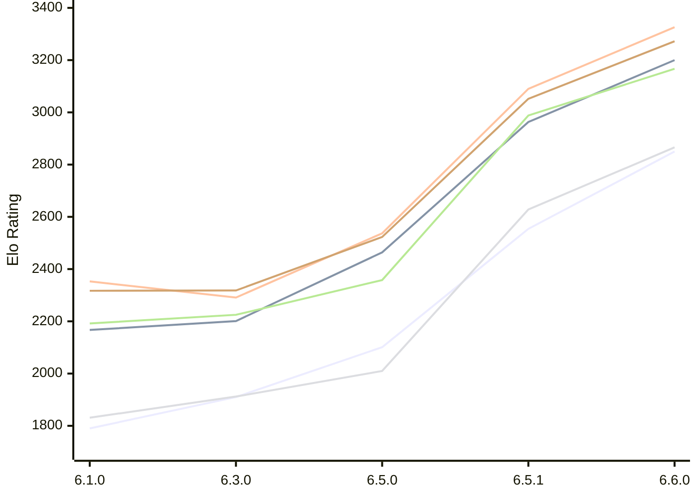

# Engine: Luminex

Author: Cheng Chang

Home: https://github.com/changcheng967/Luminex

## Elo Ratings E1 (Ultra 7 265T (1.50 GHz) - E-Core)

| Version | Published | STC 8.0+0.08s  | LTC 60.0+0.60s | VLTC 2m24s+1.12s | Comment |
| --- | --- | --- | --- | --- | --- |
| 6.6.0 | 2026-11-14 | 2850(+296) | 3200(+237) | 3326(+236) |  |
| 6.5.1 | 2026-11-07 | 2554(+453) | 2963(+499) | 3090(+553) |  |
| 6.5.0 | 2026-11-06 | 2101(+191) | 2464(+263) | 2537(+246) |  |
| 6.3.0 | 2026-10-27 | 1910(+120) | 2201(+34) | 2291(-62) |  |
| 6.1.0 | 2026-09-24 | 1790 | 2167 | 2353 |  |
 | | | cElo (∆ prev) | cElo (∆ prev) | cElo (∆ prev) | 

## Elo Ratings P1 (Ultra 7 265T (1.50 GHz) - P-Core)

| Version | Published | STC 8.0+0.08s  | LTC 60.0+0.60s | VLTC 2m24s+1.12s | Comment |
| --- | --- | --- | --- | --- | --- |
| 6.6.0 | 2026-11-14 | 2866(+238) | 3167(+179) | 3272(+220) |  |
| 6.5.1 | 2026-11-07 | 2628(+618) | 2988(+630) | 3052(+529) |  |
| 6.5.0 | 2026-11-06 | 2010(+98) | 2358(+133) | 2523(+205) |  |
| 6.3.0 | 2026-10-27 | 1912(+81) | 2225(+33) | 2318(+1) |  |
| 6.1.0 | 2026-09-24 | 1831 | 2192 | 2317 |  |
 | | | cElo (∆ prev) | cElo (∆ prev) | cElo (∆ prev) | 

## Elo Ratings T1 (i5-7500T 2.70GHz)

| Version | Published | STC 8.0+0.08s  | LTC 60.0+0.60s | VLTC 2m24s+1.12s | Comment |
| --- | --- | --- | --- | --- | --- |
| 6.1.0 | 2026-09-24 | 1831 | 2192 | 2317 |  |
 | | | cElo (∆ prev) | cElo (∆ prev) | cElo (∆ prev) | 

<a href="https://github.com/computer-chess-index/cci/issues/new?template=submit-version.yml&title=[VERSION]+Luminex+<version>&body=###%20Engine%20name%0ALuminex%0A%0A###%20Version%0A6.6.0" target="_blank">Submit new version</a>

 Test Conditions:

GUI/CLI: <a href=https://github.com/cutechess/cutechess target="_blank">Cute-Chess</a> 
Elo Calculation: <a href=https://www.remi-coulom.fr/Bayesian-Elo/ target="_blank">Bayesian-Elo</a> 
CPU for P1: Intel(R) Core(TM) Ultra 7 265T (1.50 GHz) - P-Core 
CPU for E1: Intel(R) Core(TM) Ultra 7 265T (1.50 GHz) - E-Core 
CPU for T1: Intel(R) Core(TM) i5-7500T 2.70GHz 
Opening book: 8_moves_v3 
\* STC: 8.0+0.08s, LTC: 60.0+0.60s, VLTC: 2m24s+1.12s

 Lists:
Ratings: <a href=https://github.com/computer-chess-index/cci/blob/main/lists/CCIRatings.csv target="_blank">Complete list</a>

Generated: 2026-11-26 05:40:19

## Ratings Verlauf E1 / P1

## Detailed Evaluation Results

| Version | Time Control | Variant | Elo  | Range +/- | Matches | Score | Average Opponent Elo | Draws |
| --- | --- |--- | --- | --- | --- | --- | --- | --- |
| 6.6.0 | VLTC (2m24s+1.12s) | P1 | 3272 | 42 | 144 | 52% | 3256 | 67% |
|  |  | E1 | 3326 | 35 | 216 | 50% | 3321 | 62% |
|  | LTC (60.0+0.60s) | P1 | 3167 | 46 | 134 | 53% | 3144 | 50% |
|  |  | E1 | 3200 | 29 | 336 | 48% | 3213 | 56% |
|  | STC (8.0+0.08s) | P1 | 2866 | 35 | 250 | 51% | 2854 | 44% |
|  |  | E1 | 2850 | 35 | 256 | 51% | 2844 | 38% |
| --- | --- |--- | --- | --- | --- | --- | --- | --- |
| 6.5.1 | VLTC (2m24s+1.12s) | E1 | 3090 | 30 | 344 | 57% | 3021 | 43% |
|  |  | P1 | 3052 | 32 | 310 | 58% | 2973 | 44% |
|  | LTC (60.0+0.60s) | P1 | 2988 | 45 | 168 | 55% | 2925 | 34% |
|  |  | E1 | 2963 | 27 | 442 | 48% | 2975 | 39% |
|  | STC (8.0+0.08s) | P1 | 2628 | 41 | 208 | 55% | 2573 | 33% |
|  |  | E1 | 2554 | 33 | 318 | 55% | 2492 | 33% |
| --- | --- |--- | --- | --- | --- | --- | --- | --- |
| 6.5.0 | VLTC (2m24s+1.12s) | P1 | 2523 | 50 | 144 | 52% | 2492 | 23% |
|  |  | E1 | 2537 | 41 | 208 | 53% | 2498 | 25% |
|  | LTC (60.0+0.60s) | P1 | 2358 | 51 | 144 | 49% | 2383 | 19% |
|  |  | E1 | 2464 | 39 | 228 | 53% | 2425 | 27% |
|  | STC (8.0+0.08s) | P1 | 2010 | 46 | 164 | 48% | 2032 | 22% |
|  |  | E1 | 2101 | 41 | 200 | 52% | 2083 | 26% |
| --- | --- |--- | --- | --- | --- | --- | --- | --- |
| 6.3.0 | VLTC (2m24s+1.12s) | E1 | 2291 | 39 | 240 | 50% | 2284 | 18% |
|  |  | P1 | 2318 | 50 | 140 | 53% | 2296 | 24% |
|  | LTC (60.0+0.60s) | P1 | 2225 | 45 | 176 | 53% | 2199 | 18% |
|  |  | E1 | 2201 | 42 | 204 | 51% | 2194 | 15% |
|  | STC (8.0+0.08s) | P1 | 1912 | 42 | 204 | 47% | 1943 | 21% |
|  |  | E1 | 1910 | 42 | 212 | 51% | 1902 | 16% |
| --- | --- |--- | --- | --- | --- | --- | --- | --- |
| 6.1.0 | VLTC (2m24s+1.12s) | P1 | 2317 | 63 | 80 | 50% | 2315 | 30% |
|  |  | E1 | 2353 | 44 | 182 | 49% | 2365 | 22% |
|  | LTC (60.0+0.60s) | P1 | 2192 | 48 | 164 | 55% | 2132 | 18% |
|  |  | E1 | 2167 | 44 | 200 | 52% | 2136 | 16% |
|  | STC (8.0+0.08s) | P1 | 1831 | 44 | 212 | 59% | 1701 | 18% |
|  |  | E1 | 1790 | 40 | 250 | 55% | 1696 | 17% |